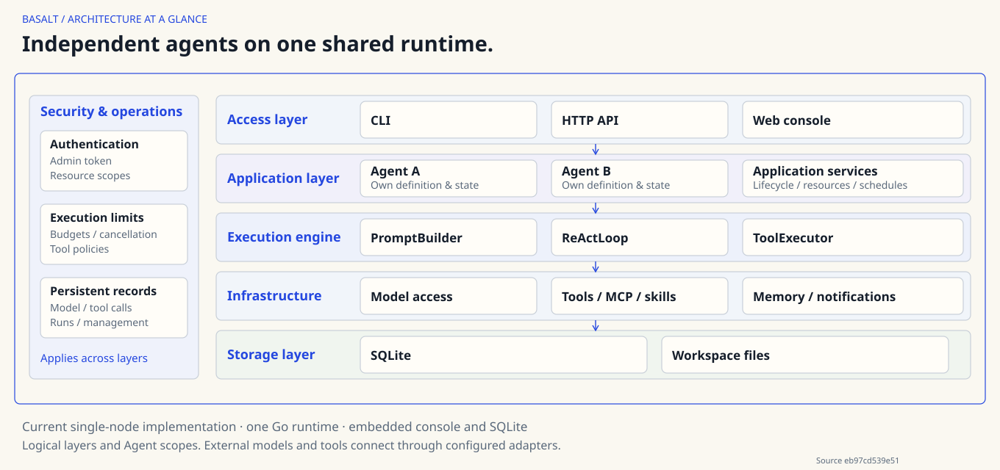

<!-- markdownlint-configure-file {"MD041":false,"MD033":{"allowed_elements":["a","details","div","img","summary"]}} -->

<div align="center">


# Basalt

**A self-hosted Agent OS for enterprise teams.**

Independent agents. Shared infrastructure.

[Website](https://ymedword.github.io/basalt/) · [Quick start](#quick-start) · [Docs](https://ymedword.github.io/basalt/docs/) · [Architecture](#architecture) · [Demo](https://ymedword.github.io/basalt/#demo) · [Issues](https://github.com/ymedword/basalt/issues)

</div>

## Why Basalt

- **Independent agents** — Configure different models, tools, skills and scoped business state on one platform.
- **Reusable resources** — Extend agents through model connections, built-in tools, MCP and skills.
- **Scheduled automation** — Manage recurring tasks per agent and deliver results to configured channels.
- **Inspectable execution** — Persist runs and model/tool calls, with budgets and applicable tool policies.
- **Self-hosted operation** — A Go binary with an embedded console and SQLite; no Node or separate database service at runtime.

For example, configure daily-report for scheduled briefings and file-review for permitted workspace checks. They reuse the platform while keeping separate configurations, sessions and memory.

## Architecture



The current architecture is single-node, multi-agent hosting with logical Agent scopes. The [full system diagram](website/public/diagrams/en/project-overview.svg) expands components and external boundaries. [Architecture documentation](https://ymedword.github.io/basalt/architecture/) covers execution, dependencies and deployment; [product documentation](https://ymedword.github.io/basalt/docs/) separates current capabilities from planned direction.

## Quick start

For a source build, use Git and the Go toolchain declared in go.mod. You also need a compatible model endpoint, model name and API key. If you already have a built binary, put it on PATH and skip the build; running the binary needs neither Go nor Node.

### 1. Build

```sh
git clone https://github.com/ymedword/basalt.git
cd basalt
CGO_ENABLED=0 go build -trimpath -o bin/basalt ./cmd/basalt
export PATH="$PWD/bin:$PATH"
```

<details>

<summary>Windows PowerShell build</summary>

```powershell
git clone https://github.com/ymedword/basalt.git
cd basalt
$env:CGO_ENABLED = "0"
go build -trimpath -o bin\basalt.exe ./cmd/basalt
$env:PATH = "$PWD\bin;$env:PATH"
```

</details>

### 2. Configure the model and management access

Expand the minimal configuration below, create basalt.yaml in the current directory, and set the environment variables it references.

<details>

<summary>Minimal configuration and environment variables (POSIX / PowerShell)</summary>

```yaml
providers:
  - name: primary
    base_url: https://api.deepseek.com
    credential_mode: env
    api_key: ${BASALT_MODEL_KEY}
    default_model: deepseek-chat
http:
  addr: 127.0.0.1:8080
  admin_auth:
    mode: token
    token: ${BASALT_ADMIN_TOKEN}
```

#### POSIX environment

```sh
export BASALT_MODEL_KEY="your-own-model-key"
export BASALT_ADMIN_TOKEN="$(openssl rand -hex 32)"
```

#### PowerShell environment

```powershell
$env:BASALT_MODEL_KEY = "your-own-model-key"
$bytes = New-Object byte[] 32
$rng = [System.Security.Cryptography.RandomNumberGenerator]::Create()
try { $rng.GetBytes($bytes) } finally { $rng.Dispose() }
$env:BASALT_ADMIN_TOKEN = [Convert]::ToBase64String($bytes)
```

Replace the example key with your own value and adjust the endpoint/model for your service. Keep environment-variable references in the configuration file.

</details>

### 3. Create and run your first agent

<!-- quickstart-commands:start -->

```sh
basalt init
basalt profile create demo
basalt profile list
```

A new agent is disabled. registered=true only means its definition loaded. Start management next to configure the actual model and enable the agent.

```sh
basalt serve
```

Open the [local console](http://127.0.0.1:8080/console/) and enter the management token generated above:

1. Open demo in Agents, select its configuration, choose the primary model connection and enter the actual model ID.
2. Save, return to the Agent workspace, enable the agent and confirm.
3. Press Ctrl+C to stop the server and release the workspace lock before CLI chat.

```sh
basalt chat --agent demo --message "Hello"
basalt session list
```

<!-- quickstart-commands:end -->

[The full quickstart](https://ymedword.github.io/basalt/quickstart/) includes console field mappings and expected output; the console currently uses Chinese labels. Replies depend on your model and configuration. The website animation is a labelled local scripted demo.

## Templates & demos

`examples/` ships five daily agents and eight templates. Each directory is a portable baseline: no instance IDs, no credentials, no delivery channels. You copy it into a workspace, follow its setup notes, and bind your own model, tools and channel.

| Daily agent | What it produces | Needs |
| --- | --- | --- |
| [daily/github-radar](examples/daily/github-radar/) | Star deltas and new projects for a topic, de-duplicated against the previous run | GitHub MCP server and a personal access token |
| [daily/repo-digest](examples/daily/repo-digest/) | Pull request, issue and release counts with follow-up items, delivered by its schedule | GitHub MCP server and a personal access token |
| [daily/biz-daily](examples/daily/biz-daily/) | Business metrics from a read-only SQLite sample, with data-quality counts | DBHub over SQLite |
| [daily/docs-diff](examples/daily/docs-diff/) | Added, modified and deleted documents with a content hash each | Bundled read-only MCP server |
| [daily/industry-brief](examples/daily/industry-brief/) | Briefing with a source table of URL, title, date and access time | Built-in web search (DeepSeek Search API) and the Fetch MCP server |

The eight templates cover smaller domains: weather, arXiv, policy pages, support tickets, onboarding docs, dependencies, web changes and startup funding. Six are complete and replayable from fixtures (tier A), one also needs the Playwright browser (tier A*, and it stays A* while that dependency is missing), and one is a configuration recipe only (tier B, not claimed to run). [The examples index](examples/README.md) lists every directory with its tier, dependencies and evidence status.

## MCP catalog

The console lists six MCP recipes: GitHub, Brave Search, Fetch, Playwright, read-only Filesystem and DBHub. Each entry shows the transport, the command or URL, the environment variables it needs, its dependencies and its known limits. "Add to configuration" prefills the form; it never saves on its own.

Saving, publishing or rolling back an MCP configuration fails closed when a referenced environment variable is missing or empty: the request returns 503 with an operation ID, and neither the file, the published version nor the pointer changes. A recipe that has not been exercised on your machine says so; the catalog shows no "verified" badge for it. Reading the catalog starts no process, installs nothing and writes no operation record.

## Run a demo

1. Copy an agent directory into the workspace:

   ```sh
   cp -r examples/daily/github-radar .basalt/agents/github-radar
   ```

2. Follow that directory's setup notes: model connection and model ID, notification channel, MCP command and environment variables. Every credential stays a `${VAR}` reference.
3. Add the MCP server command to your workspace command allowlist yourself; the examples never widen it for you.
4. Start `basalt serve` and enable the agent.
5. Trigger the schedule from the console or the management API. A manual run is recorded with `trigger=manual`: it is evidence of a working agent, but not evidence that the schedule fired by itself.

The demo scripts need Python 3; the MCP servers are separate processes you install yourself, and what each one reaches is decided by that server, not by Basalt. [The examples index](examples/README.md) carries the prerequisites and the per-directory setup.

## What is verified

Two kinds of claim live in this repository, and they are not interchangeable:

| Claim | What it means | Where it is checked |
| --- | --- | --- |
| Fixture replay | The directory loads, its declared tools resolve, and its script produces the expected business result from fixed input | `make example-tests`, plus the release end-to-end suite |
| Real external run | The same flow against GitHub, DeepSeek Search, Brave, Fetch, Playwright, DBHub, a real model and a real notification receiver | Not run in this repository: those credentials are not provided, so the claim stays unverified |

A successful MCP connection proves only that a server started and answered its tool list — it is neither of the two claims above. `make check` runs the local gate, `make e2e` runs the release scenarios against the built binary, and `make example-tests` runs the bundled MCP server tests plus every demo script's unit tests.

## Documentation

| Your goal | Start here |
| --- | --- |
| Understand the Agent OS, current scope and direction | [Product documentation](https://ymedword.github.io/basalt/docs/) |
| Build, configure and run an agent | [Quickstart](https://ymedword.github.io/basalt/quickstart/) |
| Explore detailed architecture and execution | [Architecture](https://ymedword.github.io/basalt/architecture/) |
| Deploy, authenticate, back up and upgrade | [Operations](docs/Operations.md) |
| Look up configuration and API contracts | [Configuration example](basalt.yaml.example) · [HTTP API](docs/contracts/openapi.yaml) |

The management token provides basic management authentication. Operations and architecture documentation explain remote access, model data flows and tool permissions.

## License

Original Basalt content is licensed under the [Apache License 2.0](LICENSE). Third-party components remain under their own licenses; see [NOTICE](NOTICE) and [THIRD_PARTY_NOTICES](THIRD_PARTY_NOTICES) for attribution and the notices included in distributions.

## Feedback and contributions

Use [GitHub Issues](https://github.com/ymedword/basalt/issues) for bugs and proposals. Include your platform, reproduction steps and relevant error messages.
