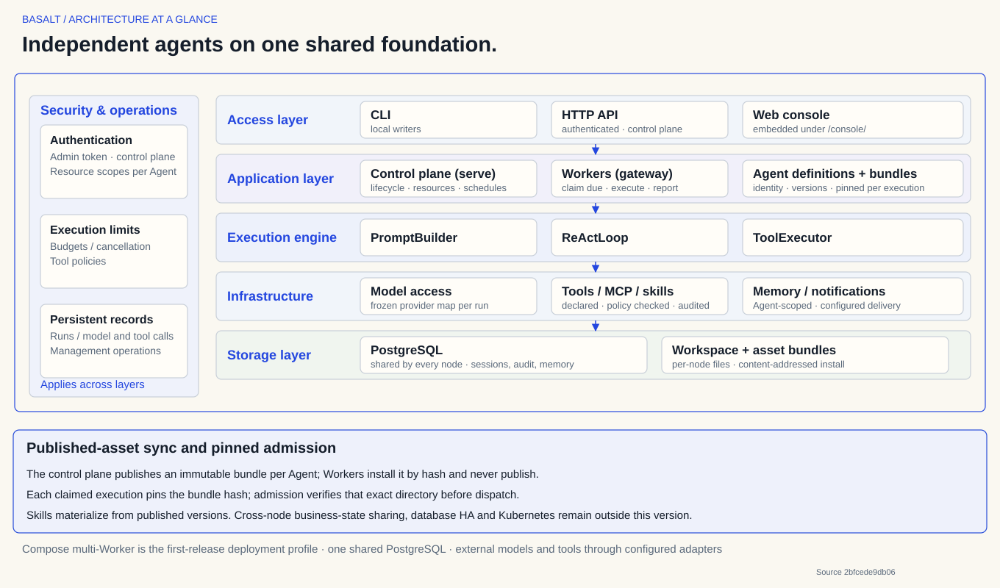

<!-- markdownlint-configure-file {"MD041":false,"MD033":{"allowed_elements":["a","details","div","img","summary"]}} -->

<div align="center">


# Basalt

**A self-hosted Agent OS for enterprise teams.**

Independent agents. Shared infrastructure.

[Website](https://ymedword.github.io/basalt/) · [Quick start](#quick-start) · [Docs](https://ymedword.github.io/basalt/docs/) · [Architecture](#architecture) · [Demo](http://43.161.200.168:8080/console/) · [Issues](https://github.com/ymedword/basalt/issues)

</div>

## What Basalt is

Basalt is a self-hosted Agent OS for enterprise teams: one Go binary that runs and manages multiple independent business agents on infrastructure you control. Each agent keeps its own definition, configuration, sessions and scoped business state; execution, model connections, scheduling, storage and audit belong to the shared foundation.

## What it solves

Running several business agents usually means gluing together a scheduler, a model proxy, tool permissions, a memory store and an audit trail once per agent. Basalt supplies that foundation once, so a new business agent is mainly its own responsibilities and resource bindings. Operators get one console, one HTTP API and one record of what each agent did.

## What makes it different

- **Independent agents** — Configure different models, tools, skills and scoped business state on one platform.
- **Reusable resources** — Extend agents through model connections, built-in tools, MCP and skills.
- **Scheduled automation** — Manage recurring tasks and durable sequential flows per agent, and deliver results to configured channels.
- **Inspectable execution** — Persist runs and model/tool calls, with budgets and applicable tool policies.
- **Multi-worker execution** — Optional Compose profiles add a `serve` control plane and one or more `gateway` Workers over one PostgreSQL. Published asset bundles sync automatically, and every claimed execution is pinned to one bundle; Workers never publish assets. See [multi-worker deployment](#multi-worker-deployment-compose).
- **Opt-in task isolation** — On Linux, bind controlled shell commands to hardened OCI and generated code to gVisor. Tasks run without network access or service credentials; unavailable isolation fails closed. Local execution remains the default. See the [isolation contract](docs/contracts/isolation.md).
- **Durable sequential flows** — Publish immutable task contracts and bounded Agent/tool/subflow steps. Acceptance, evidence and budgets persist in PostgreSQL; unknown side effects stop advancement. Ordinary messages and Runs remain synchronous. Flows are opt-in; see [operations](docs/Operations.md#durable-flows).
- **Self-hosted operation** — A single Go binary with an embedded console, backed by PostgreSQL with the `vector` and `pg_trgm` extensions, which you run yourself; no Node service at runtime.

For example, configure daily-report for scheduled briefings and file-review for permitted workspace checks. They reuse the platform while keeping separate configurations, sessions and memory.

## Architecture



The current architecture is Compose multi-Worker hosting with logical Agent scopes: a control plane owns the HTTP API, the embedded console and asset publication and also claims due executions; `gateway` Workers claim and run due executions without an HTTP listener, and Flow roots advance only on the control plane; every node shares one PostgreSQL. A publication is written payload-first and then made visible by a pointer, Workers install bundles by content hash, and each claimed execution is pinned to one bundle. The single-instance Compose file remains the default. The [full system diagram](website/public/diagrams/en/project-overview.svg) expands components and external boundaries. [Architecture documentation](https://ymedword.github.io/basalt/architecture/) covers execution, dependencies and deployment; [product documentation](https://ymedword.github.io/basalt/docs/) separates current capabilities from planned direction.

Deployment support and boundaries for this release:

- **Supported profile:** Compose multi-Worker — a control plane, one or more Workers and one PostgreSQL.
- **Kubernetes:** not delivered.
- **Database HA:** not delivered.
- **Cross-node business-state sharing:** not delivered; workspace files stay per node, and each execution is pinned to a content-addressed bundle rather than to shared mutable state.

## Quick start

For a source build, use Git and the Go toolchain declared in go.mod. You also need a reachable PostgreSQL 16/17 instance with the `vector` extension (pgvector) and `pg_trgm`, plus a database for Basalt — the runtime refuses to start when either extension is missing and never falls back to an embedded store. A compatible model endpoint, model name and API key are needed for agent runs. If you already have a built binary, put it on PATH and skip the build; running the binary needs neither Go nor Node.

### Run with Docker instead

A single-instance Compose unit lives in [`docker/`](docker/). It runs the official linux/amd64 image (Go binary with the embedded console) plus PostgreSQL/pgvector with the required extensions; nothing is built or downloaded at startup.

```sh
cp docker/.env.example docker/.env   # set BASALT_IMAGE=basalt:<version>@sha256:<digest> and the six ingress limits
sudo sh docker/init-secrets.sh docker/secrets
cd docker && docker compose -p basalt up -d --wait
```

The first start seeds the configuration into the workspace volume and generates the management token in the private volume. Read it with `docker compose -p basalt exec basalt sh -c 'cat /var/lib/basalt/basalt/instances/*/admin-token'`, then open the [local console](http://127.0.0.1:8080/console/). Image build and verification, backup/restore, upgrade and rollback are documented in [Operations](docs/Operations.md). Never run `docker compose down -v` against a real instance: it deletes the volumes that hold the identity and the management token.

### 1. Build

```sh
git clone https://github.com/ymedword/basalt.git
cd basalt
CGO_ENABLED=0 go build -trimpath -o bin/basalt ./cmd/basalt
export PATH="$PWD/bin:$PATH"
```

<details>

<summary>Windows PowerShell build</summary>

```powershell
git clone https://github.com/ymedword/basalt.git
cd basalt
$env:CGO_ENABLED = "0"
go build -trimpath -o bin\basalt.exe ./cmd/basalt
$env:PATH = "$PWD\bin;$env:PATH"
```

</details>

### 2. Configure the model and management access

Expand the minimal configuration below, create basalt.yaml in the current directory, and set the environment variables it references.

<details>

<summary>Minimal configuration and environment variables (POSIX / PowerShell)</summary>

```yaml
database:
  dsn: ${BASALT_DATABASE_DSN}
providers:
  - name: primary
    base_url: https://api.deepseek.com
    credential_mode: env
    api_key: ${BASALT_MODEL_KEY}
    default_model: deepseek-chat
http:
  addr: 127.0.0.1:8080
  admin_auth:
    mode: token
    token: ${BASALT_ADMIN_TOKEN}
```

`database.dsn` is mandatory: an unset or unresolved `${...}` placeholder is treated as an empty value and startup is refused. The template that a fresh first start generates carries the same placeholder — it only reserves the key, it does not mean a database is already available.

#### POSIX environment

```sh
export BASALT_DATABASE_DSN="postgres://basalt:<password>@127.0.0.1:5432/basalt?sslmode=disable"
export BASALT_MODEL_KEY="your-own-model-key"
export BASALT_ADMIN_TOKEN="$(openssl rand -hex 32)"
```

#### PowerShell environment

```powershell
$env:BASALT_DATABASE_DSN = "postgres://basalt:<password>@127.0.0.1:5432/basalt?sslmode=disable"
$env:BASALT_MODEL_KEY = "your-own-model-key"
$bytes = New-Object byte[] 32
$rng = [System.Security.Cryptography.RandomNumberGenerator]::Create()
try { $rng.GetBytes($bytes) } finally { $rng.Dispose() }
$env:BASALT_ADMIN_TOKEN = [Convert]::ToBase64String($bytes)
```

Replace the example key with your own value and adjust the endpoint/model for your service. Keep environment-variable references in the configuration file.

</details>

### 3. Create and run your first agent

<!-- quickstart-commands:start -->

```sh
basalt init
basalt profile create demo
basalt profile list
```

A new agent is disabled. registered=true only means its definition loaded. Start management next to configure the actual model and enable the agent.

```sh
basalt serve
```

Open the [local console](http://127.0.0.1:8080/console/) and enter the management token generated above:

1. Open demo in Agents, select its configuration, choose the primary model connection and enter the actual model ID.
2. Save, return to the Agent workspace, enable the agent and confirm.
3. Press Ctrl+C to stop the server and release the workspace lock before CLI chat.

```sh
basalt chat --agent demo --message "Hello"
basalt session list
```

<!-- quickstart-commands:end -->

[The full quickstart](https://ymedword.github.io/basalt/quickstart/) includes console field mappings and expected output; the console currently uses Chinese labels. Replies depend on your model and configuration. The website animation is a labelled local scripted demo.

### First-run configuration order

The installation only places files: the configuration template, the workspace, five daily demo agents, four Flow roles with the procurement sample, three credential-free MCP recipes and the sample documents. Models, credentials and business choices are yours. Keep this order — knowledge bindings are resolved when an agent registers, and a workflow template pins the versions that were published when it was loaded.

1. **Complete the startup configuration.** Fill the `database.dsn` and the six `callers.ingress` limits the startup log asks for, then start again. A fresh directory may begin with `basalt init` followed by the first `basalt serve`, or with the first `basalt serve` alone — both are valid first steps. If the first start is interrupted, a retry continues the installation and re-issues the master key when the instance has no business history yet.
2. **model connection** — Resources → Model connections → New: base URL, default model and credentials (managed or `${VAR}`); saving publishes the connection.
3. **bind and enable the agent** — Agents → select the agent → Configuration → model connection and notification channel → save, then enable the agent.
4. **Knowledge (Flow demo)**: first **create collections** `bid-request` and `bid-product`, then **ingest** the sample documents, and only then add **read-only knowledge bindings** to `bid-requirements` and `bid-technical`. Binding before the collections exist leaves the agent unregistered.
5. **confirm memory (4 entries)** — propose and confirm the four entries from `.basalt/samples/bid-readiness/memory-suggestions.json`.
6. **Set `flows.enabled: true`** in `basalt.yaml` and restart; the Flow executor starts with the control plane's `serve`.
7. **publish the workflow template** — Workflows → Definitions → load the procurement template, run the read-only validation, then publish.
8. **create a task manually** — Tasks → New task, choose `bid-readiness-matrix-v1` and submit.

Ingestion calls your embedding model and costs money on every run; the console reports the model id and dimension it used.

### Multi-worker deployment (Compose)

[`docker/compose.multiworker.yaml`](docker/compose.multiworker.yaml) is one file with two profiles: a **control plane** running `serve` (with PostgreSQL and the management API) and at least one Worker running `gateway`. A Worker process has no HTTP listener, no admin token and no ingress limits; every node shares the same PostgreSQL, and execution ownership is decided by database leases, not by the orchestrator. The single-instance [`docker/compose.yaml`](docker/compose.yaml) stays the default and is not replaced.

| Role | Service (profile) | Process and ports | Needs |
| --- | --- | --- | --- |
| Control plane host A | `basalt-preflight` / `postgres` / `basalt-control` (`control`) | `serve`; publishes the HTTP port; PostgreSQL bound to the private address | DSN, PostgreSQL password, exported master key |
| Worker host B | `basalt-worker` (`worker`) | `gateway`; **no published ports**, no `restart` policy | a **copy** of A's DSN and master key; no PostgreSQL password |

- **startup order**: bring up the control plane first with the Compose `control` profile enabled (`up -d --wait`), confirm the management API answers, then start the Worker with the `worker` profile enabled. The Worker service has no `depends_on` — the database lives in another profile and Compose rejects a cross-profile dependency. Each host gets its own `docker/` assets and `.env`.
- **master key**: run `(cd docker && sudo sh export-master-key.sh basalt secrets/master.key)` on the control plane host (expected owner `10001:10001`, file `0400`, parent directory `0700`) and copy the file to the Worker unchanged. The path is relative to `docker/`, matching the bind mount in the Compose file — `docker/secrets/master.key` would land in `docker/docker/secrets/`. The container mounts it read-only at `/run/basalt-secrets/master_key`, not `/run/secrets`. The Worker **must not generate** its own master key: two valid keys for one instance make half of the managed credentials unreadable.
- **DSN**: on host B run `(cd docker && sudo sh init-secrets.sh secrets --copy-from <A's docker/secrets> --db-host <A's private address>)`. The Worker **must not generate** a new database password — it would never match A's PostgreSQL.
- **seed**: stop the control plane, install each agent's asset bundle with `assets install` (a write-mode command: a live `serve` or `gateway` holds the instance lock), then export the workspace volume with `seed-workspace.sh export` and import it into the Worker's named volume before its first start. Both workspaces are named volumes, so the Operations one-off-container commands are the supported method (§8.3 step 5). The archive carries a manifest with a size and SHA-256 per file; a tampered, truncated, path-traversing or symlinked archive is refused, and configuration, SQLite databases, locks, logs, `runs/` and agent runtime state are excluded. The seed does **not** contain `basalt.yaml`: the Worker template's `providers`, `embedding` and `flows` must match the control plane.
- **Verify**: `basalt workers list` in the Worker container shows one row per registered Worker process instance, each with its own instance ID and a heartbeat inside the TTL (`name` may repeat across instances). The Worker health check only proves the database is reachable, not that the Worker is registered.
- Every Worker installs the same content-addressed asset bundle. A missing or mismatched bundle rejects new runs at admission (`ASSET_*`), and a Worker never installs or publishes assets.
- **Upgrade**: stop **all** old processes first, back up the database, every workspace, the keys and the old images, then migrate with the new control plane and start the new Workers. Two versions on the same schema have no artifact-version gate — mixed old/new processes are forbidden by deployment discipline, not by a check. Roll back the whole set (database + every workspace + master key + old images), not the database alone.

Container isolation (OCI / gVisor) is **opt-in** and **not in the first-release support matrix**. With it enabled, the **5 daily scripts** that run tools fail unless the images and runtime were adapted, while the **4 Flow roles** only read frozen text and are unaffected. To **fall back to local**, switch `sandbox.*` back to the default and restart — no data migration and no new instance. This release makes no claim that container isolation has been verified; see [Operations §8.3](docs/Operations.md#multiworker-compose).

## Templates & demos

`examples/` ships five daily agents and eight templates. Each directory is a portable baseline: no instance IDs, no credentials, no delivery channels. You copy it into a workspace, follow its setup notes, and bind your own model, tools and channel.

| Daily agent | What it produces | Needs |
| --- | --- | --- |
| [daily/github-radar](examples/daily/github-radar/) | Star deltas and new projects for a topic, de-duplicated against the previous run | GitHub MCP server and a personal access token |
| [daily/repo-digest](examples/daily/repo-digest/) | Pull request, issue and release counts with follow-up items, delivered by its schedule | GitHub MCP server and a personal access token |
| [daily/biz-daily](examples/daily/biz-daily/) | Business metrics from a read-only SQLite sample, with data-quality counts | DBHub over SQLite |
| [daily/docs-diff](examples/daily/docs-diff/) | Added, modified and deleted documents with a content hash each | Bundled read-only MCP server |
| [daily/industry-brief](examples/daily/industry-brief/) | Briefing with a source table of URL, title, date and access time | Built-in web search (DeepSeek Search API) and the Fetch MCP server |

The eight templates cover smaller domains: weather, arXiv, policy pages, support tickets, onboarding docs, dependencies, web changes and startup funding. Six are complete and replayable from fixtures (tier A), one also needs the Playwright browser (tier A*, and it stays A* while that dependency is missing), and one is a configuration recipe only (tier B, not claimed to run). [The examples index](examples/README.md) lists every directory with its tier, dependencies and evidence status.

## MCP catalog

The console lists six MCP recipes: GitHub, Brave Search, Fetch, Playwright, read-only Filesystem and DBHub. Each entry shows the transport, the command or URL, the environment variables it needs, its dependencies and its known limits. "Add to configuration" prefills the form; it never saves on its own.

Saving, publishing or rolling back an MCP configuration fails closed when a referenced environment variable is missing or empty: the request returns 503 with an operation ID, and neither the file, the published version nor the pointer changes. A recipe that has not been exercised on your machine says so; the catalog shows no "verified" badge for it. Reading the catalog starts no process, installs nothing and writes no operation record.

## Run a demo

1. Copy an agent directory into the workspace:

   ```sh
   cp -r examples/daily/github-radar .basalt/agents/github-radar
   ```

2. Follow that directory's setup notes: model connection and model ID, notification channel, MCP command and environment variables. Every credential stays a `${VAR}` reference.
3. Add the MCP server command to your workspace command allowlist yourself; the examples never widen it for you.
4. Start `basalt serve` and enable the agent.
5. Trigger the schedule from the console or the management API. A manual run is recorded with `trigger=manual`: it is evidence of a working agent, but not evidence that the schedule fired by itself.

The demo scripts need Python 3; the MCP servers are separate processes you install yourself, and what each one reaches is decided by that server, not by Basalt. [The examples index](examples/README.md) carries the prerequisites and the per-directory setup.

## What is verified: engineering and automated acceptance

`make check` is the seven-gate definition of done: format, static analysis, security, race tests, PostgreSQL integration, coverage floors and the release build. [Makefile](Makefile) binds every target; the commands are the evidence, and no badge replaces a run.

- `make acceptance` runs the same gate plus fixed behaviour and injection evaluations: [scripts/check-acceptance.sh](scripts/check-acceptance.sh).
- `make test-integration` fails closed when `BASALT_TEST_PG_DSN` is unset instead of skipping; coverage floors are enforced per package by [scripts/check-coverage.sh](scripts/check-coverage.sh).
- `make e2e` runs release scenarios against the binary produced by `make build` ([internal/e2e](internal/e2e)); `make example-tests` runs the bundled MCP server tests and every demo script's unit tests.

Two kinds of claim live in this repository, and they are not interchangeable:

| Claim | What it means | Where it is checked |
| --- | --- | --- |
| Fixture replay | The directory loads, its declared tools resolve, and its script produces the expected business result from fixed input | `make example-tests`, plus the release end-to-end suite |
| Real external run | The same flow against GitHub, DeepSeek Search, Brave, Fetch, Playwright, DBHub, a real model and a real notification receiver | Not run in this repository: those credentials are not provided, so the claim stays unverified |

A successful MCP connection proves only that a server started and answered its tool list — it is neither of the two claims above.

### Measured baseline: single-process Flow capacity (2026-11-11)

This is an isolated single-process baseline, not a production SLO and not a real-model benchmark. The model is a loopback OpenAI-compatible stub with a fixed 50 ms delay; the run uses a local PostgreSQL and no external network, real model or multi-host deployment. The numbers are a snapshot of commit `640b1de` and will change on another machine or a later revision.

| Environment | Value |
| --- | --- |
| Host | Windows 11 (10.0.26300), 12th Gen Intel Core i7-12700, 12 cores / 20 threads, 31.8 GB RAM |
| Runtime | WSL2 Ubuntu 26.04 LTS, kernel 6.6.114.1-microsoft-standard-WSL2, 20 vCPU, 15.5 GiB visible memory |
| Toolchain | Go 1.27.3 (linux/amd64) |
| Database | PostgreSQL 17.11 (Debian), local development container on the same host |
| Workload | 200 independent tasks × 20 nodes, `max_active` 4, `max_open` 32, mock model delay 50 ms |
| Build | binary SHA-256 `5dfb1b0781b09dc198f7aa92c31afadd875fb20359675a625b1ef907111e2161`; config SHA-256 `717e13dcd217c8716c2f8b886393f35bed9ea967a550a2b4e4f2083ae275f71f` |
| Date | 2026-11-11 |

| Metric | p50 | p95 | p99 |
| --- | --- | --- | --- |
| Task submission, 200 samples | 74.5 ms | 90.3 ms | 98.5 ms |
| Task status read, 1,705 samples | 9.6 ms | 12.5 ms | 15.1 ms |
| Ready to start with no queued slot, 80 samples | 25 ms | 31 ms | 124 ms |
| Queued first node start | 1,382 ms | 1,557 ms | 1,642 ms |

All 200 tasks and 4,000 node runs completed with a failure rate of 0. Peak resident memory was 56,549,376 bytes (~54 MiB); the shared test database peaked at 10 connections and 124 relation locks, with at most one lock-waiting connection (maximum observed wait 13.3 ms). The load phase lasted 215.1 s. A binary restart with 32 open tasks reconciled in 5,875 ms: 28 tasks completed safely, and the 4 with an unknown external action stayed non-terminal with zero replay.

Reproduce with the end-to-end suite (see [Operations](docs/Operations.md) for the measured table and its boundaries):

```sh
go test -count=1 -timeout=1200s -tags=e2e ./internal/e2e \
  -run '^TestFlow_(BinaryCapacity200TasksAndUnqueuedLatency|BinaryRestartReconciles32OpenWithin30Seconds)$' -v
```

## Documentation

| Your goal | Start here |
| --- | --- |
| Understand the Agent OS, current scope and direction | [Product documentation](https://ymedword.github.io/basalt/docs/) |
| Build, configure and run an agent | [Quickstart](https://ymedword.github.io/basalt/quickstart/) |
| Explore detailed architecture and execution | [Architecture](https://ymedword.github.io/basalt/architecture/) |
| Deploy, authenticate, back up and upgrade | [Operations](docs/Operations.md) |
| Look up configuration and API contracts | [Configuration example](basalt.yaml.example) · [HTTP API](docs/contracts/openapi.yaml) |

The management token provides basic management authentication. Operations and architecture documentation explain remote access, model data flows and tool permissions.

## License

Original Basalt content is licensed under the [Apache License 2.0](LICENSE). Third-party components remain under their own licenses; see [NOTICE](NOTICE) and [THIRD_PARTY_NOTICES](THIRD_PARTY_NOTICES) for attribution and the notices included in distributions.

## Feedback and contributions

Use [GitHub Issues](https://github.com/ymedword/basalt/issues) for bugs and proposals. Include your platform, reproduction steps and relevant error messages.

The default business workflow — enterprise procurement response preparation (4 agent roles, 17 flow nodes, 48 synthetic requirements) — ships with the binary. Workflows in the console loads the template; installation never calls a model, and you run it manually after configuration. See the [default workflow preparation steps](examples/workflows/bid-readiness/defaults/materials/SETUP.md).
