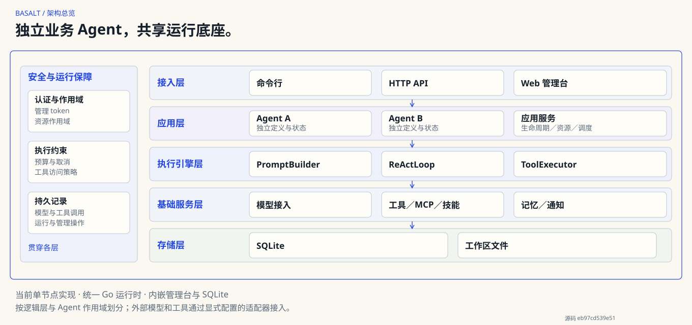

# Basalt

<!-- markdownlint-configure-file {"MD033":{"allowed_elements":["a","details","summary"]}} -->

[English](README.md)

**独立业务 Agent，共享运行底座。**

Basalt 是面向企业自托管的 Agent OS。每个业务 Agent 通过独立目录和声明式配置定义身份、模型、工具与任务，分别管理会话和作用域记忆；平台统一提供执行、接入、调度、存储与审计。

[快速开始](#快速开始) · [文档](website/zh/docs/index.md) · [架构](#架构) · [问题反馈](https://github.com/ymedword/basalt/issues)

## 为什么选择 Basalt

- **独立 Agent**：分别配置模型、工具、技能与业务状态，在同一平台管理不同职责的 Agent。
- **复用资源**：通过模型连接、内置工具、MCP 和技能扩展 Agent，减少重复接入。
- **定时自动化**：按 Agent 管理定时任务，将结果投递到配置的通知渠道。
- **执行可追踪**：运行、模型与工具调用有持久记录，执行受预算和相应工具策略约束。
- **自托管部署**：Go 二进制内嵌管理台与 SQLite，运行时无需 Node 或独立数据库服务。

例如，可以配置 daily-report 整理定时简报，配置 file-review 检查授权工作区中的文件。它们复用底座，分别管理配置、会话与记忆。

## 架构



当前是单节点、多 Agent 托管，Agent 按逻辑作用域管理。[完整项目架构图](website/public/diagrams/zh/project-overview.svg)展开系统与外部边界，[架构文档](website/zh/architecture/index.md)说明组件、执行流程、包依赖和部署结构；[产品文档](website/zh/docs/index.md)区分当前能力与未来方向。

## 快速开始

源码构建需要 Git 和 Go，Go 版本以 go.mod 的 toolchain 为准；还需要兼容的模型端点、模型名和 API key。若已有构建好的二进制，将其加入 PATH 后可跳过构建，运行本身不需要 Go 或 Node。

### 1. 构建

```sh
git clone https://github.com/ymedword/basalt.git
cd basalt
CGO_ENABLED=0 go build -trimpath -o bin/basalt ./cmd/basalt
export PATH="$PWD/bin:$PATH"
```

<details>

<summary>Windows PowerShell 构建步骤</summary>

```powershell
git clone https://github.com/ymedword/basalt.git
cd basalt
$env:CGO_ENABLED = "0"
go build -trimpath -o bin\basalt.exe ./cmd/basalt
$env:PATH = "$PWD\bin;$env:PATH"
```

</details>

### 2. 配置模型与管理认证

展开下面的最小配置，在当前目录创建 basalt.yaml，并设置它引用的环境变量。

<details>

<summary>最小配置与环境变量（POSIX / PowerShell）</summary>

```yaml
providers:
  - name: primary
    base_url: https://api.deepseek.com
    credential_mode: env
    api_key: ${BASALT_MODEL_KEY}
    default_model: deepseek-chat
http:
  addr: 127.0.0.1:8080
  admin_auth:
    mode: token
    token: ${BASALT_ADMIN_TOKEN}
```

#### POSIX 环境变量

```sh
export BASALT_MODEL_KEY="your-own-model-key"
export BASALT_ADMIN_TOKEN="$(openssl rand -hex 32)"
```

#### PowerShell 环境变量

```powershell
$env:BASALT_MODEL_KEY = "your-own-model-key"
$bytes = New-Object byte[] 32
$rng = [System.Security.Cryptography.RandomNumberGenerator]::Create()
try { $rng.GetBytes($bytes) } finally { $rng.Dispose() }
$env:BASALT_ADMIN_TOKEN = [Convert]::ToBase64String($bytes)
```

将示例密钥替换为自己的值；连接端点与模型名也可以改为实际使用的服务。配置文件保留环境变量引用。

</details>

### 3. 创建并运行第一个 Agent

<!-- quickstart-commands:start -->

```sh
basalt init
basalt profile create demo
basalt profile list
```

新 Agent 默认 disabled；registered=true 只表示定义已加载。接下来启动管理服务，配置实际模型并启用 Agent。

```sh
basalt serve
```

打开[本地管理台](http://127.0.0.1:8080/console/)，输入刚才生成的管理 token：

1. 进入 Agents → demo → 配置，在“模型连接”选择 primary，在“模型”填写实际模型 ID。
2. 保存配置，返回 Agent 工作区，启用 Agent 并确认。
3. 在终端按 Ctrl+C 停止服务，释放工作区实例锁后再执行 CLI 对话。

```sh
basalt chat --agent demo --message "Hello"
basalt session list
```

<!-- quickstart-commands:end -->

[完整教程与排障](website/zh/quickstart/index.md)提供页面字段说明和预期输出。模型回复取决于你的服务与配置，首页动画使用明确标注的本地脚本化演示。

## 文档

| 要做什么 | 入口 |
| --- | --- |
| 理解 Agent OS、当前能力与未来方向 | [产品文档](website/zh/docs/index.md) |
| 安装、配置并跑通对话 | [快速开始](website/zh/quickstart/index.md) |
| 查看详细架构、执行与存储边界 | [架构文档](website/zh/architecture/index.md) |
| 部署、管理认证、备份与升级 | [运维手册](docs/Operations.md) |
| 查配置样例与 API | [配置样例](basalt.yaml.example) · [HTTP API](docs/contracts/openapi.yaml) |

管理 token 提供基础管理认证。共享访问、远程监听、模型数据外发和工具权限的具体边界见运维与架构说明。

## 反馈与贡献

欢迎通过 [GitHub Issues](https://github.com/ymedword/basalt/issues)反馈问题或建议，附上运行平台、复现步骤和相关错误信息。
