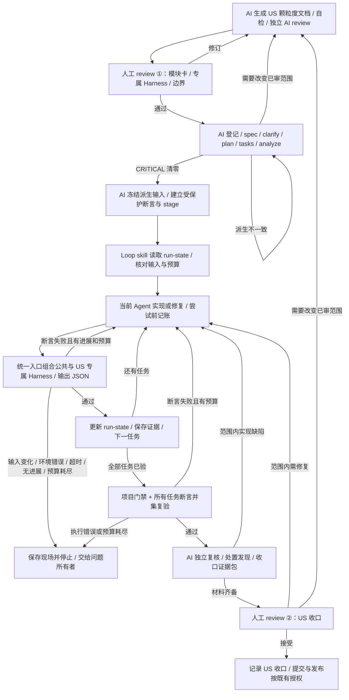

# Basalt Harness、Loop 与开发操作

本指南用于在 Basalt 仓库执行一轮可恢复、可验收的代码变更。开发的控制单位是已批准的任务单元：Harness 持有判据，Coding Agent 实现和修复，Loop 根据机器结果推进或停下。

已有仓库先看 §1～§3，任务切分看 §4，证据与发布看 §5；§6～§8 管理边界和经验；§9 是由 skill 编排、工具执行的 Loop 协议；新开发机和安装历史在 §10。无需因更换会话或模型重新初始化仓库。

技术约束以 [技术方案](TechnicalDesign.md) 和宪法为准，产品目标以 [需求文档](Requirements.md) 为准；固定契约见 [contracts/](contracts/)。模块登记仍由 `docs/us/REGISTRY.md` 负责。历史章节定位见 [引用索引](Compatibility.md#document-reference-index)。

<a id="work-entry"></a>

## 1. 从当前工作区领取一个可验收任务

准备阶段一次建立公共规则、工具链和验收基础，是为了让后续 US 复用同一判断标准；每次只领取与当前目标有关的输入，避免重复初始化和把全部历史塞进上下文。公共底座可以演进，变化需留证，不能以“一次建好”推断以后无需复验。

<a id="next-action"></a>

### 1.1 先判断下一步是什么

| 当前事实 | 下一步 | 不能据此推断 |
| --- | --- | --- |
| 只有目标、没有批准输入 | AI 生成颗粒度文档、自检与独立复核，交人工 review ① | 聊天意向不等于所有外部动作已授权 |
| 输入已批准、断言尚未建立 | 控制侧准备能拒绝反例的任务 Harness | 新建测试函数不等于具有判别力 |
| 输入与专属断言已准备 | `/loop-programming <已审范围>`，由当前 Agent 调用工具推进 | skill 自述完成不代表验收通过 |
| 上次中断或验收失败 | 读取 run-state，恢复任务、证据与累计预算，先验后修 | 更换会话不能清零预算，未持久化的状态不能声称已恢复 |
| 自动化通过 | 完成独立复核、人工项和模块收口 | 自动化结果不授权提交、推送或发布 |

Loop 入口为 `/loop-programming`；验收用 Windows 的 `.\scripts\check-acceptance.ps1` 或 Linux / macOS 的 `sh scripts/check-acceptance.sh`。定向任务加 `--stage <配置> --task <编号>`，完整 US 仅加 `--stage <配置>`。命令与结果格式见 [harness/README.md](../harness/README.md)。

<a id="delivery-owners"></a>

### 1.2 实现、验收和人工裁决各自负责什么

| 事项 | 人 | AI |
| --- | --- | --- |
| 宪法与未决事项裁决 | **决定** | 提供建议与影响分析 |
| 颗粒度文档 | 审核 | 生成 |
| spec / plan / tasks / analyze / Loop | 不设固定人工停点 | 派生、交叉复核、实施、验收与修复 |
| US 收口 | 审核结论与未验证项 | 独立复核、修复并提交证据包 |
| 代码 + 测试 | 抽查 | 实现 |
| 已批准 US 内的实现细节（辅助函数 / 私有类型 / 包内测试） | 抽查 | 自主完成、不逐项请示（边界见 §8.1 第 1 项） |
| 门禁 | 看结果 | 修复（修实现，不改断言） |
| 真实凭证类冒烟 | **执行**（凭证人手输入） | 准备步骤与核对清单 |
| commit / push / tag | **决定时机** | 不自动执行 |

<a id="execution-artifacts"></a>

### 1.3 把需求与设计变为执行输入

AI 编码工具每做一个 US，需要的输入按下表取，**只取所需，不塞全文**（上下文浪费会直接降低产出质量）：

| 工件 | 取自 | 方式 |
| --- | --- | --- |
| spec（这个 US 要什么） | 需求文档对应节 + 本指南 §4 的该 US 条目 | 提炼为 FR 列表（每条可测试） |
| plan（怎么做） | 技术方案的执行、装配与代码边界（§2～§7）+ 本指南 §4 的包级改动范围 | 落成包级改造点清单 |
| tasks（步骤） | plan 拆解 | 任务清单，含测试任务 |
| constitution（不可违背） | 本指南 §6.1（升格为仓库 `.specify` 宪法） | 逐条引用 |

**颗粒度文档**是每个 US 的执行输入：六节结构覆盖概述、设计与约束、交付物、验收测试、范围边界及验证。`/module-doc-gen`、`/us-register`、`/module-dev`、`/init-foundation` 负责生成、登记、实施与地基初始化；已存在的依赖不重建，公共接口不复制。

跨项目验收方法由 [agent-harness](../.claude/skills/agent-harness/SKILL.md) 承载，开发循环由 [loop-programming](../.claude/skills/loop-programming/SKILL.md) 承载。Basalt 的路径、命令、两处人审和恢复语义通过 [项目适配](../harness/project.md) 绑定；公共 skill 不写死 Go、US 数量或外部组件。

<a id="worksite"></a>

## 2. 建立可以重复执行的工作现场

工具链、数据夹具和执行环境需要先确定，才能分辨“实现错”与“检查根本没跑起来”。统一入口使本地和 CI 复用检查定义，环境快照与独立证据则用于识别平台差异和过期绿态。

<a id="worktree-check"></a>

### 2.1 保护现有改动并核对工具链

先读取分支、HEAD、`git status --short`、当前 US 输入与批准记录，登记已有改动；不 stash、不覆盖、不重新初始化已有工程。确认命令需要的 Go、make、检查工具和 C 编译器实际可用；缺失工具是前置问题，不是跳过理由。

安装命令和历史环境读数集中在 §10。`-race` 与 CGO=0 发布构建分别执行，不在一个环境设置下相互替代。已有工具和依赖不重复安装，版本以 `go.mod`、CI 和已批准输入核对。

<a id="project-gates"></a>

### 2.2 原子门禁与统一验收的关系

**骨架**（技术方案 §7.1.2 的包结构一次建齐，空目录放 `doc.go`）：

以下初始化命令只说明地基交付范围，已有仓库使用现行目录与统一验收入口，不重复执行 `go mod init`。首次初始化仍按项目授权流程办理。

```bash
go mod init github.com/<org>/basalt   # 模块路径以实际仓库为准
mkdir -p cmd/basalt internal/{app,core,provider,memory,tool,channel,web,storage,cli,workspace}
```

**门禁（`make check` 一条命令跑全）**：

```bash
gofmt -l .                               # 格式：不合规文件打印到 stdout 且退出码 0——须显式判空；语法错误则退出码非 0——须先查退出码（见下）
gofumpt -l .                             # 更严格式：同 gofmt，两条都要跑
go vet ./...                             # 标准静态检查
staticcheck -checks=inherit,ST1000,ST1003,ST1016,ST1020,ST1021,ST1022 ./...  # 判定集显式指定（EngineeringStandards.md §1.1）——不得裸跑
gosec -quiet ./...                       # 安全扫描
govulncheck ./...                        # 依赖漏洞扫描
go test -race -cover ./...               # 测试 + 竞态 + 覆盖率——⚠ 需 CGO + C 编译器
go test -tags=integration ./...          # 集成测试——⚠ build tag 隔离的测试默认不跑，不写这行等于没有
CGO_ENABLED=0 go build ./...             # 单二进制构建——⚠ 与 -race 要求的 CGO 状态相反
```

**三条实测纪律**（否则门禁会"报绿而实际没检"）：

1. **`gofmt -l` / `gofumpt -l` 发现格式差异时不会自动失败**——它们只把不合规文件**打印到 stdout**、退出码仍是 0。写成 `gofmt -l . && gofumpt -l .` 的串联在"有文件未格式化"时照样通过；**必须**把输出捕获后显式判空、非空即 `exit 1`。⚠ **另一半恰好相反**：**语法错误**时 `gofmt` 的退出码非 0（报错打 stderr、stdout 为空）——只判输出空会把"文件根本解析不了"判成通过。故判卷顺序**必须**是**先查退出码、再判输出**（见 Makefile 的 `fmt` 目标）
2. **`go test -race` 需要 CGO 与 C 编译器**（`-race` 走 cgo 运行时），与 `CGO_ENABLED=0` 的发布构建**要求的 CGO 状态相反**——两者**必须**分属不同 job / 不同命令，不得混在一个环境里
3. **build tag 隔离的集成测试默认不执行**——`go test ./...` 不会碰它们，**必须**有独立的 `go test -tags=integration ./...` 步骤（CI 里单列一步）

**七项目标的职责示意**（实际配置以 Makefile 为准，统一验收另调用固定评测；下面保留原子目标的命令形态）：

```makefile
.PHONY: check fmt lint sec test test-integration cover build
fmt:  ; out="$$(gofmt -l .)" || { echo "gofmt 异常退出（退出码 $$?，多为语法错误）"; exit 1; }; test -z "$$out" || { echo "未格式化（gofmt）："; echo "$$out"; exit 1; }; out="$$(gofumpt -l .)" || { echo "gofumpt 异常退出（退出码 $$?）"; exit 1; }; test -z "$$out" || { echo "未格式化（gofumpt）："; echo "$$out"; exit 1; }
test:  ; go test -race -cover ./...
test-integration: ; go test -tags=integration ./...
cover:  ; scripts/check-coverage.sh        # 按包阈值判失败；脚本由 US-1 交付（读数来源 go test -cover ./...）
lint:  ; go vet ./... && staticcheck -checks=inherit,ST1000,ST1003,ST1016,ST1020,ST1021,ST1022 ./...
sec:  ; gosec -quiet ./... && govulncheck ./...
build:  ; CGO_ENABLED=0 go build -trimpath -ldflags "-s -w" -o bin/basalt ./cmd/basalt
check:  fmt lint sec test test-integration cover build
```

> `fmt` 目标的判卷顺序是**先查退出码、再判输出**（两个格式工具各查一遍）：`out="$$(工具)" || {...}` 捕获的是命令替换里工具的退出码——语法错误（非 0）与格式差异（0 但 stdout 非空）是两种失败，都要拦。

**CI（GitHub Actions）**：**两个 job，各自固定 CGO 状态**

| job | 内容 | 关键点 |
| --- | --- | --- |
| `test` | `sh scripts/check-acceptance.sh --profile ci`；另跑 tzdata 真隔离 | 默认开启 CGO（`-race` 必需）；七目标 + 固定行为 / 注入评测，失败上传 JSON / 日志；`cover` 按包阈值阻断 |
| `build` | `CGO_ENABLED=0` 四平台交叉编译 | 验证单二进制承诺；**不得**在此 job 跑 `-race`（CGO 状态冲突） |

覆盖率报告入库或上传工件。两个 job 都**必须**经 `actions/setup-go` 把工具链钉到 `go-version: 1.27.2`（与 `go.mod` 的 `toolchain` 行一致）——**准确构建版本**由 `toolchain` 行与 CI 两处表达，`go.mod` 的 `go` 行只是**最低版本要求**（Go 1.21 起语义）。**"安全扫描拖慢默认构建"的问题在 Go 不存在**——gosec / govulncheck 都是秒级，全部进默认门禁。

**覆盖率底线（必须有可执行判据）**：core / tool（沙箱）/ memory / storage 四包 ≥ 70%，其余 ≥ 50%（可调，先立底线再逐步提高）。`go test -cover` 只打印百分比、**不会**因低于阈值而失败——故上表有独立的 `cover` 目标（由 US-1 交付的检查脚本承载），按包解析结果并 `exit 1`，且**必须**在 `make check` 里。判定口径：**有可执行语句但无测试文件的包**（`no test files`）计 0%，未达标即失败，**不得**豁免；**无可执行语句的包**（`coverage: [no statements]`）跳过（无从测量，不计通过也不计失败）。安全关键路径（沙箱三档、凭证红线、审计落库）必须有专项测试，不靠覆盖率兜底。

<a id="planning-boundary"></a>

## 3. 把工作目标转换为可执行判据

Spec-Kit 适合把明确输入派生成可追踪的工件；它不能替人决定业务契约，也不能仅凭分析报告证明代码正确。Harness 在编码前定义可拒绝反例的结果，Loop 才能根据失败收敛，而不是根据作者的自我评价推进。

| 工具匹配 | 适合承担什么 | 仍由什么证明 |
| --- | --- | --- |
| specify / clarify | 提炼需求与消除已审范围内的歧义 | 来源与需求覆盖 |
| plan / tasks / analyze | 分配责任、排依赖、检查工件一致性 | AI 交叉核对与实际验收 |
| agent-harness / loop-programming | 前者设计与复核判据，后者驱动实现 / 验收 / 修复与恢复 | 工具产生的真实结果与两处人工 review |
| 验收程序 / CI | 可重复执行、超时、进程清理与机器报告 | 对应输入版本、必跑结果及未覆盖面；不启动编码 Agent |

<a id="planning-tools"></a>

### 3.1 工具生成工件，控制侧负责派生与一致性

| 工件或动作 | 必须回答的问题 | 消费者 |
| --- | --- | --- |
| 模块设计与 spec | 行为、非目标、故障和验收分别是什么 | 计划与 Harness 所有者 |
| plan | 哪些包和接口需要改变，依赖如何满足 | 任务生成与实现适配器 |
| tasks | 哪个单元能独立实现与判定，测试何时出现 | Loop 阶段配置与控制侧 |
| analyze | 工件之间是否冲突、缺项或违背约束 | 实施前检查和模块收口 |
| stage JSON | 本轮批准依据、冻结输入、断言、CLI 与预算是什么 | `scripts/acceptance/` 执行器 |

固定人工 review 只有两处：**颗粒度文档生成后**与**该 US 收口时**。AI 先生成、自检并以独立上下文复核模块卡，再交人审核目标、接口、验收和边界；通过后由 AI 自动登记、生成 spec / plan / tasks、做一致性分析并驱动 Loop，不在登记、tasks 生成后或实现前另设人工确认。tasks 的逐项比对仍然必做，改由 AI 完成并留证；analyze 的 CRITICAL 未清零仍禁止实施。

第一处评审包包含文档路径与 SHA-256、六类输入核对、专属 Harness、依赖与公共门禁变化、AI review 的发现及处置、未决项。实际人工决定及所审版本在 run-state 建立时登记；不能用“AI 检查通过”冒充人工批准。第二处评审包包含收口三件套、公共与专属验收证据、未覆盖面和人工未验项。AI 自动化通过后仍标为“待人工收口 review”，人工接受后才记录 US 收口结论。

已批准范围内的派生错误和实现缺陷由 AI 修复、复验并记录，不反复询问。若发现需要改变已审核的目标、公共契约、权限或验收语义，保存具体差异与影响，回到第一处评审修订输入；这属于原评审的重新打开，不新增第三个常规人工停点。提交、推送和发布沿用既有授权边界。

<a id="before-code"></a>

### 3.2 写代码前核实接口和新增概念

第三方 API 先在锁定依赖的 `go doc`、源码或最小探针中核实，不能凭记忆造方法。新坐标先按项目登记流程核实；变更公共类型、端点、字段、配置、表、权限或判据时形成具体可审阅修订，私有辅助实现和批准范围内的常规修复继续执行。

测试分支与真实终端分支分别验证；决策函数通过不能证明控制台渲染或进程取消在目标系统通过。实现适配器先报告输入和权限问题，不把未知外部错误归入无限修复循环。

<a id="scope-correction"></a>

### 3.3 范围偏离时怎样定位与纠正

| 跑偏症状 | 纠正 |
| --- | --- |
| 引入框架"省事" | 回到宪法 I / II 条；Agent 框架不得作为直接或间接依赖引入；协议 SDK（如 MCP SDK）可用，但不得接管 ReAct 循环或自动执行工具 |
| 出现包级可变状态 | grep 包级变量；改 context 显式传递 |
| 新增**对外契约 / 架构边界**未申报（新配置键 / 端点字段 / 错误码 / Run 状态 / 表结构 / 新包 / 依赖坐标） | 停下确认（进颗粒度文档或用户裁决）；**私有实现类型**（辅助函数、私有结构、包内测试）不属此列——已批准范围内自主落地（§8.1 第 1 项） |
| 测试变红改断言 | **禁止**；改实现；认为测试错 → 停下报告 |
| 门禁不过想加豁免 | 优先改实现；确需抑制 → 逐条说明理由并经用户确认 |
| "顺便重构"前序代码 | 越出本 US 范围即停；重构单独提案 |
| 判据面被"顺手"改动（测试 / 夹具等判据面文件） | 停下确认：**允许**新增测试、等价重构、随已批准接口适配；**改变验收语义**（原本失败的变通过、原本被断言的场景不再被断言）须说明依据并经用户裁决——判据面口径与**单一权威枚举**见 [EngineeringStandards.md](EngineeringStandards.md) §2 |
| 续跑时重生成 `tasks.md` | **不得**：有勾选即毁证据——按 `/module-dev` 步骤 0 分流表处理（定位 glob、输入一致性核对、追加式修订） |

<a id="verifiable-slices"></a>

### 3.4 先验对单机链路，再隔离扩展风险

交付单元围绕一条可观察、可自动验收的端到端链路切分：写清输入、状态变化、外部动作、持久化结果及失败终态。只有包骨架或若干接口存在，不能证明该链路交付；独立底座 US 说明其消费者，并在消费方 US 安排装配验收，不改写历史 US 的拆分。

Basalt 的单机主链路是“CLI / API 接收请求 → Agent 准入与快照 → Provider / ReAct（LLM 调用前审计预写）→ 工具审计预写与执行 → 按会话契约保存消息及 Run 终态 → 返回结果”；API、通知和定时入口按对应 US 交付后接入，同一套准入与执行链路复用。单测使用确定性的 Provider / 工具替身，持久化与进程边界用真实 SQLite / 子进程验收；真实模型另验，不能把替身成功写成模型能力已验证。

| 交付单元 | 专属 Harness 要证明什么 |
| --- | --- |
| 单机核心链路 | 正常结果与持久化状态一致；审计预写失败时外部动作零次；取消 / 超时可收敛；重启可解释残余状态；跨会话与跨 Agent 隔离 |
| 通知 / API / 调度接入 | 输入校验、权限、重复请求或触发、截止时间与停机语义；入口接入真实主链路，失败结果可追踪 |
| 分布式扩展 | 持有者失联、暂停、租约变化、网络分区、重复触发、接管与旧持有者恢复的正确性；故障注入有具名断言及恢复后数据核对 |

分布式正确性单独立 US，不把单机测试通过推导成高可用；吞吐和资源指标在正确性证据后验证。接管时间、重复与遗漏的判定、外部副作用的幂等责任必须在对应 US 明确，不照搬示例中的固定秒数或“不丢、恰好一次”承诺。单机崩溃后的不确定外部结果继续遵守运行时契约，不为完成闭环擅自重放。未来扩展复用两层 Harness 与同一 Loop 协议，组件、协议和依赖由新 US 的实际需求确定。

<a id="delivery-map"></a>

## 4. 按依赖切分交付单元

<a id="us-dependencies"></a>

### 4.1 依赖图与硬前置

拆解为 **14 个 US**，递进式依赖：每个 US 只消费它左边已交付的能力，且**不出现"先做桩、后面替换"式的返工序**。

```text
US-1 → US-2 → US-3 → US-4 ─→ US-5 ─→ US-9 → US-10 → US-11 → US-12 → US-13 → US-14
                            ├─→ US-6（Memory，只依赖 US-4）
                            ├─→ US-7（MCP，只依赖 US-4）
                            └─→ US-8（通知渠道，只依赖 US-4）
```

主干 = 推荐执行序；挂枝 = 与 US-5 相互独立的 US（可按需调序）；精确硬依赖见下表。

| US | 名称 | 硬依赖 |
| --- | --- | --- |
| US-1 | 工程地基（骨架 / 门禁 / 配置 / 日志 / 工作区 / 持久化） | — |
| US-2 | Provider 对接 | US-1 |
| US-3 | Agent 目录与 Profile 加载 | US-2 |
| US-4 | ReAct 循环与首个工具闭环 | US-3 |
| US-5 | Shell 与 HTTP 工具（Demo 一） | US-4 |
| US-6 | Memory（Demo 二） | US-4 |
| US-7 | MCP 集成（Demo 三） | US-4 |
| US-8 | 通知渠道 | US-4 |
| US-9 | Web Service（Demo 四 / 五） | US-4 |
| US-10 | 定时任务 | US-4（调度本体）+ US-9（管理端点） |
| US-11 | 观测与管理台 | US-9 + US-10 |
| US-12 | Agent 动态管理 | US-11 + US-8（渠道 CRUD） |
| US-13 | 官网展示主页与 README（对外门面） | US-12 |
| US-14 | 发布收尾（五个每日 Demo + v0.1.0） | US-13 + US-5 / US-6 / US-7 / US-8 / US-10 |

- **五大能力 ↔ US 对照**：能力一 → US-2；能力二 → US-4；能力三 → US-6；能力四 → US-4 / 5 / 7 / 8；能力五 → US-9
- **粒度刻意不均匀**：够独立演示的拆细（地基与 Provider 分开各自验收），不够独立演示的不硬拆（US-4 的循环 + 工具是一整条竖切，再拆就是半截状态）
- 每个 US 结束：统一验收通过、演示结果和一致性证据齐全，再按已有授权提交；commit 本身不是验收结论
- 完不成时：拆出可独立演示的子集先交付，其余挪扩展阶段——**不砍验收口径**

<a id="kernel-slices"></a>

### 4.2 建立运行链路

<a id="us-1"></a>

#### 4.2.1 US-1 工程地基（骨架 + 门禁 + 配置 + 日志 + 工作区 + 持久化）

- **核心目标**：从干净检出到 `make check` 全绿、`basalt init` 产出 `.basalt/` 工作区、SQLite 库与全部表就位（幂等 schema）
- **涉及包**：根（`go.mod` / `Makefile` / CI）、`app`（装配骨架）、`cli`（init / status）、`workspace`（目录约定）、`storage`（SQLite 打开 + schema.sql 幂等 + 仓储接口与实现）
- **task 大类**：`go.mod` + `internal/` 十包骨架（**起点布局，包数不冻结**——纪律是依赖方向 / 接口定义在消费方 / 第三方实现就近封装，见 §2.2 与技术方案 §7）→ Makefile 门禁（gofmt / gofumpt / vet / staticcheck / gosec / govulncheck / test -race / `test -tags=integration` / `CGO_ENABLED=0` build）+ CI 双 job（test / build，CGO 状态各自固定）→ `basalt.yaml` 加载与 `${ENV_VAR}` 占位校验（未解析残留即拒、不静默取默认）→ slog 双档日志（dev 文本 / prod JSON）→ `basalt init` 工作区幂等生成（agents / skills / memory / logs / archive / AGENTS.md / SOUL.md / USER.md / mcp_servers.yaml）→ SQLite（modernc、WAL；读写池分离、写池 1）→ `schema.sql` 幂等建齐**核心八张 + 支撑三张**（sessions / messages / runs / config_snapshots / llm_calls / tool_invocations / scheduled_tasks / task_executions + notify_channels / memory_entries / schema_version）→ 仓储接口（core 定义 / storage 实现）→ **时区数据库内嵌**（`import _ "time/tzdata"`——裸镜像里 IANA 时区名才解析得出来，否则带 `zone: Asia/Shanghai` 的 Agent 到了容器里整只不注册；见 [Operations.md](Operations.md) §3）→ 契约 YAML 解析单测（用项目已有的 YAML 依赖解析 `docs/contracts/*.yaml`——别名指示符类隐性错误当场红，见 §7 陷阱 32）→ **测试基础设施**（临时工作区 / 本地 HTTP 测试服务——假 Provider 随 US-2、MCP 测试服务随 US-7 以同口径补，见 §8.1 第 2 项）→ `basalt status`
- **颗粒度**：最大的管线类 US（多为样板代码）；约 25~30 个文件
- **硬依赖**：无
- **验收 Demo**：干净检出 `make check` 全绿；`basalt init` 出工作区、二跑幂等（已有文件不覆盖）；`basalt status` 显示库与表就绪；`CGO_ENABLED=0 go build` 出静态二进制；`TZ=` 清空 + 无系统 zoneinfo 的环境里 `time.LoadLocation("Asia/Shanghai")` 仍成功（tzdata 内嵌生效）；测试基础设施跑通首个不依赖真实网络的用例（本地 HTTP 测试服务）

<a id="us-2"></a>

#### 4.2.2 US-2 Provider 对接

- **核心目标**：一次真实 LLM 调用打通——配置 → 显式映射 → 调用 → `llm_calls` 落库（成败都写）；`basalt provider list` 可用
- **涉及包**：`core`（ProviderClient 接口 + 审计接口）、`provider`（OpenAI 兼容实现）、`storage`（llm_calls 仓储）、`app`（装配）、`cli`（provider list）
- **task 大类**：`providers` 段配置解析 → 客户端构造（base_url / key / 超时）→ 显式映射装配（启动时一次构建为 map，不做遍历推断）→ 调用路径 + usage 解析（可空兜底）→ 审计落库（成败都写）→ `provider list`（含配置状态）→ 错误语义（未注册 provider 点名报错）
- **颗粒度**：接口 + 一个实现 + 一个命令；约 8~10 个文件
- **硬依赖**：US-1
- **验收 Demo**：配置两家 provider，真实调用成功一次；`SELECT provider, model, total_tokens FROM llm_calls` 可见记录；断网调用失败也落审计

<a id="us-3"></a>

#### 4.2.3 US-3 Agent 目录与 Profile 加载

- **核心目标**：`.basalt/agents/<name>/AGENT.md` 契约落地——frontmatter 加载期校验、system prompt 第一段（正文 + Bootstrap + 技能卡片 L1）、`profile` 四个子命令
- **涉及包**：`workspace`（AgentLoader / ContextLoader）、`core`（Profile）、`cli`（profile 组：`list` / `show` 为只读命令；`create` / `delete` 会写工作区，属**写模式命令**——取实例锁，锁被活实例持有时**拒绝启动**并指引改用服务 API / 管理台，见 [contracts/run-and-errors.md](contracts/run-and-errors.md) §4.3.1）
- **task 大类**：frontmatter 解析（`schedules` 6 段 cron / zone 缺省 UTC / `skills:` 声明）→ 加载期校验（`name` 等于目录名 / provider 已注册 / `model` 非空白（占位符放行）/ bootstrap 文件存在 / `mcp_servers` 在配置内 / 技能在库；任一失败 → 该 Agent **整只不注册** + 点名 WARN）→ Profile 派生 → ContextLoader 段一（AGENT.md 正文 + Bootstrap 三件 + 技能卡片 L1（name + description + 库内真路径）+ 当前日期时间）→ `profile create / list / show / delete`
- **颗粒度**：加载器 + 段落拼装 + 四命令；约 12~15 个文件
- **硬依赖**：US-2（provider 注册判定）
- **验收 Demo**：`profile create` 出模板 → `list / show` 可见；故意写坏配置（未注册 provider / 库里没有的技能 / 5 段 cron / 空白 model）→ 整只不注册 + WARN 点名；技能声明即绑定（卡片 L1 出现在 system prompt）

> 技能渐进披露的 L2/L3（模型经 `read_file` 取 SKILL.md 与附属资源）依赖文件工具与技能库白名单——在 US-4 走通；"工具名必须在注册池"的加载期门禁也随 US-4 的 Registry 落位接入。

<a id="us-4"></a>

#### 4.2.4 US-4 ReAct 循环与首个工具闭环

- **核心目标**：第一条真正的 agent 竖切——四段提示词 → 循环 → 工具执行（沙箱正式实现，非桩）→ 结果回填 → 多轮会话落库；`basalt chat` 可用
- **涉及包**：`core`（ReActLoop / PromptBuilder / ToolExecutor / AgentService / `Policy` 与 `CommandRunner` 接口）、`tool`（Registry / WhitelistPolicy / LocalRunner / FileTools）、`channel`（CliChannel）、`cli`（chat / session list）、`storage`（sessions / messages / runs 读写）
- **task 大类**：PromptBuilder 四段拼接（段 4 工具列表来自 Registry）→ Tool 接口 + Registry 显式注册 → **`WhitelistPolicy`（授权）+ `LocalRunner`（执行）**——文件真实路径投影、可执行名整串比对、域名 + scheme 固定、子进程环境变量白名单、超时杀进程树——与四段式拒绝信息（模型可见契约）→ ToolExecutor（**先 `Policy.Check` 再 `CommandRunner.Run`**）→ **完整消息模型**（`tool_calls` / `tool_call_id` / `reasoning_content` 原样回传；裁剪按完整工具交互组）→ ReActLoop（工具顺序执行、失败信息回填、`max_iterations` → `limit_reached`）→ **`AgentService.Run(ctx, RunRequest) (RunResult, error)`**（生成 `run_id`、每次运行重建配置快照并运行内冻结、同会话准入检查、取消与超时）→ FileTools 三件（read_file / write_file / list_dir，写范围 = 当前 Agent 自己的目录）→ **审计两阶段写**（`tool_invocations` 先插 `pending`，插入失败即拒绝执行；`llm_calls` 带 `run_id` + `round`）→ CliChannel（真控制台 vs 管道分流的装配，平台差异走 build tag）→ `chat`（多轮 + `--message` 单条）→ 会话落 SQLite 并跨重启恢复 + `session list` → 加载期"工具名在注册池"门禁接入 AgentLoader → **行为评测基座**（`evals/` 首批固定任务集 + 运行脚本：工具选择 / 实际结果 / 越权尝试 / 调用次数 / 资源用量读数，业务结果判定——见 §8.1 第 3 项）→ **注入类安全用例**（网页 / 文件 / 工具返回中的恶意指令不改变执行层权限——见 §8.1 第 4 项）
- **颗粒度**：全项目**唯一保留的大 US**——再拆会出现"有循环没工具"或"有工具没人调"的半截状态；约 25~30 个文件
- **硬依赖**：US-3
- **验收 Demo**：`basalt chat` 多轮对话（AGENT.md 身份生效）；模型调 `read_file` 读工作区文件并用于回答；越界路径被四段式拒绝且审计落 `failed` + `error_kind=sandbox_denied`；思考模式模型连续多轮带工具调用**不报 400**（`reasoning_content` 回传）；重启进程后会话历史仍在并可继续；行为评测首批任务集跑通（五读数入库）；注入用例的越权尝试被四段式拒绝且审计落 `failed`

<a id="capability-slices"></a>

### 4.3 接入外部动作与持久经验

<a id="us-5"></a>

#### 4.3.1 US-5 Shell 与 HTTP 工具（Demo 一）

- **核心目标**：内置十件补齐到六件（File×3 + Shell + Http×2）；三档授权全部有真实消费方
- **涉及包**：`tool`（ShellTools / HttpTools）、`cli`（tool list）
- **task 大类**：ShellTools（`executable` + `arguments` argv 直执、不经任何 shell、可执行名整串逐字白名单、超时 / 中断两条路径杀**进程树**、有 Agent 上下文时工作目录 = 该 Agent 目录、**子进程只透传白名单环境变量**）→ HttpTools（scheme 固定 http/https、域名白名单大小写不敏感、超时）→ `tool list`
- **颗粒度**：两个工具 + 一个命令；约 8~10 个文件
- **硬依赖**：US-4
- **验收 Demo**：**Demo 一**——`basalt chat` 问天气，模型调 `http_get` 取数据后给出穿衣建议；沙箱拒绝样例（`bash -c "…"` 串接被整串白名单拒绝）

<a id="us-6"></a>

#### 4.3.2 US-6 Memory

- **核心目标**：长期记忆两层作用域（Agent 层 / 全局回退层，不叠加）+ 三档载体接口（本 US 交付 markdown 与 sqlite 两档，mem0 按 U-8 裁决）+ save / recall 两个记忆工具
- **涉及包**：`memory`、`storage`（memory_entries）、`core`（记忆接口）、`workspace`（memory 路径约定）
- **task 大类**：MemoryService 门面 → 两层作用域解析（无 Agent 上下文 = 全局层，`null` 语义不得用空串顶替；Agent 层有内容不叠加全局层）→ markdown 载体（核心 / 归档分区、运行级快照语义（每次运行重建、运行内冻结）、核心区**有界**（单条 ≤ 4KB、每 Agent ≤ 32KB，超限可读拒绝）、裁剪只作用归档区）→ sqlite 载体（同语义断言，换后端只改一行配置）→ save_memory / recall_memory 工具（单关键词契约、分区与 scope 入参）→ 断言 `memory/` 不在文件工具白名单（记忆只能由记忆工具写）
- **颗粒度**：接口 + 两载体 + 两工具；约 12~15 个文件
- **硬依赖**：US-4
- **验收 Demo**：**Demo 二**——会话 A 告诉它偏好，进程重启，会话 B 仍按偏好输出；`MEMORY.md` 两分区可见条目

<a id="us-7"></a>

#### 4.3.3 US-7 MCP 集成（Demo 三）

- **核心目标**：MCP client（stdio）+ 工具适配进 Registry + 连接失败不影响启动；零代码扩展路径走通
- **涉及包**：`tool`（MCP Client / 工具适配）、`app`（装配）、`workspace`（`mcp_servers.yaml` 解析）
- **task 大类**：`mcp_servers.yaml` 解析（env 值只允许 `${VAR}` 占位）→ 官方 go-sdk stdio client（初始化 / 列工具 / 调用）→ 工具适配进 Registry（ReAct 循环不感知工具来源）→ 连接失败不中断启动（WARN + 跳过该 server）→ 依赖它的 Agent 因"工具解析不到"整只不注册（沿用 US-4 门禁）
- **颗粒度**：一个子系统；约 10~12 个文件
- **硬依赖**：US-4
- **验收 Demo**：**Demo 三**——Agent 目录 + 现成 MCP server 完成 PR digest；故意写错 `command`：启动不中断 + WARN + 该 Agent 不注册

<a id="us-8"></a>

#### 4.3.4 US-8 通知渠道

- **核心目标**：`notify` 工具 + 渠道注册表 + 两适配器（webhook / feishu）+ 凭证红线
- **涉及包**：`tool`（NotifyTools / 适配器）、`storage`（notify_channels）
- **task 大类**：`notify_channels` 表与仓储 → 类型 → 适配器装配层显式映射（类型支持集只有**一份真值**）→ WebhookNotifyAdapter（通用 `{"content": …}`；发送前同样过域名白名单）→ FeishuNotifyAdapter（`{"msg_type":"text",…}`；**只认响应体 `code == 0`**，回执解析不出判失败）→ 凭证红线（响应 / 日志 / 错误文案只出 scheme + host；沙箱越界文案不得透传）
- **颗粒度**：一个工具 + 两适配器 + 一张表；约 8~10 个文件
- **硬依赖**：US-4
- **验收 Demo**：真 webhook 发一条（人工执行，凭证人手输入）；飞书故意用错关键词 → HTTP 200 但判定失败（`code=19024`）；渠道 CRUD 在 US-12（管理台批）

<a id="service-slices"></a>

### 4.4 服务、调度与管理

<a id="us-9"></a>

#### 4.4.1 US-9 Web Service

- **核心目标**：REST 10 端点 + 统一信封 + `serve` / `gateway` 命令；外部系统可完整调用
- **涉及包**：`web`（server / 中间件 / handlers）、`cli`（serve / gateway）
- **task 大类**：ServeMux 路由 + 中间件链（recover / 日志 / CORS）→ 信封与错误码翻译（含 `SESSION_BUSY` 409 / `TOO_MANY_RUNS` 429 / `LIMIT_REACHED` 200——**达上限是正常终止不是故障**）→ 10 个端点（口径以 [contracts/openapi.yaml](contracts/openapi.yaml) 为准）→ **并发准入**（同会话串行、实例级上限、**不排队**）→ 会话历史返回上限与消息大小限制 → `http.Server` 四超时 + **默认监听 `127.0.0.1:8080`** + 优雅关闭 → `serve` / `gateway` 命令
- **颗粒度**：约 15~18 个文件
- **硬依赖**：US-4
- **验收 Demo**：**Demo 四 + 五**——curl 全链路（建会话 → 发消息 → 查历史 → 归档）；`POST /agents/{name}/invoke` 无状态调用；同一会话并发第二请求回 409（可读文案）；`ss -tlnp` 只见 `127.0.0.1:8080`

<a id="us-10"></a>

#### 4.4.2 US-10 定时任务

- **核心目标**：钟推第三触发源——按 cron 动态注册、到点生成消息走同一 `AgentService`；四个管理端点；补第 10 个内置工具 `manage_schedule`
- **涉及包**：`core`（Scheduler）、`storage`（scheduled_tasks / task_executions）、`web`（schedules 端点）、`tool` + `workspace`（`manage_schedule` 工具与写入门）
- **task 大类**：robfig/cron/v3 **6 段 + zone**——**结论已实测写死**（v3.0.1 源码核实）：六段用 `cron.NewParser(cron.Second｜cron.Minute｜cron.Hour｜cron.Dom｜cron.Month｜cron.Dow)`；**该版本没有 `parser.WithLocation`**，每任务时区经 `CRON_TZ=<zone>` 前缀（装载时由 `zone` 字段生成，缺省 UTC）；`L` / `W` / `#` 不支持、星期 0–6（`7` 无效）→ 按固定起点验证未来十次触发时间与 DST；支持语法以工具契约为准→ 启动扫描各 Profile 的 `schedules` 动态注册 → 每任务一把锁（上一次没跑完则跳过，**跳过不产生 409**、不排队）→ 失败只记日志不崩调度器、审计照走 → 两表状态与历史（**下线 = 置 `retired_at` 标记、不物理删**（`task_executions` 的外键因此永不撞）；**重启对账：`enabled` 以库为准、定义以文件为准**；**停机期间错过的触发点不补跑**——记 WARN，补跑走 `/schedules/{id}/run`）→ **启动恢复收尾遗留 `started` 执行行**——按 Run 终态映射：`completed` / `limit_reached` → `completed`，`failed` / `cancelled` → `failed` → 四端点（list / executions / run / enable-disable）→ **`manage_schedule` 工具**（`set` / `remove` / `list`，**只能改当前 Agent 自己的 `schedules:` 段**、身份取自运行时上下文而非入参；经与页面编辑器同一道注册写入门）→ session_id 沿用既有公式（channel 与 user 固定为 scheduler）
- **颗粒度**：约 12~15 个文件
- **硬依赖**：US-4（调度本体）+ US-9（管理端点）
- **验收 Demo**：到点触发真跑一次（含手动补跑）；`scheduled_tasks` / `task_executions` 可见状态与历史；Agent 用 `manage_schedule` 改自己的任务成功、改别人的被拒

<a id="us-11"></a>

#### 4.4.3 US-11 观测与管理台

- **核心目标**：观测端点 + 配置热加载 + 管理台（前端 = Vue + Vite 产物 `go:embed`，U-9 已定）
- **涉及包**：`web`（含 embed 静态资源）、`workspace`（watcher）、`memory`（按层查询）、根（`assets/`）
- **task 大类**：只读观测端点（技能 / MCP / 通知渠道（**只回 scheme + host**）/ 沙箱白名单 / 会话列表 / 记忆分层）→ **热加载 = 校验通过的不可变配置快照 + 原子发布 + 失败保旧**（`config_snapshots` 表 + `config_hash` 进 `runs` / `llm_calls`）→ fsnotify **非递归**（逐目录 watch、新目录补 watch、编辑器原子替换的 rename 事件、漏事件兜底 rescan；`mcp_servers.yaml` 与白名单改动**需重启**）→ 归档 = 注销定时 → 移出注册 → **取消该 Agent 正在跑的 Run 并等待退出**（有界等待；超时报错并恢复注册，不留半残态）→ 目录移入 `archive/` → 管理台页面（模型产出文本走自研安全子集渲染器；无外部资源 / 无路由库 / 无 Markdown 库）→ 页面写动作白名单与 CI 断言
- **颗粒度**：约 20~25 个文件（含前端工程）
- **硬依赖**：US-9 + US-10（定时页）
- **验收 Demo**：浏览器里看清一个 Agent 全貌；改 `AGENT.md` 保存 → **下一次运行**生效（正在跑的运行以旧快照跑完，不出现"旧 Profile × 新正文"混搭）

<a id="us-12"></a>

#### 4.4.4 US-12 Agent 动态管理

- **核心目标**：页面三分钟上新一个 Agent；归档不删数据；工作区只读浏览；通知渠道 CRUD 落位
- **涉及包**：`web`、`workspace`（生命周期：创建 / 生成 / 提交 / 归档 / 浏览）、`storage`（notify CRUD）
- **task 大类**：草稿生成（复用 LLM 路径 + `agent-author-<name>` 审计标识 + 作者模型未配置 503 且零调用）→ 脚手架创建（先验后写 + 回滚 + 未选模型写可见占位符）→ 多文件提交（**staging 构建 + 两次 `rename` 目录交换**：先在 `.staging` 构建完整副本、校验通过后原目录 → `.backup`、staging → 正式目录、删 `.backup`；崩溃窗口有界，启动按 `.backup` 残留判定回滚 / 前滚）→ 归档删除（注销定时 → 移出注册 → **取消该 Agent 正在跑的 Run 并等待退出**（有界；超时报错并恢复注册）→ 移入 `archive/`；会话 / 记忆 / 审计不动）→ 工作区浏览（真实路径投影 + 256KB 上限 + 只读）→ 通知渠道 CRUD（**`url` 列存 `${ENV_VAR}` 引用、发送时解析**；删除前扫 `AGENT.md` 整词匹配引用，命中 400 点名，`?force=true` 强删；url 留空 = 保留原值；响应 / 日志 / 错误文案只出 scheme + host）
- **颗粒度**：约 20~25 个文件
- **硬依赖**：US-11 + US-8
- **验收 Demo**：页面上新 Agent 全流程（生成草稿 → 就地编辑 → 创建 → 立即生效）；删除被引用的通知渠道被拒并点名

<a id="release-slices"></a>

### 4.5 对外说明与候选发布

<a id="us-13"></a>

#### 4.5.1 US-13 官网展示主页（对外门面）

- **核心目标**：对外门面立起来——官网展示主页（讲清 Basalt 是什么 / 五大核心能力 / 架构 / 快速开始）+ README 快速开始（与站点同源）；与核心代码同期发布，作为 `v0.1.0` 对外亮相的一部分
- **涉及包**：仓库根（新增站点工程 `website/`、README、`.github/workflows/` 的 Pages 部署）
- **task 大类**：站点工程（VitePress；**仅构建期依赖**，不进单二进制）→ 首页（一句话定位 + 五大能力卡片）→ 架构页（ReAct 循环 / 四段提示词 / 沙箱三档 / 记忆分层，配图入库）→ 快速开始页（干净检出 → 编译 → `init` → `chat` 跑通）→ README 快速开始（与站点 quick-start 同源，不写第二份口径）→ Pages 部署工作流 → 内容纪律自查（每条能力对应已交付实现，**不得**写"即将支持"）
- **颗粒度**：约 10~15 个文件（站点工程 + 三页 + README + 部署工作流）
- **硬依赖**：US-12（站点展示的每条能力必须已经真实存在）
- **验收 Demo**：站点本地构建可访问，页面内容与已交付能力逐条对应；新克隆仓库按 README 起服务、跑通一次对话（**只需 Go 工具链**）

<a id="us-14"></a>

#### 4.5.2 US-14 发布收尾（五个每日 Demo + v0.1.0）

- **核心目标**：五个每日 Demo 入素材库并真跑；干净检出发布走查；`v0.1.0` 锚点
- **涉及包**：素材库 `examples/`、e2e 测试目录与脚本（`e2e` 目标）、Makefile 与发布工作流、根（走查与 tag）
- **task 大类**：五份 Agent 目录 D1 接口巡检 / D2 交接待办 / D3 CSV 数据质量 / D4 风险跟踪 / D5 知识库变更（具体输入、cron、依赖与断言以技术方案 §8.1 为准）→ 素材钉住测试（装载、工具声明、技能三级读取、脚本、Memory 与只读 MCP、业务结果及故障样例）→ 本地固定快照与测试通知接收器自动验证 → 五个每日 Demo 真模型与现场定时实跑（人工项分别留证）→ 干净检出全量门禁 + **mock 模型集成测试**（假 OpenAI 兼容服务 + 发布候选二进制，**零真实凭证**、确定性判定；七场景——工具闭环 / 越权拒绝 / 取消与工具超时 / 崩溃恢复 / 同会话并发 409 / 运行中热加载 / Web·调度·通知，覆盖 §5.2 五链路 + 越权 + Web·调度·通知；独立 Make 目标 `e2e`（`//go:build e2e`），新构建步骤按「构建步骤追加」登记并注明**仅发布流程必跑**——见 §8.1 第 8 项与 §5.3）+ 发布走查（按 US-13 的 README / 站点口径）→ **数据与长期运行策略落实**（保留期 / 访问权限 / 磁盘告警与满盘行为 / 清理时消息组与关联记录完整——策略文本落 [Operations.md](Operations.md)，见 §8.1 第 7 项）→ **发布与平台验证**（版本号 + commit + 产物 sha256；锁 / 中文控制台 / 进程树取消在目标系统实跑；前端资源随工件；升级 / 恢复演练——见 §8.1 第 8 项）→ `v0.1.0`（打 tag 由用户手动）
- **颗粒度**：素材 + 文案 + 发布验证代码（e2e 场景 / 假模型服务 / 脚本）；约 15~20 个文件
- **硬依赖**：US-13（README / 站点就绪，走查按它做）+ US-5 / US-6 / US-7 / US-8 / US-10（Demo 会用到 HTTP / 记忆 / 技能 / 脚本 / 通知 / 定时）
- **验收 Demo**：五个每日 Demo 自动跑通（人工验收）；`v0.1.0` 锚点；升级 / 恢复演练一次通过（按 Operations §5）；mock 模型集成测试全绿（独立目标 `e2e`，七场景覆盖五链路 + 越权 + Web·调度·通知；绑定候选产物 sha256——发布闸门，口径见 §5.3）

<a id="acceptance-evidence"></a>

## 5. 判卷、交接与发布证据

<a id="module-evidence"></a>

### 5.1 模块收口必须交付的证据

一个 US 算完成，先走**收口三件套**（analyze 复跑 → 独立复核 → 本清单，module-dev 步骤 7），七项证据齐：

**四态口径**：每个验收点 / 门禁项标 **通过 / 失败 / 跳过 / 未验证**（均附本轮当场读数）；**必验项处于跳过 / 未验证 → 该项验收保持未完成**（"跑不动"不是"通过"，见 §7 陷阱表第 55 条），并进 run-state 未验证清单；"不适用"须给文档依据，记"跳过 + 依据"。

1. **门禁通过**：`make check` 逐目标四态（贴关键输出）；要跳过或不适用的目标单列并给依据
2. **测试映射**：颗粒度文档"验收测试"节列出的测试逐个存在且通过——每个测试类标四态，关键回归测试（安全路径）逐条附本轮读数
3. **交付物核对**：颗粒度文档"交付物清单"逐项存在性核对（文件 / 表 / 端点 / 配置键）
4. **回归**：前序 US 的测试全部仍绿
5. **全局不变量自查**：宪法十条 + 安全约束逐条 grep 复核（§6.1 复核方式列）
6. **验收 Demo**：该 US 的 Demo 实跑通过（需要真实凭证的部分，由人执行、AI 给核对清单）
7. **变更导读**：给 reviewer 的总结——改动点（按包分组）/ 重点 review 清单（按风险排序）/ **判据面变更**（逐类核对；改变验收语义的列依据与裁决记录，无则记"判据面零变更"）/ 如何验证（可复制的命令块）；独立复核的 findings 表与处置逐条附后

<a id="runtime-validation"></a>

### 5.2 逐阶段验证运行可靠性

五条链路决定底座可不可靠，比二进制体积与空载启动速度更早暴露问题、也更难事后补救。验收口径见[需求文档 §6.5](Requirements.md)；通过后把实测结论（尤其是任何偏离契约之处）回写 `contracts/`。

**执行时机已决（2026-10-15，口径"丙"，历史裁决摘要见 §10.4）**：**不**要求"写第一行业务代码之前全部跑通"——链路 5（崩溃恢复 + 实例锁）由 US-1 的**小探针**先验（不入库、内存 SQLite）；链路 1 / 3 / 4 在 **US-4** 交付后立即验证（含链路 5 的真实实现复验）；链路 2 的 HTTP 准入面（409 / 429）到 **US-9** 补齐。四件契约在对应链路验证通过前保持**待验证设计草案**状态（状态头见 `contracts/` 各文件），**不构成** US-2 / US-3 的开工阻断。五链路**全部通过**，连同真实模型调用往返与双底座样例加载实测（见各契约文件头部与 [Compatibility.md](Compatibility.md) §5），即为契约的最终冻结条件。

| # | 链路 | 最小验证方式 |
| --- | --- | --- |
| 1 | 多轮工具调用 | 一个假 provider + 两个工具，跑三轮带工具调用的对话；含一轮并列两个工具调用（验证 `tool_call_id` 回填）；再串一次思考模式真实端点验证 `reasoning_content` 回传 |
| 2 | 同会话并发 | 同一 session 并发两个 `Run`：后者回 409；跨会话并发互不阻塞；压到实例上限回 429 |
| 3 | 执行取消 | 起一个长跑子进程（`sleep` / 长脚本），取消 ctx 后确认进程树被杀、Run 落 `cancelled`、审计有终态；未完成工具组补齐为「已取消」；**取消后在同一会话再发一条消息，能正常跑完**（会话可继续——半截工具组不得让会话哑掉） |
| 4 | 运行中热加载 | 运行进行中改写 `AGENT.md`：本次运行以旧快照跑完，下一次运行取到新正文（断言不出现混搭） |
| 5 | 崩溃后恢复 | 运行进行中 `kill -9`：重启后 `running` → `failed`、`llm_calls` 与 `tool_invocations` 的 `pending` 行都 → `unknown`，无遗留 `running` 记录；未完成工具组以**消息**为入口扫出、与 Run 状态**同事务**补齐（终态行还原真实结果 / `pending` 或 `unknown` 或缺失补「结果未知」「未执行」）；**重启后同一会话再发一条消息能跑完**；**恢复执行到一半再 `kill -9`，下次启动仍能补齐同一批组**（**工具组**的入口是消息、不看 Run 状态，所以恢复可重入；**没有半截组可补**的 `running` Run 由补组后的扫表兜底收尾——**组看消息、Run 看表**）；活实例持锁时第二个写模式进程**拒绝启动**、只读命令不触发恢复；实例锁为**操作系统级独占文件锁**——被 `SIGSTOP` 暂停的实例心跳会停，但**不得**因此被抢锁（实例锁语义见 [contracts/run-and-errors.md](contracts/run-and-errors.md) §4.3） |

<a id="release-e2e"></a>

### 5.3 发布候选二进制的替身端到端验收

与 §5.2 五链路原型验证（开发期）、§4.5.2 每日 Demo（真实链路人工验收）并列的**发布前自动化回归**——发布闸门，不进日常门禁；场景集（七场景）与挂点见 §4.5.2。

1. **构造三条硬边界**——① **不加入 `make check`**（七目标不含 `e2e`，日常门禁不被发布回归拖累）；② **生产代码无测试开关**（不设 test-only 分支 / 旁路环境变量，测试只经正式配置项——如 provider `base_url`——指到假服务）；③ **执行发布候选二进制**（跑将要发布的那份产物，不是源码形态）。测试记录**绑定候选产物的 sha256**；产物发生任何变化后**必须重跑**。
2. **入口隔离与防假绿**——测试代码用独立 build tag `//go:build e2e`（**不得**并入 `integration`，日常 `-tags=integration` 不携带它）；独立 Make 目标，登记构建步骤时注明**仅发布流程必跑**（不进入每个 US 的全量门禁）；发布运行**不得**因缺少产物 / 环境而跳过（缺前置 = 失败）；若由 `go test` 驱动，**必须** `-count=1` 禁用测试缓存（Go 官方推荐的禁缓存写法——缓存会把"没真跑"渲染成通过）。
3. **假模型双向断言**——假服务除返回预设响应外，**必须**断言**收到的请求**：`tool_call_id` 回填正确、工具结果已进入下一轮请求、消息顺序符合契约；**遇到预期之外的请求即失败**——专防"数据库记录齐了、发给模型的协议错了"。
4. **取消与超时分开验收**——**主动取消 / Run 超时 → Run 落 `cancelled`**（契约 §4.2.1：取消优先于预算判定）；**工具自身超时 → 工具审计落 `failed`（`error_kind = timeout`）、Run 继续**（契约 §7.3；失败结果回填后续轮继续）——两者判据不同，用例分开写；两者都验证**进程树清理**（无孤儿进程）；取消后**在同一会话再发一条消息**，确认会话可继续（契约 §4.2.4 补齐链路）。
5. **崩溃测试先确认命中故障点**——**不得**靠固定 sleep 掐时机：先等到"assistant 工具声明已落库 + 工具处于阻塞（经测试服务 / 辅助进程握手确认）+ 对应审计行为 `pending`"三点齐备，再强杀进程；恢复后核对：Run 收尾、审计归一化（`pending` → `unknown`）、工具交互组补齐、**无副作用重放**（恢复语义 = 标记不重放）；**再次重启**确认没有重复追加（恢复可重入，契约 §4.3.2）。
6. **环境完全独立、调度断言有来源**——每个场景：临时工作区 + 独立端口 + 测试环境变量。"零凭证"的准确表述是**零真实凭证**：启动校验仍要求非空 key，用虚构值（环境变量指向假值）。通知接收器用**域名形态**（如 `localhost`）——渠道域名不在白名单即 `sandbox_denied`（契约 §5.5），IP 字面量目标直接拒（§5.3），域名形态顺带把白名单匹配纳入回归。cron 断言**同时**核对 `task_executions` 与关联 Run（证明通知来自自动触发，而非手工发消息）；一切等待**有界**（到点即失败，不无限等）。

<a id="engineering-boundary"></a>

## 6. 实现过程中不可越过的边界

<a id="engineering-invariants"></a>

### 6.1 架构约束与复核办法

升格为仓库宪法（`.specify/memory/constitution.md` 或等价物），每条**不得/必须**句式 + 违反症状 + 复核方式；修改宪法必须经用户确认，AI **不得**自行修订。

| # | 原则 | 违反时的症状 | 复核方式（可验证） |
| --- | --- | --- | --- |
| 1 | **自实现 ReAct Loop**：核心循环手写；**不得**引入任何 Agent 框架（eino / langchaingo / adk-go / trpc-agent-go） | 框架接管循环，工具被调两次或行为不可控 | `go.mod` 不出现框架坐标；`ReActLoop.Run` 为仓库内代码 |
| 2 | **LLM 客户端只做协议调用**：**不得**启用其任何自动工具循环 | 工具被框架与执行器各调一次 | 调用面只有 Chat 请求/响应结构；装配处无"agent/runner"类 API |
| 3 | **Provider 必须显式映射**：`name → 客户端` 装配时一次构建；**不得**遍历推断、**不得**"取第一个" | 多 Provider 时路由错乱（Go map 遍历顺序**随机**，行为不可复现） | 装配处无 `range` 选择逻辑；路由只查 map |
| 4 | **一个目录 = 一个 Agent**：`AGENT.md` frontmatter 即运行配置；技能**声明式绑定**（`skills:` 声明即绑定，**不得**引入软连接/本地目录类绑定）；渐进披露 L1/L2/L3 | Agent 目录被当 Tool 注册；技能卡片不出现而其它一切正常 | 加载器有 `AGENT.md` 专项测试；`skills:` 缺实体 → 该 Agent 不注册 |
| 5 | **审计 day-one 且 fail-closed**：审计表在 US-1 随 schema 建齐；`runs` 自 US-4（首次运行）起、`llm_calls` 自 US-2（首次 LLM 调用）起、`tool_invocations` 自 US-4（首次工具执行）起写入；工具执行**先插 `pending`、插入失败即拒绝执行** | 扩展阶段审计无从落地；或"跑都跑了却没记录" | 任一 Demo 跑完查 SQL 有记录；删审计写权限后工具调用应被拒而非照跑 |
| 6 | **授权与执行分离（两接口）**：`Policy.Check(ctx, action) error`（允许吗）+ `CommandRunner.Run(ctx, cmd) (CommandResult, error)`（怎么执行）；核心阶段唯一组合 = `WhitelistPolicy` + `LocalRunner`；**不得**让沙箱细节泄漏进调用方 | 升级（容器 / microVM）要改多处；授权与执行职责糊在一起，无法单独替换 | 调用方不得直接依赖 `WhitelistPolicy` / `LocalRunner`（只在装配处与实现文件出现）；装配处显式选择实现；容器档 = 两接口各加实现 + 装配切换 |
| 7 | **同步执行 + context 只承载取消 / 截止 / 追踪**：全程同步阻塞；Profile / Session / 工具执行环境一律走**显式类型化参数**（`RunRequest` / `RunEnv`），**不得**用 `context.WithValue` 传递业务状态，**不得**用包级变量模拟 ThreadLocal；**不得**引入异步编排 | 隐式耦合、取消失效、并发串号（Go 无 ThreadLocal，塞进 context 等于把隐式依赖合法化） | 逐处审查业务代码中的 `context.WithValue`——只允许追踪标识；业务状态一律显式类型化参数传递；grep 无包级可变状态存 Profile/Session；请求路径无自建 worker pool |
| 8 | **单二进制纪律**：发布产物 `CGO_ENABLED=0`，运行时代码和管理台静态资源随单 Go 二进制交付；核心底座无需外部数据库 / 缓存 / 消息队列（模型服务与显式配置的 MCP Server 属按配置接入的业务能力）；竞态测试与发布构建分开执行；依赖最小化（新增第三方坐标先问用户） | 交叉编译失败 / 目标机缺动态库 | `CGO_ENABLED=0 go build` 通过；发布产物按各目标平台分别验证——Linux 用 `ldd`/`file` 断言静态，macOS / Windows 验证无额外依赖即可启动；`-race` 只在测试命令 / job 中启用 |
| 9 | **不用 ORM，手写 SQL**：schema 幂等脚本 + 显式 SQL + repository 接口（定义在 `core`，实现在 `storage`）；**不得**引入 ORM，**不得**由 ORM 自动推断或修改数据库结构（迁移按 `schema_version` 版本化追加，已发布迁移不得改写） | SQLite 迁移能力弱，ORM 自动迁移反复出坑；SQL 不可审计、不可优化 | `go.mod` 无 ORM 坐标；建表与迁移只在显式 SQL 脚本与 `schema_version` 记录里（复核覆盖升级迁移脚本） |
| 10 | **五大能力优先，范围卡紧** | 功能蔓延，内核迟迟不完整 | 每 US 范围对照需求文档 §7.1 边界 |

> 十条的事实源是[技术方案 §1.1](TechnicalDesign.md)——本表与它**必须**逐条一致，出现分歧以技术方案为准并当场修正本表。宪法正式文本落地（`.specify/memory/constitution.md` 或等价物）**必须**经用户确认，AI **不得**自行修订。每个 US 的验收 Demo 与门禁全绿（`make check`）**不**列为原则，是开发工作流的交付口径。

<a id="change-discipline"></a>

### 6.2 测试与变更纪律

1. **测试纪律**（保护**已批准的验收语义**，不是"测试文件一律不许动"）：不得删断言、不得无理由跳过测试（`t.Skip` 须写明理由）、不得放宽阈值让测试变绿——实现错修实现，认为测试错 → 停下报告；**判据面变更 = 变更**——改变验收语义须说明依据、停下确认；**允许**新增测试、等价重构、随已批准接口适配。判据面口径与免责边界以 [EngineeringStandards.md](EngineeringStandards.md) §2 末条的**单一权威枚举**为准
2. **如实汇报**：报错贴原文、跳过步骤明说、没验证的部分标注——**不得**掩饰
3. **凭证纪律**：真实凭证不明文落盘 / 落日志 / 进对话；通知渠道地址在库里也只存 `${ENV_VAR}` 引用、**发送时解析**（解析失败点名环境变量、不静默）；凭证类操作由人执行
4. **提交纪律**：AI 不自动 commit / push / tag；提交时机由用户决定（提交信息 = 英文 Conventional Commits 标题 + 四段**双语**正文（Problem / Design / Testing / Impact——每段先英文段、空行、再中文段逐段对照）；规范原文见 [EngineeringStandards.md](EngineeringStandards.md) §5，模板 `.gitmessage` 入库）
5. **文档纪律**：四份权威文档各司其职，**不得**互相"修正"；有冲突先裁决（技术方案最权威）再动手
6. **完成证据纪律**：任何「完成 / 通过 / 修好」的表述**必须**附**本轮当场**跑出的命令与输出（含退出码）——「没在本轮跑过那条验证命令，就不能声称它通过」；**不得**以「应该能过 / 上次跑过 / 局部过了」外推（2026-10-15 摘编自 superpowers 的 `verification-before-completion`，MIT，按本仓口径重写）
7. **审查回执纪律**：收到审查 / 评审意见——先验证再实施、不清楚先问，**不得**猜着改；审查方「跳过不判」的项**必须**显式列出、由执行者裁决，**不得**静默丢弃；**不得**表演式应答（「你说得对 / 好问题 / 感谢指正」式客套免掉，以技术回应与动作作答）；模块收口「独立复核」（module-dev 步骤 7 收口三件套）产出的 findings 表与未覆盖面清单**同按本条处置**——逐条验证 / 裁决，未处置不得宣布完成（2026-10-15 摘编自 superpowers 的 code-review 两技能，MIT）

<a id="engineering-risks"></a>

### 6.3 失败风险与对应控制

| 风险 | 缓解 |
| --- | --- |
| AI 产出量大但一致性漂移（命名、错误语义、日志格式） | 宪法 + 颗粒度文档 + 每 US 一致性检查；样板在 US-1/US-2 期就定死（命名与错误风格一次定准） |
| 上下文污染导致"顺手重构" | 提示词只喂所需章节；越界即停、单独提案 |
| 门禁形同虚设（跳过、豁免） | 门禁一条命令、CI 强制执行；豁免必须逐条说明理由并经用户确认 |
| 演示环境的真实凭证操作出错 | 凭证类操作一律由人执行；AI 只给步骤与核对清单；凭证不入库、不入日志、不进对话 |
| 范围蔓延（新想法插队） | 新想法进"扩展阶段方向清单"或未决事项，不插当前 US |

<a id="foundation-record"></a>

### 6.4 开发前置的历史确认记录

- [x] 需求文档 §7.6 未决事项**已全部裁决完毕**（U-1~U-10，2026-10-15）
- [ ] **运行时契约四件套已冻结**：Run 契约（`RunRequest` / `RunResult` / 状态机）、完整消息模型（含 `reasoning_content` 回传）、配置快照语义、`Policy` / `CommandRunner` 边界（事实源：[contracts/run-and-errors.md](contracts/run-and-errors.md) + 技术方案 §2）。**冻结条件见各文件头部**——在 §5.2 的**对应链路**验证通过之前，四件契约的状态是**待验证设计草案**，不得当成已冻结使用（分阶段安排见 §5.2）
- [ ] **原型五链路验证通过**（**分阶段执行**，见 §5.2——US-1 探针 + US-4 / US-9 分批；不阻塞 US-2 开工）——结果回写 `contracts/`
- [ ] 宪法十条经用户确认（特别是第 1 条"不引框架"、第 6 条"两接口"与第 8 条"单二进制"）
- [ ] `go.mod` 坐标经 goproxy.cn 实测，`go.sum` 已锁定（`go` 行写最低要求 `go 1.27`；准确构建版本由 `toolchain` 行与 CI 固定）
- [ ] 门禁命令在本机全部跑通（哪怕只有空包；含 `-race` 与 `-tags=integration` 两次调用）
- [ ] 工作区目录约定（`.basalt/`）及隔离边界确认，样例能按本仓契约装载
- [ ] cron 固定起点、时区 / DST 与样例 `AGENT.md` 装载验证跑过一次；样例 `AGENT.md` 在两个底座上分别装载通过（判据见 [Compatibility.md](Compatibility.md) §5）
- [x] 开工前待落地工件就位（2026-10-15 落地）：`CLAUDE.md`（项目根）+ 四个自制 skill（`.claude/skills/`：`module-doc-gen` / `us-register` / `module-dev` / `init-foundation`）+ speckit 层（`.specify/` + 10 个 `speckit-*` skill）

<a id="failure-cases"></a>

## 7. 故障反例与工程复核索引

> 按当前任务的失败面选择条目，先构造反例，再检查修复是否消除了同一坏行为。编号是工程案例的稳定标识；标注「Go 特有」的条目涉及 Go 的类型、并发或工具链行为。案例存在不等于当前版本已验证，具体结果仍需本轮读数。

| # | 陷阱 | 症状（怎么发现） | 修复与复核 |
| --- | --- | --- | --- |
| 1 | 引入 Agent 框架的循环 | 工具被调两次；行为不可控 | 宪法 1/2 条；复核：`go.mod` 无框架坐标 |
| 2 | **Go 特有**：靠 map 遍历"取第一个"推断 Provider | 路由随进程随机漂移、不可复现 | 显式映射；需要顺序处显式排序；复核：装配处无 `range` 选取逻辑 |
| 3 | 审计只写日志 | 事后无法回放"为什么那样答" | 两表 day-one 落库；复核：跑 Demo 查 SQL |
| 4 | 用 ORM / 自动迁移 | SQLite `ALTER TABLE` 弱 → 表结构漂移 | 手写 SQL + `schema.sql` 幂等 + `schema_version`；复核：迁移脚本入库可重放 |
| 5 | **Go 特有**：`exec.CommandContext` 超时只杀直接子进程 | 孙进程成孤儿继续跑（进程泄漏可复现） | 独立进程组（Unix `Setpgid` + 杀 `-pgid`；Windows 任务对象 / `taskkill /T /F`）；复核：测试跑"父→孙"进程树，超时后断言孙进程消失 |
| 6 | shell 走 `sh -c` 或参数拼进可执行名 | 命令注入：`git status; curl evil.com` 首 token 合法但串接执行 | argv 直执 + 可执行名整串白名单、不给 `bash`/`sh` 放行；复核：测试断言含空格参数原样传递 |
| 7 | 路径白名单只做词法规范化 | `..` / 软连接绕过 | `filepath.EvalSymlinks` 投影真实路径后比前缀、不可解析失败关闭；复核：软连接放行 / 拒绝两用例 |
| 8 | 技能绑定用软连接 / 本地目录 | Windows 上不可行；平台行为分叉 | `skills:` 声明式绑定、软连接形态 day-one 不识别；复核：加载测试断言"声明即绑定" |
| 9 | `AGENT.md` 不声明 `tools` | 空工具池——模型把 tool call 当**文本**吐出（不报错、看起来答了） | frontmatter 显式声明；复核：Demo 断言工具真被调用（审计表有行） |
| 10 | cron 写 5 段 / zone 取本机时区 | 解析拒 → Agent 整只不注册；"早上 8 点"随部署环境漂移 | 6 段（秒分时日月周）+ zone 缺省 UTC；`time.Local` 与 `time.Now().Location()` 是禁用词，**对时间值调 `Local()` 是同一禁令的另一种写法**（2026-10-16 实测：旧判据只查字面，`session list` 渲染路径的 `.Local()` 漏网）；复核：加载期专项测试 + 全局不变量第 7 条扩展判据（注释里也**不得**出现禁用字面量——同第 47 条 nosec 约定） |
| 11 | `recall_memory` 传多词 query | 整串匹配只认**连续子串**：条目里连排写着的 `SQLite 方案 评估` **会**命中，而只分别含 `SQLite` 与 `评估`、从不连排的条目**不会**命中（旧文写"多词必不命中"，与 `contains` 语义不符，2026-10-17 澄清） | 单关键词契约；复核：测试钉**两态**——连续短语命中 / 分散词不命中（**不得**钉"多词必不命中"——那是钉错误行为） |
| 12 | 通知渠道地址回显进响应 / 日志 / 错误 | 凭证（url 即 token）进浏览器历史与日志文件，长期有效 | 对外只回 scheme + host；沙箱越界文案**不得**透传；复核：测试断言响应体不含完整 url |
| 13 | 飞书只看 HTTP 200 | 投递失败也 200 → 审计出现假成功 | 只认响应体 `code == 0`；回执解析不出同样判失败；复核：19024 样例测试 |
| 14 | **Go 特有**：Windows 控制台编码 | 真控制台中文乱码、管道正常（最难查的一类）；`os.Stdin` 是字节流不替你解码 | 按 `IsTerminal` 分流：控制台经 ConsoleW API 收发、管道显式 UTF-8；复核：真控制台跨进程冒烟（不得用测试进程冒充） |
| 15 | MCP / shell 配裸名 `python` | Windows 商店存根静默空转 → server 不回话，报错不指向根因 | `mcp_servers.yaml` 用绝对路径；复核：`-c "print(1)"` 实探候选解释器 |
| 16 | 自写 MCP server 未统一 UTF-8 | 中文乱码 / 解码异常，报"工具调用失败"看不出根因 | server 启动即 `stdin/stdout.reconfigure(encoding="utf-8")`、日志走 stderr；复核：中文样例协议往返测试 |
| 17 | **Go 特有**：goroutine 泄漏 / context 未传播 | 长跑内存涨、请求取消失效、关闭时挂起 | context 显式贯穿；watcher / 调度器有关闭路径与测试；复核：`go test -race` + 长跑冒烟看 goroutine 数 |
| 18 | `http.Server` 未设超时 | 慢速连接拖住（gosec G112 报警） | `ReadHeaderTimeout` 等四超时必设；复核：门禁 gosec 零告警 |
| 19 | 忘记 `CGO_ENABLED=0` | 二进制混入动态库依赖，目标机跑不起 / 交叉编译失败 | 构建命令与 CI 固定该变量；复核：`file` / `ldd` 断言静态 |
| 20 | 生成物类交付物无单测 | 命令行模板 / 脚手架产出"能看不能用"（如模板漏记忆工具，生成的 Agent 永远记不住事） | 凡会被交到用户手里的生成物，必须有"能被下游解析器读回 + 关键能力声明齐"的单测；复核：模板解析测试 |
| 21 | **Go 特有**：`gofmt -l` / `gofumpt -l` 发现格式差异**不会自动失败**（退出码仍 0）；反过来语法错误时退出码**非 0** | ①有未格式化文件而门禁"报绿"（CI 形同虚设）②只判 stdout 空 → 把"文件根本解析不了"判成通过——两个方向都错 | 先查退出码、再判输出，两个格式工具各查一遍（见 §2.2 Makefile 的 `fmt` 目标）；复核：留一个未格式化文件 `make fmt` 必须非零退出，再留一个语法错误文件同样必须非零退出 |
| 22 | 把达 `max_iterations` 当错误 | 只是"轮次用尽"却回 500，运维去查"服务为什么坏了" | `limit_reached` 是**正常终止**：HTTP 200 + 部分结果 + `status=limit_reached`；复核：集成测试断言 200 与 `data.status` |
| 23 | 历史里丢 `tool_calls` / `tool_call_id` / `reasoning_content` | 供应商 **HTTP 400**；历史被"洗干净"后**整个会话持续 400**（不可恢复） | 完整消息模型原样往返；裁剪以**完整工具交互组**为单位；复核：思考模式模型连续三轮带工具调用的集成测试 |
| 24 | 用 `context.WithValue` 传 Profile / Session | 业务状态隐藏在线程或上下文局部存储中，依赖不显式，并发时难以定位串号 | 显式类型化参数（`RunRequest` / `RunEnv`）；复核：grep `context.WithValue` 命中处**逐处确认为追踪标识**（trace id 等，随日志透传），**业务状态零命中**——Profile / Session / 预算都不得经 `context` 携带 |
| 25 | 调用"先执行、后写审计" | 崩溃 / 取消留下"跑了但没记录"的窗口，审计与事实对不上 | `llm_calls` 与 `tool_invocations` **同一套两阶段写**：先插 `pending`、**插入失败即拒绝发出调用 / 执行工具**、返回后覆盖终态；残余窗口（终态更新失败保 `pending` → 重启标 `unknown`）如实登记；复核：让审计写失败，断言工具**未被调用**（见 [contracts/run-and-errors.md](contracts/run-and-errors.md) §7.2） |
| 26 | `go test -race` 与 `CGO_ENABLED=0` 混在一个 job | 竞态检测跑不起来，或产物不再是纯静态二进制 | 两个 job 各自固定 CGO 状态（见 §2.2）；复核：CI 中 `-race` 步骤与交叉编译步骤分属不同 job |
| 27 | 热加载写成"每轮重读" | 一次运行里前几轮用旧 Profile、后几轮用新正文（混搭），排障对不上号 | 每次运行开始重建**不可变快照**、运行内冻结；复核：原型链路 4（运行中改 `AGENT.md`） |
| 28 | 靠 fsnotify 递归监控目录树 | fsnotify **非递归**——新建的子目录收不到事件，新 Agent 静默不注册 | 逐目录 watch + 新目录补 watch + `rename` 事件处理 + 漏事件兜底 rescan；复核：测试里新建目录后断言其变更被感知 |
| 29 | 事务跨 LLM 调用 / 工具执行 | 一次几十秒的持锁把全部写入堵死（SQLite 单写者） | 事务只覆盖单条记录读写，LLM 与工具执行期间**不持**事务；复核：代码走查 + 并发写测试 |
| 30 | 启动时"重放"崩溃前的工具调用 | 有副作用的调用（`http_post` / `notify`）被执行两次 | 恢复语义 = **标记不重放**：`running` → `failed`、两表 `pending` → `unknown`；且**只有持工作区实例锁的进程做恢复**（只读的一次性命令不得把活实例的 Run 标成失败）；复核：原型链路 5（`kill -9` 后重启 + 第二实例拒绝启动），另验证多文件提交中断后 `.backup` 残留的两条判定分支（正式目录缺失 → 回滚；正式目录完整 → 前滚删残留） |
| 31 | 崩溃 / 取消后的会话留下**半截工具交互组**（assistant 带 `tool_calls`、结果缺失或不齐） | 下一条消息送进供应商 → `tool_call 无对应结果` **HTTP 400**；历史被"洗干净"前**整个会话持续 400**（取消或崩溃一次，会话从此哑掉） | 组的定位**必须按位置判定**——每条 assistant（`tool_calls` 非空）取其后 `seq` 更大且**连续**的 tool 消息段，段内 `tool_call_id` 未全覆盖即半截组；**不得**全会话按 `tool_call_id` 全局查找（旧 Run 同 id 的结果行会让新组被误判成已完成）；再把组**补齐为显式结果**（写入 `messages`，不进审计）：有终态行 → 还原真实结果；`pending` **或 `unknown`** → 「结果未知」；无行 → 「未执行」；取消路径由循环同步补齐、崩溃路径由启动恢复补齐；补齐**幂等**且判据落在**消息**上（不看内存列表，恢复可整段重跑）；复核：取消后与 `kill -9` 重启后**各发一条新消息，必须能跑完**（契约见 [contracts/run-and-errors.md](contracts/run-and-errors.md) §4.4） |
| 32 | 契约 YAML 里**值以 `*` 开头又不加引号**（如 `description: **url 留空 = 保留原值**`） | YAML 把 `*` 当**别名指示符** → 整个文件解析失败，OpenAPI 校验器/生成器直接拒收——而文件在编辑器里"看着完全正常"（2026-10-14 评审用 SnakeYAML 实测复现） | 含 `*` / `&` / `!` / `%` 等指示符开头的标量**必须**加引号；复核：仓库内一个单测用**项目已有的 YAML 依赖**解析 `docs/contracts/*.yaml`（frontmatter 与 `basalt.yaml` 本就用同一个库，零新依赖），解析失败即红 |
| 33 | 用"心跳超过 N 秒没刷新"判断持锁进程**已死**并抢锁 | 进程被 `SIGSTOP` / 宿主挂起 / 长停顿后心跳同样会停，但**它没有退出**——第二个进程抢到锁并执行恢复，两个进程同时写库，"同会话串行"当场失效 | 互斥**必须**用**操作系统级独占文件锁**（Unix：`flock` 加 `LOCK_EX` + `LOCK_NB`；Windows：`LockFileEx` 独占）：锁随进程消亡由内核释放，"拿不到锁"就等价于"有活进程"；心跳 / pid **仅作诊断**，**不得**据心跳过期抢锁；**不得**用 exists 判据（"创建文件即持锁"会让崩溃遗留的文件永久挡住启动）；复核：原型链路 5 加一条——把实例 `SIGSTOP` 后启动第二个写模式进程，必须**拒绝启动**而不是抢锁 |
| 34 | 崩溃恢复以 `runs.status = 'running'` 为**入口**，且"Run 标 `failed`"与"补齐半截工具组"**分两步提交** | 前一步提交后恢复进程再崩（或被 `kill -9`），下次启动已找不到这个 Run（它不再是 `running`）→ 半截组**永久遗留**，该会话此后每次请求 400；且"归一化"步骤已把 `pending` 翻成 `unknown`，补齐规则若只认 `pending`，同一个组在下次恢复里判不出该合成什么（用当前 DDL 在内存 SQLite 里构造过该反例：恢复候选为 0、工具结果仍缺失） | 恢复**必须**以**消息**为入口修**工具组**（**按位置判定**：每条 assistant（`tool_calls` 非空）取其后 `seq` 更大且连续的 tool 消息段、段内 id 未全覆盖即为半截组，**不得**全会话按 `tool_call_id` 全局查找——旧 Run 同 id 的结果行会让新组被误判完成；**不看** Run 状态），且每个 Run 的**状态修复与组补齐放进同一个短事务**提交——崩溃在提交前整体回滚、提交后一起落地，"Run 已翻而组仍半截"不可能持久化；补齐判据**必须**同时把 `pending` 与 `unknown` 认作「结果未知」；整段恢复**幂等**、每次启动重跑；补组完成后、开放服务前**必须**再扫一次 `runs`，把**没有半截组可补**的 `running` Run 一并标 `failed`（等首次 LLM 响应 / 最终回答已落库而终态未写 / 无状态 invoke）——**组看消息、Run 看表**，只做一样会留下永远 `running` 的记录；复核：原型链路 5 加一条——恢复执行到一半再 `kill -9`，下次启动仍能补齐同一批组 |
| 35 | 把解释器当普通可执行名放行（`python -c "…"` / `python -m …` / `bash -c`） | "脚本受控通道"退化成**任意代码执行**：模型一轮就能用 `-c` 内联代码绕过 `scripts/` 只读区，只读区形同虚设；且这条口子一开，后续"脚本须经评审"的纪律全落空 | **必须**在形态上钉死：解释器白名单（`shell.interpreters`）只接受 `[<脚本路径>, <参数…>]`，`arguments[0]` 以 `-` 开头一律拒（`-c` / `-m` / `-e`），脚本真实路径必须落在该 Agent `scripts/` 或技能库内（模型改不动脚本是该通道的前提）；`bash` / `sh` **不得**进白名单（等于把解释层请回来）；解释器进程拥有宿主同等权限，容器化隔离属 [Roadmap.md](Roadmap.md) F 方向；复核：shell 单测断言 `-c` 形态被拒、脚本越界被拒（契约见 [contracts/agent-md.md](contracts/agent-md.md) §5.2） |
| 36 | 多任务 Agent 用缺省派生 id（`<agent>-1` / `<agent>-2` 按列表顺序） | 调整 `schedules:` 顺序（或中间插一条）就把 id 换到别的任务头上——库里的 `enabled` 开关与执行历史**跟错人**，且全程无声 | **必须**：单项任务才允许缺省派生 `<agent>-1`；**两项及以上每项必须显式 `id`**（加载期拒绝并点名）；显式 id 全局唯一；给派生任务补显式 `id` = 换身份（旧状态不跟随）；复核：加载期单测（≥2 项缺 `id` 被拒）（契约见 [contracts/agent-md.md](contracts/agent-md.md) §3） |
| 37 | 恢复时按 `tool_call_id` 在**整个会话**里查结果行，判"组是否已完成" | 供应商的 `tool_call_id` 会重复，旧 Run 的结果行给新组的缺行"顶包" → 半截组判成完整、**永久遗留**，该会话此后每次请求 400；而恢复日志显示"无异常"，排查从"为什么又 400"重新开始 | **必须按位置判定**：组 = 一条 assistant（`tool_calls` 非空）**紧邻其后的连续 tool 段**（按 `seq` 相邻，直到角色不再是 tool），只看段内 id 覆盖情况；复核：构造"同一 id 在旧 Run 已收尾"的反例，断言新组仍被判为半截（契约见 [contracts/run-and-errors.md](contracts/run-and-errors.md) §4.3.2） |
| 38 | `PRAGMA foreign_keys` / `busy_timeout` 只在初始化时设一次（或只设在一条连接上） | 两者是**连接级**设置：连接池里其它连接没有 → 外键约束**静默失效**（脏引用照落库）、并发写直接 `SQLITE_BUSY` 报错；本地单连接跑测试全绿，上线压测才炸 | **必须逐物理连接设置**：modernc DSN 参数 `?_pragma=busy_timeout(5000)&_pragma=foreign_keys(1)` 随每条连接生效；`journal_mode=WAL` 是**库级持久**设置，设一次即可（两者语义不同，不得混为一谈）；复核：并发写测试 + 删父行断言被外键拒（见 [contracts/schema.sql](contracts/schema.sql) 迁移纪律 6） |
| 39 | `config_snapshots` 只存一个 `hash`，而哈希的对象与运行实际注入的内容来自**两次读取** | 两次读取之间文件被改（或读取失败被吞）→ 哈希对应的内容与模型实收提示词不是同一份；`runs` / `llm_calls` 上挂的 `config_hash` **证明不了**"当时用的就是这份配置"，审计链断在最有价值的一环，而表面一切正常 | **必须**"读即所记"：同一次读取产出**注入内容**与**冻结清单 manifest**（`[{path, sha256}]`，覆盖 AGENT.md + bootstrap 文件 + 绑定技能 `SKILL.md`），`hash` = manifest **规整序列化**的 sha256（内容寻址）；任一清单文件读失败 → 该次 Run **拒绝启动**（可读 reason），**不得**降级为部分清单；L2/L3 技能正文与 `scripts/` 按需读取、不在运行冻结范围（读时为准）；复核：快照单测——构建清单后改动文件，断言本次 Run 仍用旧内容且 `hash` 可复算（见 [contracts/schema.sql](contracts/schema.sql) `config_snapshots` 节） |
| 40 | 把 YAML 库的错误文案当"已脱敏"；凭证键的占位检查只在**字符串分支**做 | ①**首行也会带源文本，不只是源码摘录**：未定义别名带别名名（实测 `api_key: *SENTINEL` 的 `could not find alias "SENTINEL"` 把 SENTINEL 送进 stdout / stderr）、重复映射键带所重复的键名、溢出错误带源数字——"去了摘录"不等于脱敏；②**凭证类型检查缺位**：凭证值不是字符串时整个形态检查被绕过——数字 / 布尔经解码器被无损转成字符串（实测 `api_key: 123456789` 与 `api_key: true` 在完整工作区下 `status` 判 exit 0，配置被接受） | **库文案一个字都不外传**：位置取自错误的**结构化字段**（goccy `yaml.Error.GetToken()` 的行列），类别由具体错误类型自产（本包固定文案，不含配置数据）；**凭证键路径在解码器上游先过"类型关"**（必须是字符串）**再进"形态关"**（必须整体 `${VAR}`）；复核：未定义别名 / 重复映射键 / 数字 / 布尔四份夹具——报文含 `[行:列]` 且不含别名名、键名、原始值（`internal/cli/config_test.go` 的 `TestConfig_UndefinedAliasDoesNotLeakSource` / `_DuplicateMappingKeyDoesNotLeakSource` / `_RejectsNonStringCredential`） |
| 41 | 把"拒绝 / Kept **零写**"当成"不建表、不写版本行"就算数——**持久化初始化（WAL 切换）排在判态之后但仍在拒绝 / Kept 路径上** | `journal_mode=WAL` 是**库级持久属性**、写进库头：被拒绝的旧版本 / 过高 / 损坏库在 init 里被切成 WAL、SHA256 改变；已有当前版本库二跑 init 报"零写"、exit 0，库头仍变 WAL、SHA256 改变（两项均实测复现） | 装配顺序 = **判态 → 持久化修改 → 读池**：WAL 切换只在本进程**实际创建**（或长期服务入口）时执行，**Kept 路径连 WAL 都不切**；"零写"的判据是**库文件逐字节不变**（SHA256 前后相等 + 无 `-wal` / `-shm` + 回读 journal_mode 不变）；复核：DELETE 模式的完整库夹具跑 Kept 路径、拒绝两态夹具跑拒绝路径，各自断言逐字节不变（`internal/storage/bootstrap_test.go`） |
| 42 | DSN 的路径不转义 URI 保留字符 | `#` 被当 fragment 起始 → 路径被截断，**库静默落到兄弟路径**（实测：init 报"已创建"、退出 0，库落在名为 `hash` 的兄弟文件上，随后 status 判"库不存在"）；`%` / `?` 同类 | 转义 `%` / `#` / `?` 三个字符（`%` **先**转、单遍处理，避免替换产物被二次转义），其余按字节字面保留；复核：`#` / `%` / `?` / `%#` 同现四类路径夹具，断言库落**原路径**、父目录无截断残骸（`internal/storage/bootstrap_test.go` 的 `TestBootstrap_PathWithURIReservedCharacters`） |
| 43 | 覆盖率阈值按**四舍五入后的百分比**判卷 | 1249/2500 = 49.96% 先舍成 50.0% 再比较 → 不达标包判 ok（实测）；显示端若同时保留"50.0% (< 50%)"式输出，判据自相矛盾 | 判定用**原始计数**（100 × covered ≥ threshold × total），舍入只用于显示（两位小数）；复核：合成 profile 1249/1250 夹具必须判 FAIL 且显示 49.96%（`scripts/check_coverage_test.go` 的 `TestCheckCoverage_RoundingDoesNotPassBelowThreshold`） |
| 44 | 覆盖率 profile 的输入校验只认"`mode:` 前缀"；修校验循环时用 `tail -n +2 \| while` 或 `head` 取值不消费 | ①合法 mode 头 + 损坏正文（垃圾行 / 数值非法 / `mode: banana`）被聚合器静默跳过或强转，"输入坏了"判成"全部达标"；②`head -n 1` **只取值不消费**文件，循环仍从首行读起 → 表头被当正文拒绝（实测把真 profile 判红，报行号还错位）；③`cmd \| while …` 的循环体在**子 shell** 里，`exit 1` 只退子 shell，父进程照旧判卷、损坏输入被放行 | 首行**显式跳过**（行号先增后用；**不得**改成管道子 shell 写法）；正文逐行匹配记录语法，违例即非零退出且错误文案**不回显输入内容**；复核：`mode: banana` / 垃圾行 / 非法数值三条判红 + 真 profile 必须判绿（脚本自检逐条覆盖六类判据） |
| 45 | 以为 `busy_timeout` 覆盖所有锁竞争 | **本次切换场景的观察（口径收窄，不外推）**：`journal_mode` 的切换要求此刻没有别的连接持有该库，否则 SQLite **静默拒绝**——不报错、回读仍是原值；先开读池再设 WAL 即命中（实测）。本条只覆盖本场景，**不得**据此断言"所有 journal_mode 竞争都不等待"——一般锁竞争的等待行为另有实测口径 | **装配顺序固定为 WAL 先于读池**；切换后**必须回读判卷**（回读值非 `wal` 即失败，不得只发语句不验结果）；复核：先开读池再设 WAL 的夹具必须判红（回读仍是 `delete`；`internal/storage/pragmas.go` 的 `applyWAL` 回读循环） |
| 46 | **Go 特有**：`require.Eventually` 的条件跑在**另起的 goroutine** 里（首查一次、每个 tick 各一次——testify `assert/assertions.go` 的 `go checkCond()`） | 拿 `Eventually` 当"等到某状态"的轮询：条件里数 goroutine / 连接数时，**判卷工具自己先污染读数**（泄漏类断言必假红或假绿）；条件里用 `require.*` 且不满足 → 在**非测试 goroutine** 里 `FailNow` → panic 而非干净失败 | 数资源 / 查泄漏的等待用显式 `select` + `time.After`（或 `WaitGroup` + 超时），**不得**用 `Eventually`；复核：`grep -rn "require.Eventually\|assert.Eventually" internal cmd` 逐处确认条件体不数资源、不含 `require.*` |
| 47 | Go 注释里写出"禁用标注"的字面量（行首 `#nosec`，或行首 `//gosec:disable`） | 本意是写文档（"这里没使用抑制标注"），若该行**以** `#nosec` 开头（允许前导空白）→ gosec 把它当**生效**的抑制指令，该处告警被**静默关闭**、门禁报绿而实际没检；反之正文中间提及（前有非空白字符）**不生效**——"任何位置都算"与"哪都不算"两种印象都错 | 文档 / 注释里提它一律写**不带井号**的「nosec」（本仓 `internal/cli/config.go` 即此写法）；复核：`grep -rn '#nosec\|//gosec:disable' --include='*.go' .` 的**每一处命中都必须是经用户裁决的定向豁免**（当前全仓命中 5 行：`evals/main.go:80-81` 的 G101×2——环境变量占位名与进程内哨兵值，按误报处理、逐行只豁免该规则；`internal/tool/runner_windows.go:59` 的 G103——API 形参即 uintptr、无类型化封装；`internal/tool/runner_unix.go:42` 的 G204——受控动态 argv，可执行名到达该处前已由 `WhitelistPolicy` 整串逐字判过白名单（该行 2026-10-17 用户裁决新增，起因见陷阱 #56）；`internal/tool/mcp.go:193` 的 G204——受信配置面驱动的 argv（`mcp_servers.yaml` 管理员登记、仅按空白切分不经 shell），G204 只接受常量实参、无法用代码消除（该行 2026-10-17 用户裁决新增，US-7 验收报告例外表）；前三项清单登记在 US-4 验收报告例外表），此外零命中（规则源：gosec v2.29.0 `analyzer.go` 的 `findNoSecDirective` / `findNoSecTag`——`strings.HasPrefix` 命中，或行首前导仅空白命中；`config.go` 的 `NoSecAlternative = "#nosec"`） |
| 48 | 新增坐标在 `go mod tidy` 之前先落在 `// indirect` 块 | 判"坐标已落地"若只看"go.mod 里有这一行"会误判：间接块里的坐标在下次 tidy 时可能被整行删；构建照过，"已落地"的取证没落对 | 判据 = 坐标出现在**直接** `require` 块内 + `go mod tidy -diff` 输出为空；复核：`go mod tidy -diff`（无差异）与 `sed -n '/^require (/,/^)/p' go.mod` 两段各查一遍（US-2 的 go-openai 即如此从 indirect 迁入直接块） |
| 49 | **Go 特有**：`url.URL` 有 `ForceQuery`，**没有** `ForceFragment` | `base_url` 以空 `#` 收尾（`https://api.example.com/v1#`）：`url.Parse` 成功且 `Fragment == ""`——只看 `Fragment != ""` 的校验**整体放行**；随后拼接端点把 `#` 带进请求 URL，其后内容全落进 fragment，**请求实际打到 base path**（探针实测：请求路径变了） | 判据看**原始串**是否含 `#`（装载期 `internal/cli/config.go` 与构造期 `internal/provider/client.go` 两处同口径），空 query 的 `?` 同理（`ForceQuery` 分支）；`%23` 是合法 path 字符，正例不得误伤；复核：`TestConfig_RejectsProviderBaseURLWithUserinfoQueryFragment`（空 fragment / 空 query 子例）+ `TestOpenAIClient_RejectsBaseURLWithUnsupportedParts`（构造期）+ `TestConfig_AcceptsEncodedHashInPath` / `TestOpenAIClient_AcceptsEncodedHashInPath`（合法 `%23` 正例） |
| 50 | 响应**读取阶段**的失败沿用传输阶段分类——"链上带 ctx 错误"**不等于**"类别判对" | 取消 / 截止发生在"响应头已到、body 未读完"：链上 `errors.Is(err, context.Canceled)` 成立（看着没错），但沿用传输口径记成 `external_error` → 运维按"供应商坏了"排查（探针实测：`Status == 200` 却记 `external_error`）；另一个独立盲区：4 KB 截断发生在**读完**之后——它是文案界不是内存界，无界 `io.ReadAll` 仍可被超大响应打爆 | 读阶段失败单独分类：`ctx.Err() != nil` 或 `isContextError(readErr)` → `timeout`（文案「未取完响应」与传输阶段的「未取得响应」可区分；非 ctx 错误但 ctx 已结束用 `errors.Join` 保链）；读取用 `io.LimitReader(cap+1)` 判超限（`internal/provider/client.go` 的 `maxResponseBodyBytes`）；复核：`go test -race -count=1 -run 'ResponseRead\|OverLimit' ./internal/provider/`（含服务层落库断言 `failed` + `timeout`） |
| 51 | 判卷侧解码**重现**被测代码刚修好的同一缺陷 | 出站 JSON 里的大整数（`9007199254740993`）已被 `json.Number` 保住，但判卷若经 `map[string]any` 反序列化出站体 → 判卷自己把它变回 `...992`，**同一缺陷两边抵消**、用例永远绿；假服务的 `Requests()` 就是这种解码视图，不得拿它判精度 | 精度敏感的判据一律落在**原始字节**上：假服务另行保留 raw body（`captureRawRequests`），断言 `strings.Count(raw[1], "9007199254740993") == 3` 且不含 `...992`；复核：`go test -race -count=1 -run BigIntegers ./internal/provider/`（含两跳往返） |
| 52 | 客户端**主动断读**时，共享假服务把写失败经 `t.Errorf` 上报 → 用例因**预期内**的断连而红 | 响应体超限用例里客户端读满上限即关连接，服务端继续写 body → broken pipe / "hijacked" 类写错误；`testutil.NewHTTPServer` 的处理器"任何写失败即判红"，排查方向被带偏（超限用例首跑即红在假服务侧） | 断连 / 超限类用例自带**容忍断写**的处理器（`stalledResponseServer` 形态：先发头与部分 body、写失败忽略），不复用会把写失败判红的共享假服务；复核：`go test -race -count=1 -run OverLimit ./internal/provider/` 绿，且该用例自建服务（`grep -n "NewHTTPServer" internal/provider/client_test.go` 处该用例零命中） |
| 53 | **Go 特有**：`os.Root` 下发的句柄与 Windows **区段锁**跨进程互认——"换了打开方式，锁还认不认"须实测 | 修 gosec G304（`os.OpenFile` 拼路径）时把锁文件改走 `os.OpenRoot(root)` + `base.OpenFile(...)`，并**随即关闭 Root 句柄**（只留文件句柄）：自然的疑虑是"句柄来源变了，`LockFileEx` 的区段锁可能失效或只在进程内可见"——若失效，跨进程用例会判红；若"同进程看着正常"，则更危险（假绿） | 结论 = **互认**：`os.Root` 只是路径约束层，下发的句柄仍是同一内核文件对象，**Root 句柄关闭也不影响**已取到的文件句柄；锁语义只看文件本身，不看取文件的路径形态（US-3 改后 `TestInstanceLock_HelperProcessMutualExclusion` 与 `_HelperProcessReacquiresAfterHolderKilled` 复绿）；故 G304 → `os.Root` 的改造**不需要**为锁单开逃生通道（如退回裸 `os.OpenFile` 或加 `#nosec`）；复核：`go test -race -count=1 -run 'TestInstanceLock_HelperProcess' ./internal/workspace/`（两例必须真跨进程——同进程判不出区段锁的跨进程语义） |

| 54 | **跨包消费者需要导出符号，但冻结签名表未同步** | 收口核对签名表时，表里写的名字在实现里 grep 不到、实现里的导出名表里没有：US-4 的签名表写 `const estimateVersion`（未导出），实现按裁决取导出名 `EstimateVersion` / `ReserveTokens`——因为跨包消费者（`evals` 的结果文件）要**直接引用同一份常量**，未导出名跨不出包；裁决只落在代码里、表未同步，收口时的 `grep -c "<常量名>" tasks.md` = 0 才发现。**注意泛化边界**：坑是"表与实现**不一致**"，不是"未导出名就是问题"——同包内消费的未导出名（`estimateTokens` / `trimByTurns` / `cardsFor`）表里照写、实现照用，一致即无坑；导出与否的唯一判据 = 有没有跨包消费者 | 修法：签名表同步为实际符号，并按「收口补登」格式补记用途 / 调用方 / 回归证据（不为了匹配旧表撤销合理实现）；怎么发现：对签名表逐符号双向 grep——`grep -rn "<表里的名字>" internal/<包>/` 应有命中；复核：表里每个名字都能在实现里点到、实现里每个导出符号都能在表里找到（双向对号，单侧零命中即不同步） |
| 55 | **平台条件跳过不等于该能力验证通过** | `t.Skip` 带平台条件（如"Windows 需开发者模式或特权"的符号链接用例、`realcall_integration_test.go` 的三重门控）：本机跳过、CI 也跳过时，**没有任何平台产出过该能力的运行读数**，而全绿门禁看起来"都验过了" | 修法：跳过**必须**写明理由（无理由跳过即门禁造假）；运行证据**必须**来自具备该能力的平台（Windows 无权限可注明理由跳过，但 Linux / CI 要真跑出对应读数；反之亦然）；交付报告把"跳过项"与"通过项"分开记，本机与 CI 都跳过的项留在**未验证清单**里。怎么发现：`grep -rn "t.Skip" --include='*_test.go' .` 逐处读理由；复核：每处跳过都指名"能力平台上的读数来源"（CI job 或人工读数），指不出即该项仍未验证 |
| 56 | **平台分片的文件集：同一条门禁命令在两个平台上判的不是同一批文件** | `//go:build unix` / `//go:build windows` 把文件集切成两半，而 gosec / staticcheck / `go vet` 经 `go/packages` 装载——装载结果由 `GOOS` 决定：本机 Windows `make check` 全绿（`Files 79 / Lines 15035 / Nosec 3 / Issues 0`），CI Linux 上**同一条命令**在 `sec` 判红（`runner_unix.go:33` G204）；两端读数都真实、命令名一模一样，**从命令上看不出判的不是同一批文件**。更糟的是 `make check` 是顺序聚合，`sec` 一红，后面的 `test` / `test-integration` / `cover` 三个目标**在 Linux 上一次都没跑**（"CI 红"背后还压着三个未判卷的目标）；另一半同病：`runner_windows_test.go` 带 `windows` tag，CI 上**从不执行** | 修法：① 行内定向豁免（`#nosec` + 逐条理由）**仅当**规则确实无法用代码消除——先读规则源码再判（G204 只接受常量实参、跨包授权不变式静态不可见），不得一上来就豁免，也不得改走 `os.StartProcess` / 把调用藏进 reflect（躲扫描器不是修）；② 本地复现加 **`GOOS=<对方平台>`** 前缀跑扫描器（`GOOS=linux gosec ./...` 与 CI 读数**逐字一致**），把"本地看不见的那半边"翻出来；③ CI 触发面覆盖所有分支（`.github/workflows/ci.yml` 的 `on.push.branches: ["**"]`，2026-10-17 扩面），让分支阶段就判卷而不是等合回主干；④ 交付报告**不得**以单平台 `Issues 0` 宣称扫描完整。怎么发现：`grep -rln '^//go:build' --include='*.go' internal cmd` 列出分平台文件；复核：两条扫描器文件集读数（`Files / Lines`）在两个平台各登记一次，且该平台独有文件逐个确认被扫（Linux 侧补 `GOOS=windows gosec ./...`、Windows 侧补 `GOOS=linux gosec ./...`） |
| 57 | **Go 特有**：`encoding/json` 把 `null` 解进 `string` 字段**不留任何痕迹** | `http_post` 的 `body: null` 被静默放行并**真发出去**（用户经真实 `ToolExecutor` 实测：POST 发送 1 次、`error_kind` 为空）：两层校验的判据面不同——执行器入口判「必填键在不在」（键在），`json.Unmarshal` 判「能不能解」（`null` 解进 `string` 等同缺席、不报错），于是"键在、值却不是字符串"这一态**两层都没接住** | 可空字段声明为 `*string`（`null` → `nil`、`""` → 非 `nil`，二者由此分清），在**工具解码点**分流（执行器管必填键、工具管类型与取值——`internal/tool/httptools.go` 的 `decodeHTTPToolInput`）；复核：`GOPROXY=https://goproxy.cn go test -count=1 -run TestHttpPost_NullBodyIsInvalidInputBeforeSend ./internal/tool/`（断言 `invalid_input` + **假 doer 零请求**；对照极 = `body: ""` 合法、照发一次） |
| 58 | **Go 特有**：把"错误**身份**原样"实现成"错误**对象**原样"上抛——脱敏被直通路径绕过 | `http.Client` 的 `url.Error` 原文是 `Get "http://api.example.com/weather?token=…": context deadline exceeded`，**整条 URL 含 query**：包装层（`ExternalError.Error()` 只出自产摘要）已脱敏，但"命中 ctx 身份就 `return err`"这条直通路径不经过它——同一份文案随三处外露：模型可见结果、WARN 日志、审计 `error_message`（用户探针三处均见查询参数标记） | 只回**身份哨兵本体**（`context.Canceled` / `context.DeadlineExceeded`）：`errors.Is` 乃至 `==` 的分类能力零变化、也不引入只有文案没有身份的新路径（`internal/tool/httptools.go` 的 `ctxPreferred` 两条路都如此）。纪律推广：**脱敏是对每条出口路径分别成立的属性，不是对"某个结构"成立的属性**——新增错误出口时按路线重判；复核：`GOPROXY=https://goproxy.cn go test -count=1 -run TestHTTP_InternalDeadlineNeverLeaksURLText ./internal/tool/`（两子测断言文案不含 query 标记与 `http://`，且 `core.IsExternalError` 为假） |
| 59 | 条件写成"内容非空"而不是"方法 / 语义" | 合法空 POST 丢 `Content-Type`：正文类型的语义来自**方法**（POST 携带正文语义），代码却写成 `if spec.Body != ""`——`body: ""` 是契约明文的合法值（在场即算），于是缺省 `application/json` 与显式 `text/plain` 都没进请求头（用户实测两态全空） | 判据挂到方法上（`spec.Method == http.MethodPost` 就设；301 / 302 / 303 转出的 GET 不设）；**不要顺手把 `body` 读取分支的同一条件一起改**——那里判的确实是"有没有字节可读"，两处条件语义不同；复核：`GOPROXY=https://goproxy.cn go test -count=1 -run TestHttpPost_EmptyBodyStillSetsContentType ./internal/tool/`（缺省 / 显式两态，并断言 `ContentLength == 0`） |
| 60 | 删除清单**手抄**自规格清单，少抄一项且无机器判据兜底 | 301 / 302 / 303 转 GET 后仍带 `Content-Encoding: gzip`——已无正文的 GET 却宣称"以下内容按 gzip 解释"：规格的冻结清单是三项（`Content-Type` / `Content-Length` / `Content-Encoding`，`docs/us/us5-shell-http-tools.md` 约束 30），代码只删两项；当时的大小写变体面也只覆盖了 `Content-Type` | 清单与规格**逐字对齐**，大小写不敏感由 `http.CanonicalHeaderKey` 保证（`withoutBodyHeaders`）；复核：`GOPROXY=https://goproxy.cn go test -count=1 -run TestHTTP_PostToGetRedirectClearsEncodingHeader ./internal/tool/`（301 / 302 / 303 三态：首跳照带做对照、次跳三个正文头全空且 `X-Keep` 保留） |

<a id="maintenance"></a>

## 8. 扩展、维护与跨会话交接

<a id="governance"></a>

### 8.1 按生效阶段落实工程治理

八项规则本体集中在本节；US 章节只保留一行挂点（§4.2.1 / §4.2.4 / §4.5.2），跑偏纠正表（§3.3）与 CI 表（§2.2）同口径。测试案例与检查脚本**随代码维护**（`evals/` / `scripts/` / 测试文件本身），本节只记规则与判据。

1. **修改权限（自主 vs 确认分档）**——已批准 US 范围内（颗粒度文档 §2 交付物清单内）的**实现细节**——辅助函数、私有类型、包内测试、不涉契约的内部重构——**自主完成、不逐项请示**；清单**外**的结构性变更——新增对外契约（API / 错误码 / Run 状态机 / 配置键 / 表结构）、架构边界（新包 / 依赖方向）、依赖坐标与版本、跨 US 重构——**必须**停下确认（软门禁）。**生效**：即日（US-1 起）。**判据**：每 US 收尾报告逐条列出本轮停等确认项（无则记「无」），§3.3 同口径。
2. **测试策略（基础设施 + 五类重点 + 验收先定）**——自 US-1 起建立**可复用测试基础设施**：临时工作区、本地 HTTP 测试服务（`httptest`）先落，固定假 Provider 随 US-2 接口落位、MCP 测试服务随 US-7 补齐——后续 US 一律复用，**不得**各自造桩（同 §4.1 不出现「先做桩、后面替换」式返工序）；五类重点在各 US 的验收测试（Harness）中**显式覆盖**：取消、并发、崩溃恢复、错误模型响应、审计写入失败；验收条件（Harness）**编码前定稿**（颗粒度文档先行），实现期**不得**事后放宽——放宽 = 变更，走用户确认。**生效**：US-1 起。**判据**：基础设施包被后续 US 复用（import 可知）；五个关键词在测试名可 grep。
3. **Agent 行为评测（固定任务集 + 变更重跑）**——自 US-4 起积累**固定任务集**（`evals/`，随代码维护），每次运行记录五项读数：工具选择、实际结果、越权尝试、调用次数、成本；**模型 / 提示词 / 技能变更后必须重跑**；按**业务结果**判定（任务是否达成），**不得**要求回答逐字一致。**生效**：US-4 起（首批随 US-4 落）。**判据**：每 US「变更导读」附重跑读数（通过率 / 调用次数 / 成本）。
4. **安全专项测试（注入与越权由执行层兜底）**——网页内容、文件内容、工具返回中嵌入恶意指令的用例：权限**仍由执行层**（模型之外的代码）控制；覆盖三类手法：路径绕过、重定向、环境变量泄露；授权与最小权限由模型外代码执行（宪法第 6 条），用例设计参考 OWASP LLM Top 10（提示注入 / 过度代理）。**生效**：US-4 起（有工具即有注入面）。**判据**：注入用例组全绿——越权尝试 → 四段式拒绝 + 审计 `failed`。
5. **契约变更规则（同批更新 + 旧态显式）**——修改 API / 错误码 / Run 状态 / 配置键 / 数据库结构时，**同一变更内**同步更新 `docs/contracts/`、消费方（实现 + 测试）与 [Compatibility.md](Compatibility.md)（双侧契约变化时）；**旧配置 / 旧工作区的处理必须显式**——迁移或拒绝（报错点名），**不得**静默兼容；契约冻结（§6.4）后的修改 = 变更提案，走用户确认。**生效**：即日。**判据**：变更类 commit 里 contracts / 实现 / 测试同批出现。
6. **CI 与人工审查（门禁全量入 CI + 审查重点排序）**——测试 / 覆盖率 / 安全扫描 / 构建**全部**为合并前检查（§2.2 双 job 全跑、`cover` 按包阈值阻断）；GitHub 侧两个 job 设为**必需检查**（branch protection，由用户设置、设置后回读一次）；人工审查按风险排序覆盖五类：文件访问 / 进程执行 / 凭证处理 / 迁移 / 恢复逻辑——每 US「变更导读」的 review 清单按此排序。**生效**：US-1（CI 内容）；远端就绪后（必需检查）。**判据**：CI 配置含 `cover`；branch protection 回读一次；变更导读符合五类排序。
7. **数据与长期运行（发布前必须定策略）**——**首次发布前必须明确**：审计 / 会话 / 日志 / 备份的**保留期与访问权限**、**磁盘告警**、**磁盘满时的行为**（失败关闭、报错可读、审计记录不破坏）、**清理如何保持消息组与关联记录完整**（工具调用组与 run 关联不得因清理断裂）；策略文本落 [Operations.md](Operations.md)、涉存储行为的设计落技术方案（改动走用户确认）；**未定即阻断发布**。**生效**：US-14 发布收尾前。**判据**：US-14 走查对照 Operations 对应节；满盘行为有实测读数。
8. **发布与平台验证（记录校验值 + 平台实跑 + 回归闸门）**——固定构建工具版本（`toolchain` 行 / CI setup-go 已锁）；每次发布的记录 = **版本号 + commit + 产物校验值（sha256）**；**锁、中文控制台、进程树取消**在目标系统（Windows + Linux）**实跑**验证；发布工件**包含前端资源**（US-13 站点）；升级与恢复按 [Operations.md](Operations.md) §5 **演练一次**；**每次发布前必须先跑一次 mock 模型集成测试**（独立目标 `e2e`，**零真实凭证**：假 OpenAI 兼容服务 + 发布候选二进制全链路回归；场景挂点见 §4.5.2，六条口径见 §5.3）。**生效**：首次发布（US-14）。**判据**：发布记录含校验值清单；平台实测读数；升级 / 恢复演练记录；mock 集成测试全绿（记录绑定候选产物 sha256，产物变化后重跑）。

<a id="document-ownership"></a>

### 8.2 正文、事实与来源各有归属

本指南统一承载环境准备与 Loop 工作法；`GettingStarted.md` 是旧入口，不能重新添加另一套流程。技术设计写 TechnicalDesign，业务验收写 Requirements，工程规则写 EngineeringStandards，运行手册写 Operations；其他位置用指针引用。

项目介绍直接解释 Basalt 的需求与设计理由；跨项目来源、迁移和历史对照只记录在 Compatibility。保留第三方依赖的真实许可与必要归属，不将参考工作方法写成实现来源，也不把其他项目的测试结果记入 Basalt 验收。

<a id="frozen-inputs"></a>

### 8.3 冻结输入变化时如何处理

用户授权的本次文档整理包括：项目叙述自包含、每日 Demo 从三套旧场景改为五套新场景、入门流程并入 Loop 指南，以及验收遗漏补充。它不回写历史 `docs/us/`、`docs/interview/` 或已有 feature 的 spec / plan / tasks / run-state，不替未来 US 勾选任务。

后续模块使用修订后的项目文档；续跑已有模块时核对其批准输入，发现与新文档不一致就形成明确差异和修订记录，而不是偷偷改旧哈希或假装历史验收曾覆盖新场景。旧章节引用通过 GettingStarted 索引定位到本指南。

<a id="document-checks"></a>

### 8.4 文档更新也需要验证

- Compatibility 之外的现行项目文档不重复历史来源叙述；排除的历史目录不参与改写。
- 每日场景只用 D1–D5，与原功能 Demo 一～五区分；需求、设计、依赖和 US-14 发布描述一致。
- 相对链接可达，代码围栏配对，表格列一致；外部资料标明方法参考，无法访问时不能声称读过全文。
- SQL 文档仅改注释时校验非注释内容不变；API / 工具参数、错误文案、表列和枚举不因文案整理变化。
- 新的执行器、脚本、命令、配置与端点若尚未实现，标明计划与交付阶段；不能把设计片段写成已可执行功能。
- 文档检查通过仅证明本轮文档一致性；不追加未实际运行的测试、平台或发布证据。

<a id="work-prompts"></a>

### 8.5 开始新任务与修复的提示词

```text
按 docs/DevelopmentLoop.md 开发 Basalt，目标是当前已批准 US 的任务范围。
先读取宪法、需求与技术方案的相关段落、该 US 输入、run-state 和工作区状态。
保护已有改动，由控制侧建立有效断言和 stage 配置，按 §9 启动或恢复 Loop。
实现者只修改批准范围；不写冻结输入，不弱化 Harness，不自行勾选未验收任务。
依据机器报告修复，通过后做独立复核和必验人工项；记录指纹、退出码、证据与下一步。
没有授权的提交、推送、发布与真实外部操作，不能从测试全绿推断获准。
```

修复从可复现的坏行为和根因假设开始；发布从候选制品、平台与依赖清单开始。修复使用相关回归，发布还要满足 §5.3 与需求中的业务验收，不能让一个提示词替代这些证据。

<a id="loop-protocol"></a>

## 9. Loop 的执行、修复与恢复协议

本节适用于现有仓库、后续 US 与未来扩展阶段。开发循环由 [loop-programming skill](../.claude/skills/loop-programming/SKILL.md) 指挥当前 Agent，通过工具完成实现、验收与修复；不再保留自动调用 Agent CLI 的脚本执行器。产品的 ReAct 运行循环仍由 `internal/core` 承载。

**职责分开维护。** agent-harness 定义公共与专属验收方法；loop-programming 管理任务、归因、修复和过程状态；`scripts/acceptance/` 只执行确定性检查、超时与进程清理、指纹和报告。验收包装器也供 CI 调用，不构成另一条开发循环。绑定与停止规则见 [项目适配](../harness/project.md)。

<a id="loop-protocol-1"></a>

### 9.1 输入：项目基准、公共底座、模块执行卡

| 层次 | 本仓输入 | 运行前检查 |
| --- | --- | --- |
| 项目基准 | 宪法、TechnicalDesign、Requirements、EngineeringStandards 与本文 | 目标、非目标、依赖坐标、权限边界及门禁一致 |
| 公共底座 | `docs/contracts/`、消费方接口、既有测试与 `internal/testutil` | 状态 / 字段 / 参数有唯一含义，复用接口与替身，不复制另一套 |
| 模块执行卡 | `docs/us/` 中已批准的颗粒度文档、对应 spec / plan / tasks / run-state | 有可判定验收、交付文件、依赖、故障场景、停止条件与批准记录 |

模块卡仍用现有六节格式；依赖与被依赖、调用链、接口字段、正反例、专属 Harness、风险及交付清单必须在六节中找到落点，不为采用 Loop 再造一套平行登记。缺少验收或存在公共契约冲突时，先补可审阅方案，不能凭代码现状静默决定产品行为。

本指南与 [When AI 编程实施指引](https://github.com/oryx-labs/when/blob/main/docs/When%20%E9%A1%B9%E7%9B%AE%20AI%20%E7%BC%96%E7%A8%8B%E5%AE%9E%E6%96%BD%E6%8C%87%E5%BC%95.md) 的关系是工作方法参考：采用分层输入、分层 Harness、结果反馈与问题归属；本仓模块、执行模型、工具链和验收仍由 Basalt 自身设计决定。

<a id="loop-protocol-2"></a>

### 9.2 进入循环与已有工作区保护

1. 读取当前分支、HEAD、`git status --short`、模块输入与批准记录；记录开工前已有改动及未跟踪文件。不 stash、不覆盖、不把已有改动计为本轮产出。
2. 已有 `go.mod`、门禁、台账或进行中的 feature 时，从现状续跑；不要重复执行安装、`git init`、建 schema 或创建另一份同名模块。
3. 一次只领取批准范围内、依赖已满足的一组任务。模块文档已有人审依据、任务由 AI 派生并分析通过时继续执行，不重复请求同一批准；只有新增边界、权限、公共协议或判据变更才提交新的具体裁决项。
4. 新工作可使用隔离分支 / worktree；已有脏工作区先登记其归属，不能擅自移动、清理或提交它。并行写入仅在契约稳定、文件集合不交叉、可独立验证且已获相应协作授权时使用。
5. 执行前确认命令、超时、工具链和测试数据。缺少前置就记录失败或未验证，不能用跳过伪造通过；安装系统工具、真实云调用与凭证使用按已有授权办理。

<a id="loop-protocol-3"></a>

### 9.3 公共与专属两层 Harness

**公共的集中写一层，专属的写进每个 US 颗粒度文档。** 集中定义不代表只运行一次：各轮按 profile 复用公共检查，阶段最终执行完整公共门禁和专属断言并集。独立复核是审核方式，覆盖两层，不另列为第三层 Harness。

| 层次 | 定义位置与所有权 | 内容及复用方式 |
| --- | --- | --- |
| 公共 Harness | `CLAUDE.md`、宪法、工程规范与公共契约定义规则；`harness/acceptance.json` 定义可执行公共清单，Makefile / CI 调用同一入口 | 安全红线、架构不变量、格式 / lint / 安全 / 测试 / 构建及固定评测；US 引用来源，不复制另一份公共规则或重造测试基础设施 |
| US 专属 Harness | 每份 `docs/us/usN-*.md` 的 §4 定义验收与反例，§2 / §5 定义特有边界，§3 列出测试与夹具，§6 列出执行及人工未验项 | 该 US 的行为、接口、故障路径、资源生命周期、原子性和受影响回归；AI 从文档单向派生 stage 的 check、任务绑定与保护路径 |

每个 US 的 §4 保留两个明确的小节：**公共 Harness 引用**（项目规则与公共配置的路径 / 锚点、适用 profile）和**本 US 专属 Harness**。专属条目至少能对号到下列信息，字段可分布在已有表格中，不增设第七节：

| 专属条目 | 必须写清 |
| --- | --- |
| 判据与依据 | 预期行为、失败或拒绝结果、对应需求 / 契约锚点；不适用的故障面写依据 |
| 测试与反例 | 测试路径、具名测试、数据 / 前置条件、关键断言；关键不变量的逆改点及预期红态 |
| 执行方式 | check ID、argv / 命令、超时、必须实际 PASS 的测试、允许跳过的条件与原因 |
| 范围与保护 | 本 US 允许改动及禁止触碰的路径 / 接口，冻结断言与夹具，受影响的前序回归 |
| 任务与交接 | 文档生成期可暂缺真实 task ID；AI 生成 tasks 后绑定实际 ID、stage 路径与输入指纹；人工 / 真模型 / 平台未验项单列 |

公共配置是公共可执行清单的事实源，US 文档是专属验收语义的事实源，stage JSON 仅是验收映射（inputs / protect / checks / tasks，无 CLI 或开发 prompt）。三者不相互复制或静默覆盖；US 专属检查不能缩减公共门禁，公共全绿也不能替代专属验收。`CLAUDE.md` 的文字约束与人工 review 不等于已经有机器断言，自动化覆盖和未覆盖面分别登记。现有冻结 US 不为格式迁移追改，后续与扩展 US 按此生成。

#### 验收深度和执行节奏是另外两个维度

| 验证深度 | Basalt 应验证的边界 | 执行节奏 |
| --- | --- | --- |
| 单元 | 解析、预算、状态转移、配置与错误映射 | 每轮定向反馈 |
| 集成 | 真 SQLite、MCP 协议、子进程、实例锁、网络边界 | 廉价且适用的每轮跑，完整集进入最终门禁 |
| 端到端 | CLI / API / 定时入口到运行、状态和下游接收器 | 能力交付后整合，候选发布必验适用链路 |
| 故障正确性 | 审计失败、取消交叠、崩溃窗口、恢复；分布式扩展再验失权与分区 | 最小确定性反例进入快反馈，重型真实故障试验进入隔离环境 / CI |
| 性能 / 压测 | 定义负载下的资源、分位延迟与集中触发 | 正确性之后在明确环境与预算内测量 |

专属 Harness 逐项回答五问：**关键失败是什么、在哪层测、断言能否机器判定、何时执行、判据由谁保护**。覆盖率底线继续生效，但不能用空洞测试凑覆盖替代失败模式。完整集或外部重型检查缺少证据时保持未验证，不能因为没有每轮执行就当作不必验。

将故障写成有前置与屏障的输入：先证明 pending 已落库，再阻断动作或终态提交；确认下游已收到，再模拟响应丢失；暂停持锁进程后验证第二实例被拒。检查身份 / 集合、内容、次数、时序、终态和禁止动作，不只看条数与“成功”日志。随机重复记录种子与失败轨迹；有限试验不证明所有时序。可复用方法见 [验收设计](../.claude/skills/agent-harness/references/acceptance-design.md)。

实现者与验收所有者分离，禁止通过删断言、扩大 SKIP、降低门槛或缩减故障窗口转绿。当前哈希 / protect 属于同工作区协作守卫；CI 只有在验收策略、可信代码和执行身份的写权限已隔离时，才具有相应的权限保护。不能仅因有 workflow 就声称 Agent 改不了判据，本轮未核实远端分支保护或权限配置。

验收入口为 `sh scripts/check-acceptance.sh`（Windows：`.\scripts\check-acceptance.ps1`），默认汇总七目标和固定行为 / 注入评测。`--stage <配置> --task <编号>` 默认使用 task profile（格式）加任务专属断言 / 受影响回归；完整 US 去掉 `--task`，默认 full 并加入所有阶段断言，包括未绑定任务的整合检查。每次输出全新 JSON、逐项状态、退出码与源码指纹。CI 使用同一验收工具；必跑 ID、唯一允许的真模型 SKIP、0/1/2 约定见 [Harness 说明](../harness/README.md)。替身评测不证明真模型效果与抗注入泛化。

执行者可以按批准范围新增测试、修正实现和适配夹具；不能为转绿删除断言、扩大允许集合、降低阈值、改 CI 判定或修改预期结果。若验收本身错误，先给出反例、影响与具体修订，再按已有变更流程确认，不把冻结输入当作保留已知缺陷的理由。

<a id="loop-protocol-4"></a>

### 9.4 单轮执行与反馈



“红”必须能说明具体坏行为：构建失败只证明缺少符号，不能替代行为断言。跨故事已实现的行为用仓库外 `go test -overlay` 逆改证明判别力；确认命中了目标测试并因预期断言失败，`no tests to run`、编译错误或环境失败不算逆改成功。探针结束后仅清理本轮拥有的临时文件和进程。

`make check` 是既有七项目标门禁；本次新增的 `make acceptance` 再纳入两组固定评测。Loop 任务阶段执行格式、任务断言和显式登记的受影响回归，最终执行完整门禁、固定评测及任务断言并集；最终失败也反馈修复，不能用定向绿态替代完整阶段。关键 Go 断言用 `-json -count=1` 与 `required_tests`，缺少具名 PASS（含空匹配 / SKIP）直接失败。默认、`integration`、发布 `e2e` 层分别运行，不能互相代替。

<a id="loop-protocol-5"></a>

### 9.5 持久状态、指纹与中断恢复

`specs/<feature>/run-state.md` 是开发循环的过程记录。每次尝试前、验收后、任务切换前由 AI 控制侧保存：

- 批准依据、所审版本、当前分支 / HEAD、已有改动、输入与源码版本；
- 当前任务、失败命令与断言、原始退出码、修复假设及累计次数；
- 当前报告位置、已验与未验范围、下一条可执行动作；
- 独立复核、人审结论、人工 / 真模型 / 平台待验项；
- 本轮临时进程、端口、文件的归属及清理情况。

机器证据保存于 `.loop/runs/`。验收指纹包含跟踪文件的未提交改动与未忽略新增文件，过程状态 / 凭证 / 生成目录按工具规则排除。HEAD 相同不能推断源码相同；源码变化使旧证据失效，最终必须针对当前工作区重验。验收执行期间源码变化退出 2。输入或判据变化先核对是否涉及已审语义，必要时修订 review ①；旧批准、报告和失败历史保留。

上下文压缩、终端退出或模型更换后，重新使用 Loop skill：先读 run-state 和已有报告，验证可能已完成的实现，再决定修复。未持久化的步骤不能当成已恢复。旧 `.loop/state/` 如存在仅保留历史，不再写机器 checkpoint；删除脚本不清零原累计预算。

验收命令使用同工作区独占锁；强杀遗留锁先核实旧进程及子进程已退出，再仅移除 `.loop/lock`。机器报告不入库，过程记录引用必要证据。skill 负责恢复纪律，不能保证在会话关闭后自主唤醒或继续运行。

<a id="loop-protocol-6"></a>

### 9.6 停止条件与授权边界

失败预算沿用现有 `/module-dev`：同一问题修复 3 次仍不收敛转 `/debug`；其中同一问题累计 3 个假设失败转设计讨论；每个 US 的 `/debug` 轮次最多 2 次。相邻两次尝试没有新读数、新假设或新定位时立即停止盲试。次数从 run-state 恢复，不能换会话清零。

Loop skill 在尝试前将累计次数、修复假设和下一步写入 run-state，验收后追加实际结果；重启会话和修订输入都不清零。验收工具每条命令显式限制超时，但不代管开发预算或自动调用 Agent。skill 依赖当前 Agent 遵循协议，不宣称拥有不可篡改账本或强杀后自动续跑能力。

用户明确给出的时间、调用或费用预算同样生效。预算耗尽、外部环境阻断、缺少必要授权、公共契约冲突或发现实现范围外的故障时，保存证据与可执行下一步；需要裁决时给出具体方案和影响。停止表示待处理，不能把失败任务勾成完成或自动放弃。已批准范围内的常规实现、回归修复、只读调查和文档同步持续执行，不增加反复确认。

不要把下列状态混为一谈：

| 判断 | 必须具备的证据 |
| --- | --- |
| 实现完成 | 交付物与改动范围齐全，消费方能使用 |
| 自动化已验证 | 对应断言、故障测试、门禁在当前指纹下通过 |
| 人工待验 | 自动化不能替代的项目明确列出，保持未验证 |
| 模块验收完成 | 模块约定的必验项完成，复核发现已处置 |
| 可以发布 | 发布候选制品、平台实跑、真模型 Demo、恢复演练等发布闸门完成 |

此表是文档验收判断，不新增运行时状态枚举。`tasks` 全勾选、CRITICAL=0、覆盖率达标与报告写好，都不能单独证明模块或发布完成。

<a id="loop-protocol-7"></a>

### 9.7 独立复核、反馈归属与最小交接

独立 AI review 与人工 review 分开记录：模块卡生成后的 AI review 先核对 §3.1 的六类输入及两层 Harness；人审核后，spec / plan / tasks 的一致性检查与 plan review 均由 AI 完成。收口时 AI 先完成独立复核并处置发现，再交人审核收口材料。独立上下文不可用时标明复核方式及其隔离限制，不把作者自检冒充独立 review。

独立复核先看输入、diff、调用方和测试，按正确性、取消 / 并发、资源清理、权限 / 凭证、持久化、可观测性排序。只读复核保护源文件与判据，**不等于不能执行测试**；允许使用隔离测试数据库和临时 overlay。未能实际执行的检查如实列出，不把作者报告当作独立证据。

实现错误归当前任务，跨模块错误归负责该契约的模块，输入缺陷回填设计；集成分支不能长期堆绕过补丁。新增边界测试验证修复，同时核对其他消费方。若暂时接受残余风险，写出影响、接受依据和复验条件，不用“已记录”替代处置。

交接至少包含：改了什么与为何修改、变更文件、测试命令与退出码、指纹与证据位置、已知边界、未验证项、下一条可执行任务。commit / push / tag 依已有授权执行，测试通过不自动授权发布。

<a id="loop-protocol-8"></a>

### 9.8 可直接使用的启动提示词

```text
按 docs/DevelopmentLoop.md §9，在当前 Basalt 仓库持续执行开发循环。
本轮目标：<US 编号或已批准任务范围>。

固定人工 review 仅在 US 颗粒度文档生成后与 US 收口时。
已有人审通过的模块卡时，AI 连续完成登记、spec / clarify / plan / tasks / analyze；
保留任务比对和 CRITICAL 清零，不再索取 tasks 或实施前的常规确认。
公共 Harness 复用 harness/acceptance.json，专属 Harness 从 US 文档 §4 派生。
使用 loop-programming skill 驱动当前 Agent；agent-harness 负责判据方法，
Basalt 映射取 harness/project.md，状态与累计预算写入 run-state。
从 harness/stage.example.json 派生验收映射，不配置编码 Agent CLI 或 driver。
验收用 Windows 的 .\scripts\check-acceptance.ps1，或其他平台的
sh scripts/check-acceptance.sh；定向任务带 --stage / --task，最终去掉 --task。
未来扩展继续使用同一 skill 和公共 Harness，新增专属检查按实际交付接入。

先读取项目约束、该模块输入、run-state 和工作区状态，恢复已有批准与失败计数。
已经批准的范围直接续跑；只对新增的范围 / 权限 / 公共契约 / 判据变更提交具体裁决项。
保护开工前已有改动，不重复初始化仓库，不改 us 台账或验收语义来换取绿态。

对每个依赖已满足的任务：先补有效断言，再实现，运行相关检查并依据结果修复；
通过后保存证据并继续下一任务，直到本轮范围完成、遇到真实阻断或达到停止预算。
规格或 Harness 错误先给反例和修订建议，不能照着错误口径宣布实现正确。

收口执行既有 analyze、独立 AI 复核和七项证据，再提交人工收口 review；
人工未验、跳过与发布待办分别列明，未获收口决定时保持待审核。
报告测试命令、退出码、关键读数、工作区 / 制品指纹和下一步。
按已有授权处理提交与发布，不从“全绿”推断新的授权。
```

<a id="loop-protocol-9"></a>

### 9.9 两次系统整合

整体 Harness 将公共与各 US 专属验收拼成系统验证，不增设第三层所有权。部件分别通过后，还要沿同一关联身份核对实际入口、依赖、Run / 调用记录、下游结果、观测 / 管理面与部署制品，发现接口、时序或版本接缝上的错误。整合判据写在负责该链路的 US 中，不能只取各包绿态的并集。

第一次整合验证运行内核：Provider、Agent 装载、ReAct、工具、Memory 与 MCP 的组合，覆盖协议回填、父 context 取消、审计失败关闭和进程生命周期。使用既有假模型与协议测试；相关能力已交付时立即运行，不等待 US-14 才发现装配问题。

第二次整合面向候选发布：Web / 调度 / 通知 / 管理台接同一运行链，执行 §5.3 发布 e2e、D1–D5、跨平台启动及升级 / 恢复演练。替身自动化和真实外部依赖分别留证。未实现的模块不以桩结果宣称交付，制品变更后受影响的发布验证重跑。

<a id="environment"></a>

## 10. 开发机配置与历史环境实测

本节将工具安装、仓库准备和历史环境读数放在一起，供新开发机核对。**已有项目先执行 §9.2，不重复初始化。** 带日期的 Windows / Git Bash 读数只说明当时环境，不能代替当前验收；安装前以 `go.mod`、CI 与锁定依赖核对版本。历史命令注释中的原起步笔记“§8”对应现 §10.8，命令与当时读回值保留原样。

<a id="environment-1"></a>

### 10.1 开工前先定三件事

这三件事会影响后面几节的具体命令，**先定再动手**。

<a id="environment-1-1"></a>

#### 10.1.1 模块路径（module path）

`go mod init` 要一个模块路径，它是本仓库所有 Go 代码的导入前缀，事后再改会牵动全仓 import。本指南 §2.2 给的形态是 `github.com/<org>/basalt`。

- 计划托管到 GitHub → 用 `github.com/<你的 org 或用户名>/basalt`
- 计划自托管（内网 GitLab / Gitea）→ 用实际域名路径（如 `git.example.com/team/basalt`）
- **一旦定了就不要再改**：模块路径出现在每个 `.go` 文件的 import 里，也出现在 `go.mod`

<a id="environment-1-2"></a>

#### 10.1.2 远程仓库（决定 CI 是否生效）

CI 工作流（`.github/workflows/`，双 job：`test` 开 CGO 跑 `-race` / `build` 用 `CGO_ENABLED=0` 四平台交叉编译）是 **US-1 的交付物**。它只有在推到 GitHub 后才真正运行；不推也能开发，但本机就是唯一的门禁执行者（见 10.1.3）。

<a id="environment-1-3"></a>

#### 10.1.3 本机装不装 C 编译器（决定能否本地跑竞态检测）

门禁里的 `go test -race` **需要 CGO 与 C 编译器**（本指南 §2.2 纪律 2），而发布构建要求 `CGO_ENABLED=0`——两者相反，必须分属不同命令。

| 选择 | 后果 |
| --- | --- |
| 装 GCC（推荐） | 本机 `make check` 能整条跑通，竞态检测本地即时可见 |
| 不装 GCC | `make check` 会在 `test` 目标失败；**不得**改 Makefile 去掉 `-race` 让它变绿（那是静默取消竞态检测）——只能如实登记为"本机未验证"，把竞态检测留给 CI 的 `test` job（Linux runner 自带 gcc） |

<a id="environment-1-4"></a>

#### 10.1.4 定案记录（2026-10-15）

| # | 事项 | 定案 | 落到哪 |
| --- | --- | --- | --- |
| 1 | 模块路径 | `github.com/ymedword/basalt` | US-1 的 `go mod init` 入参；全仓 import 前缀，**定了不再改**（10.1.1） |
| 2 | 远程仓库 | GitHub · **Public** · 账号 `ymedword` · 仓库名 `basalt` | §10.3.3 的 `git remote add origin https://github.com/ymedword/basalt.git`；推到 GitHub 后 CI 生效（10.1.2） |
| 3 | 本机装 C 编译器 | **装**（MSYS2 + mingw-w64 gcc，见 10.2.4） | 本机 `make check` 整条可跑通，`-race` 本地即时可见（10.1.3） |

**第 2 / 3 步的执行分工（2026-10-15 定案，同日修订）**：初次定案为「全部由用户执行」；用户随后**明确指令改为由 AI 执行第 2、3 步**——工具链安装、`git init`、三个仓库级配置文件与首个 commit 已由 AI 在本机执行完毕（代跑均由用户指令逐次触发，与 CLAUDE.md「禁止**自动** commit / push / tag」不冲突）。远程仓库由用户在 GitHub 网页创建（`ymedword/basalt`）；**经用户明确授权，`push` 亦已执行**（2026-10-15：`main` → `origin/main`，本地分支已跟踪）。此后每个 US 的 commit 仍按原口径由用户执行，这两次授权**不构成**对后续的默认授权。

<a id="environment-2"></a>

### 10.2 环境准备（你执行）

<a id="environment-2-1"></a>

#### 10.2.1 现状盘点（本机实测，2026-10-15）

以下为 2026-10-15 安装前快照；随后安装读数见 10.8。恢复开发不能据此判断今天仍未安装：

| 工具 | 现状 | 说明 |
| --- | --- | --- |
| `git` | **已装** `/mingw64/bin/git` 2.53.0.windows.2 | Git Bash 随 Git for Windows 提供 |
| `winget` | **已装** v1.29.380 | 可按环境选择安装方式 |
| `go` / `gofmt` | 未装 | 见 10.2.2（`gofmt` 随 Go 一起装） |
| `gofumpt` / `staticcheck` / `gosec` / `govulncheck` | 未装 | 见 10.2.5（`go install`） |
| `make` | 未装 | 见 10.2.3 |
| `gcc` / `cc` | 未装 | 见 10.2.4（`-race` 需要） |
| `node` / `npm` | 未装 | **核心阶段 US-1~US-10 不需要**，见 10.2.7 |

<a id="environment-2-2"></a>

#### 10.2.2 装 Go 1.27.2

⛔ **不要用 `winget` 装 Go**——**实测（2026-10-15）**：winget 源上的 `GoLang.Go` 当前是 **1.27.0**，比本项目的**构建版本 1.27.2** 旧（[TechnicalDesign.md](TechnicalDesign.md) §1.3）。

从官方下载页 <https://go.dev/dl/> 取 **`go1.27.2.windows-amd64.msi`**，双击按默认选项装完，然后**重开一个 Git Bash**（MSI 会写系统 PATH，已开着的终端看不到），验证：

```bash
go version
```

期望输出：`go version go1.27.2 windows/amd64`。低于 1.27.2 → 卸载重装，不要将就；更新的版本也可用（`go.mod` 的 `go` 行只是**最低版本要求**，准确构建版本由 `toolchain` 指令与 CI 工具链配置固定），但**本机与 CI 一致**最省事、构建结果可复现。

<a id="environment-2-3"></a>

#### 10.2.3 装 make

门禁一条命令 `make check` 靠它。**实测（2026-10-15）**：winget 源上可用的 GNU Make 有两个，选新的那个：

```bash
winget install --id ezwinports.make --exact --accept-source-agreements
```

装完重开 Git Bash，验证：

```bash
make --version
```

期望输出首行含 `GNU Make 4.4.1`。

> 另一个 `GnuWin32.Make` 是 **3.81**（2006 年版本），**不要**装——新版 Makefile 语法（`$(...)` 递归展开、`||` 组合）在老版本上行为不一致。

<a id="environment-2-4"></a>

#### 10.2.4 装 GCC（`-race` 需要，见 10.1.3）

**待实测**：以下为 MSYS2 官方路径的命令形态，装完必须用 10.2.6 的探针验证。

```bash
winget install --id MSYS2.MSYS2 --exact --accept-source-agreements
```

MSYS2 装到 `C:\msys64`。在它自己的环境里装 mingw-w64 的 GCC：

```bash
/c/msys64/usr/bin/bash -lc 'pacman -S --needed --noconfirm mingw-w64-ucrt-x86_64-gcc'
```

装完**把 GCC 目录加进 Git Bash 的 PATH**——追加到 `~/.bashrc` 末尾（先跑一次 `/c/msys64/ucrt64/bin/gcc --version` 确认该路径存在，MSYS2 若装在别处就换成实际路径）：

```bash
export PATH="$PATH:/c/msys64/ucrt64/bin"
```

重开 Git Bash，验证：

```bash
gcc --version
```

期望输出首行含 `gcc (Rev..., Built by MSYS2 project) ...`。

> 备选（一步拿到 gcc + make，省掉 MSYS2 两步）：`winget install --id BrechtSanders.WinLibs.POSIX.UCRT --exact`（**实测搜索到** 16.2.0-14.0.0-r1）。本指南主推 MSYS2——它是 Windows 上 GCC/mingw-w64 的事实标准，后续要别的 Unix 工具也顺手。

**若你日常在 PowerShell / cmd 里跑命令**（而不是 Git Bash）：`~/.bashrc` 里的 PATH 对它不生效，需要改 Windows 用户环境变量（`Win+R` → `sysdm.cpl` → 高级 → 环境变量 → 用户变量 `Path` → 新建一行填绝对路径）。**不要**用 `setx PATH ...` 整串覆盖——那会把系统 PATH 截断。

<a id="environment-2-5"></a>

#### 10.2.5 装四个 Go 工具（`go install`）

> **顺序提醒（2026-10-15 实测踩到）**：`go install` 要走模块代理，而本机 `proxy.golang.org` 不可达（见 10.2.6）——**必须先执行 10.2.6 的第一条**（`go env -w GOPROXY=...`）再回到本节，否则四个工具全部安装失败。

版本全部取自 [TechnicalDesign.md](TechnicalDesign.md) §1.3（2026-10-14 经 `goproxy.cn` 实测）：

```bash
go install mvdan.cc/gofumpt@v0.12.0
go install honnef.co/go/tools/cmd/staticcheck@v0.8.2
go install golang.org/x/vuln/cmd/govulncheck@v1.9.0
# gosec **不得**用 `go install ...@v2.29.0` 装——见下方「gosec 的构建配方」。
```

<a id="environment-2-5-1"></a>

##### 10.2.5.1 gosec 的构建配方（2026-10-16 实测踩到）

`go install github.com/securego/gosec/v2/cmd/gosec@v2.29.0` 装出来的二进制**在 Go 1.27 上读不了导出数据**：它带的 `golang.org/x/tools` **v0.49.0** 最高只认导出数据版本 4，而 go1.27.2 的编译器**无条件**写版本 5（源码读数：`$(go env GOROOT)/src/cmd/compile/internal/noder/unified.go` 的 `const uirVersion = pkgbits.V5`，对应 `pkgbits` 的 `V5 Version` 条目）。

后果不是报错停下，而是**静默降级**——扫描器只按语法树判，类型相关规则整批失效。2026-10-16 的探针读数（三处明摆着的违规：`uint32(int)` 窄化、`os.ReadFile` 变量路径、`0644` 写入）：

| 扫描器 | 探针命中 | 仓库命中 | 「无法解析导出数据」报错 |
| --- | --- | --- | --- |
| `go install` 装出的 v2.29.0（x/tools v0.49.0） | **1 / 4** | 不报错也不命中——**读数不可信** | 探针侧 3 条；仓库侧时有时无 |
| 按下方配方构建（x/tools v0.50.0） | **4 / 4** | 0 命中（本轮修复后） | 零 |

结论一句话：**命中数不能证明扫描完整**——同一个二进制既会打印「cannot decode … version 5 is greater than maximum supported version 4」，也会一声不吭地漏掉三条规则。配方固定 `gosec v2.29.0 + golang.org/x/tools v0.50.0`，在任意临时模块里构建：

```bash
mkdir -p "$(go env GOPATH)/tmp/gosec-build" && cd "$(go env GOPATH)/tmp/gosec-build"
go mod init basalt-gosec-build
go get github.com/securego/gosec/v2/cmd/gosec@v2.29.0
go get golang.org/x/tools@v0.50.0
go build -o "$(go env GOPATH)/bin/gosec$(go env GOEXE)" github.com/securego/gosec/v2/cmd/gosec
```

装完的**来源判据**（两道都要看，`Version: dev` 是 `go build` 的正常读数）：

```bash
go version -m "$(go env GOPATH)/bin/gosec$(go env GOEXE)" | grep -E "gosec/v2|x/tools"
# 期望两行：mod github.com/securego/gosec/v2 v2.29.0 …／dep golang.org/x/tools v0.50.0 …
```

它们装进 `$(go env GOPATH)/bin`（默认 `C:\Users\<你>\go\bin`）。**这个目录不在默认 PATH 里**，先查出实际路径：

```bash
go env GOPATH
```

把 `<上面输出的路径>/bin` 追加到 `~/.bashrc`（**写绝对路径，不要每次开 shell 都调 `go env`**，那会拖慢启动）：

```bash
export PATH="$PATH:/c/Users/<你>/go/bin"
```

重开 Git Bash，逐个验证：

```bash
gofumpt -version && staticcheck -version && gosec -version && govulncheck -version
```

> 版本纪律：`go install` 报 `not found` 时，**不得**凭记忆改版本号——先跑 `GOPROXY=https://goproxy.cn go list -m -versions <模块路径>` 核实可用版本，再与 [TechnicalDesign.md](TechnicalDesign.md) §1.3 对照后决定。

<a id="environment-2-6"></a>

#### 10.2.6 Go 环境变量与一次探针验证

**设模块代理**（**实测**：本机 `proxy.golang.org` 不可达，见 [TechnicalDesign.md](TechnicalDesign.md) §1.3 注）：

```bash
go env -w GOPROXY=https://goproxy.cn,direct
go env GOPROXY        # 回读确认
```

`go env -w` 把设置写进 Go 自己的环境文件，对本机所有项目持久生效——**不是**仓库配置，不进 git。

**探针（同时验证 GOPROXY 与 `-race`）**：在仓库之外建一个一次性小工程，确认工具链真能编译、真能跑竞态检测：

```bash
mkdir -p ~/raceprobe && cd ~/raceprobe
go mod init raceprobe
printf 'package raceprobe\n\nfunc Add(a, b int) int { return a + b }\n' > add.go
printf 'package raceprobe\n\nimport "testing"\n\nfunc TestAdd(t *testing.T) {\n\tif Add(1, 2) != 3 {\n\t\tt.Fatal("Add(1, 2) != 3")\n\t}\n}\n' > add_test.go
go test -race ./...
```

期望输出含 `ok` 与包名 `raceprobe`（`go test` 的输出列之间有制表符，这里只判这两个词都在即可）。跑完删掉：`cd ~ && rm -rf ~/raceprobe`。

| 探针报错 | 含义 | 回到哪一步 |
| --- | --- | --- |
| `cgo: C compiler "gcc" not found` | `-race` 缺 C 编译器 | 10.2.4（装 GCC 并确认 PATH） |
| `dial tcp ... proxy.golang.org` | 代理没设上 | 本节第一条命令 |
| `gofmt` 相关报错 | Go 装错了版本 | 10.2.2 |

<a id="environment-2-7"></a>

#### 10.2.7 现在**不要**装的东西

| 工具 | 为什么现在不需要 |
| --- | --- |
| Node.js / npm | 只在 **US-11**（管理台，Vue + Vite 产物 `go:embed`）与 **US-13**（官网 VitePress）需要，且**仅构建期**（[TechnicalDesign.md](TechnicalDesign.md) §1.3 / §6.2.4）。到那两个 US 时按颗粒度文档装，并用 `npm registry` 核实版本 |
| Python | 本项目开发不需要。Python 只在「某个 Agent 用 `shell` 工具跑 `scripts/*.py`」时才需要——那是运行时/演示侧，不是开发机前置（[Operations.md](Operations.md) §1.2） |
| `sqlite3` CLI | 只有在线备份需要（[Operations.md](Operations.md) §1.2） |
| Docker / 数据库 / 消息队列 | 底座是单二进制 + 内嵌 SQLite，零外部服务（[Operations.md](Operations.md) §1.1） |

<a id="environment-2-8"></a>

#### 10.2.8 环境完成判据

逐条复制执行，**全部有期望输出**才算就绪：

```bash
go version            # go version go1.27.2 windows/amd64
make --version        # GNU Make 4.4.1
gcc --version         # gcc (MSYS2 ...)
gofumpt -version      # v0.12.0
staticcheck -version  # 2025.x（以实际为准，能打印版本即可）
gosec -version        # Version: dev（**实测**：`go install` 装法不含 ldflags 版本注入；真实模块版本用 `go version -m` 反查 = v2.29.0，见 §8）
govulncheck -version  # Go: go1.27.2 / Scanner: v1.9.0
go env GOPROXY        # https://goproxy.cn,direct
```

**另需**：2.6 的 `-race` 探针输出过 `ok raceprobe`。

<a id="environment-3"></a>

### 10.3 仓库初始化（你执行）

<a id="environment-3-1"></a>

#### 10.3.1 `git init` 与三个仓库级配置文件

**`git init` 由你执行**——AI 不得自行初始化仓库（[CLAUDE.md](../CLAUDE.md) 硬性禁止；[Roadmap.md](Roadmap.md) §4.4 把它列为准备阶段第 0 步）。

```bash
cd /d/code/basalt
git init -b main
```

接着在仓库根建三个文件（内容建议值如下；`git init` 之后立即做，**早于**第一个 commit——行尾问题一旦入库，后面每个 US 的格式门禁都会对本机文件误报）。

**`.gitattributes`**（行尾钉死 LF）：

```gitattributes
# 默认：入库与检出统一 LF——gofmt 要求 LF，CRLF 会让格式门禁永远报"未格式化"
* text=auto eol=lf
# 例外：批处理脚本必须 CRLF（cmd.exe 对 LF 结尾的 .bat / .cmd 会出问题）
*.bat text eol=crlf
*.cmd text eol=crlf
```

为什么需要它：Git for Windows 默认 `core.autocrlf=true`，会把检出到工作区的文本文件转成 CRLF，而 `gofmt -l` 会把 CRLF 判成格式差异——于是「本机文件没动过，门禁却说未格式化」。`.gitattributes` 的优先级高于 `core.autocrlf`，写进去就与本机设置无关了。

**`.gitignore`**：

```gitignore
# 运行时工作区（`basalt init` 生成：SQLite 库 / 记忆 / 日志 / Agent 目录）——是数据，不入库
.basalt/

# 构建产物
/bin/
*.exe

# 本地环境文件（凭证一律走 ${ENV_VAR}，明文不得落盘——万一写下也绝不入库）
*.local.env
.env
```

**`.gitmessage`**（提交信息模板，规范原文见 [EngineeringStandards.md](EngineeringStandards.md) §5；本指南 §6.2 第 4 条要求「模板入库」）：

```text
<type>(<scope>): <subject>

**Problem:**
<English: why this change is needed — symptom / trigger / root cause>

<中文：为什么需要这次改动——现象 / 触发场景 / 根因>

**Design:**
<English: what and how — key decisions, referenced principles / documents>

<中文：改了什么、怎么改——关键决策，引用的原则 / 文档章节>

**Testing:**
<English: how it was verified — commands run this round and their results; state what was NOT verified>

<中文：如何验证——本轮当场跑过的命令与结果；未验证 / 未覆盖处如实写明>

**Impact:**
<English: scope — packages / contracts / dependencies / compatibility / follow-ups>

<中文：影响范围——涉及包 / 契约 / 依赖 / 兼容性、后续项>
```

标题**英文**祈使句 ≤ 72 字符；正文四段**逐段对照**（先英文段、空行、再中文段）；`<type>` 取 `feat` / `fix` / `docs` / `refactor` / `test` / `chore` / `ci` / `build` / `perf` / `revert`。完整填写说明见 `.gitmessage` 内的 `#` 注释。挂上模板：

```bash
git config commit.template .gitmessage    # 仓库级；此后 git commit 自动带出模板
```

<a id="environment-3-2"></a>

#### 10.3.2 首个 commit

```bash
git add -A
git status --short | wc -l        # 先看清要提交多少文件，不该有 .basalt/ 或二进制
git commit                        # 打开编辑器，模板已带出
```

首个提交信息建议：`chore: initialize repository with phase-1 docs and project skills`。

⚠ **此后每个 US 的 commit 也由你执行**——AI 全程不自动 commit / push / tag（本指南 §6.2 第 4 条）。

<a id="environment-3-3"></a>

#### 10.3.3 远程仓库与 CI（可选）

**已执行（2026-10-15）**：`origin` = `https://github.com/ymedword/basalt.git`（用户在 GitHub 网页创建仓库后授权推送）；`main` 已推至 `origin/main`，本地分支已跟踪。参考命令：

```bash
git remote add origin https://github.com/ymedword/basalt.git
git push -u origin main
```

推送按**单次**凭证助手执行（`git -c credential.helper= -c credential.https://github.com.helper='!gh auth git-credential' push -u origin main`），**未向 git 配置写入任何凭证**；以后本机被要求登录时先跑一次 `gh auth setup-git`。

推到 GitHub 后，**US-1 交付的 CI 工作流**才会真正开跑。在此之前没有 CI，本机 `make check` 是唯一门禁执行者。

<a id="environment-3-4"></a>

#### 10.3.4 完成判据

```bash
git log --oneline              # 一行：首个 commit
git status --short             # 空
git ls-files --eol             # 看 w/ 列：应为 lf（.bat / .cmd 例外；当前仓库没有这两个后缀）
git check-attr text -- docs/TechnicalDesign.md   # 实测显示 text: auto（`* text=auto eol=lf` 的读回值；要 `set` 需写 `* text`，会把二进制也当文本——判据以实测的 auto 为准，见 §8）
```

<a id="environment-4"></a>

### 10.4 原型时序的历史裁决（2026-10-15）

原起步手册的“口径丙”是分阶段验证：US-1 后用仓库外的小探针验证恢复算法和实例锁；US-4 后用真实实现复验多轮工具调用、取消、快照与恢复；HTTP 409 / 429 在 US-9 补齐。该裁决不要求 US-2 / US-3 等待全部原型完成。

探针验证状态构造、按消息位置补组、事务边界、恢复可重入，以及活实例 / 暂停实例的独占锁。探针证据不能替代真实实现复验。相关契约的最终冻结条件仍为五链路全部通过及真实模型往返；以契约文件头部与验收读数确认状态。

当时尚未定案的恢复归属和平台文件锁依赖，后来是否落地应查 US 台账、当前代码和 `go.mod`；本摘要不把历史待决重新变成当前阻断，也不追认尚未执行的验证。

<a id="environment-5"></a>

### 10.5 从起步转入开发循环

完成环境核对后按 §9.2 读取仓库现状，再使用 §9.8 的启动提示词。US 顺序只在 §4.1 维护；原起步手册中重复的顺序表与三步链说明由该引用替代。

<a id="environment-6"></a>

### 10.6 提交、版本锚点与发布形态

- **提交时机**：每个 US 收口一个 commit；提交信息用**英文** Conventional Commits 标题 + 四段**双语**正文（逐段英中对照；模板见 10.3.1，规范原文见 [EngineeringStandards.md](EngineeringStandards.md) §5）。AI 不自动 commit / push / tag
- **版本号只有两个载体**：构建注入（`-ldflags "-X main.version=..."`）与 git tag；**文档正文不写版本号**（写进去的版本号就是会腐烂的事实，[Roadmap.md](Roadmap.md) §4.4）
- **`v0.1.0`** = 第一阶段交付范围（US-1~US-14），打 tag 由你手动执行
- **发布形态**：`CGO_ENABLED=0` 静态单二进制，四平台交叉编译（linux/amd64、linux/arm64、windows/amd64、darwin/arm64）——由 US-1 的 CI `build` job 承载

<a id="environment-7"></a>

### 10.7 排障

| 现象 | 原因 | 怎么办 |
| --- | --- | --- |
| 装完 MSI 后 `go: command not found` | 装它的终端在 PATH 写入之前就开着 | 重开 Git Bash（或重开 VS Code 让集成终端重启） |
| `winget` 装到的 Go 是 1.27.0 | winget 源版本落后（**实测**） | 卸载，改从 <https://go.dev/dl/> 装官方 MSI（10.2.2） |
| 没有管理员权限，装不了 MSI | — | 下载同版本的 `.zip`，解压到任意目录，把 `<解压目录>\go\bin` 加进 PATH |
| `go test -race` 报 `C compiler "gcc" not found` | `-race` 走 cgo，需要 C 编译器 | 装 GCC（10.2.4）并确认它在 PATH 里 |
| `gofumpt: command not found` | `$(go env GOPATH)/bin` 不在 PATH | 10.2.5 最后一步 |
| `go mod download` 连不上、报 `proxy.golang.org` | 代理没设 | `go env -w GOPROXY=https://goproxy.cn,direct`（10.2.6） |
| `go install` 报 `not found` | 版本号可能已不存在 | 先 `GOPROXY=https://goproxy.cn go list -m -versions <模块>` 核实，**不得**凭记忆改版本 |
| `gofmt -l` 对本机文件常报"未格式化"，文件看着没问题 | 行尾被转成 CRLF | 建 `.gitattributes`（10.3.1），然后 `git add --renormalize .` 重整索引 |
| 在 Git Bash 里 `make` 跑了，配方却像被 cmd.exe 解释（`$(...)` 报了奇怪的错） | 原生 make 找不到 `sh.exe`，退回 cmd | **待实测**：在 Makefile 顶部加 `SHELL := /bin/sh`；US-1 交付 Makefile 时必须在本机实跑一次 `make check` |
| 门禁"全绿"但其实没检 | 手写了 `gofmt -l . && gofumpt -l .` 这类串联（格式差异时退出码为 0） | 判卷顺序是**先查退出码、再判输出**——只跑 `make check`（Makefile 的 `fmt` 目标已按此写），不手拼门禁命令 |
| `make check` 里 `sec` 目标失败 | `gosec` / `govulncheck` 真发现了问题或没装 | 修问题或回 10.2.5；**不得**把 `sec` 从 `check` 里摘掉 |

<a id="environment-8"></a>

### 10.8 本指南的验证状态（如实登记）

以下是原手册保留的历史环境与验证记录；其中“尚未交付”“待实测”仅表示记录当时的状态。当前交付与验证状态读取台账、当前代码、CI 和对应验收证据，不将这些历史条目重新作为本轮待办。

**已实测（2026-10-15，本机）**：

- 本机无 Go / make / gcc / node 工具链；`git` 2.53.0.windows.2 与 `winget` v1.29.380 可用（10.2.1 表）
- winget 源读数：`GoLang.Go` = **1.27.0**（与要求的 1.27.2 不一致）；`ezwinports.make` = 4.4.1；`GnuWin32.Make` = 3.81；`MSYS2.MSYS2` = 20260611；`BrechtSanders.WinLibs.POSIX.UCRT` = 16.2.0-14.0.0-r1

**已实测（2026-10-15，第 2 / 3 步首次执行；本次由 AI 按用户明确指令代跑，见 10.1.4）**：

- Go：`go version go1.27.2 windows/amd64`——MSI 从 <https://go.dev/dl/> 下载，sha256 与 go.dev 官方下载 JSON 记录一致（66,154,496 字节）；装到 `C:\Program Files\Go`（10.2.2）
- make：`GNU Make 4.4.1`——winget 装到 `…\WinGet\Packages\ezwinports.make_…\bin`，已写入用户 PATH（10.2.3）
- GCC：`gcc.exe (Rev5, Built by MSYS2 project) 16.1.0`——MSYS2 20260611 装到 `C:\msys64`，pacman 装 `mingw-w64-ucrt-x86_64-gcc 16.1.0-5`（binutils 首次下载遇 mirror 超时，pacman 自动重试成功）；`ucrt64/bin` 已追加进 `~/.bashrc`（10.2.4）
- 四个 Go 工具（`go version -m` 反查模块版本）：gofumpt `v0.12.0`；staticcheck `2026.2.2 (0.8.2)`；gosec **`Version: dev`**（**偏离 10.2.8 原期望的 `2.29.0`**——`go install` 装法不带 ldflags 注入；模块版本反查 = `v2.29.0`，**版本以模块坐标为准**）；govulncheck `Go: go1.27.2` / `Scanner: govulncheck@v1.9.0`（10.2.5）
- `-race` 探针：输出 `ok raceprobe`——CGO 与 MSYS2 gcc 配合成立（10.2.4 的 **待实测** 消项）；`go env GOPROXY` = `https://goproxy.cn,direct`（10.2.6）
- 顺序陷阱：`go install` 必须先设 `GOPROXY`（10.2.5 已加提醒）——按原文顺序（10.2.5 在 10.2.6 前）在本机跑不通
- `~/.bashrc` 原不存在：Git Bash 的 `/etc/profile.d/bash_profile.sh` 会自动生成 `~/.bash_profile` 来加载它（首次新开 shell 打印一行红色 WARNING，属预期）
- 系统级 `/etc/gitconfig` 原已设 `core.autocrlf=true` 与 `init.defaultBranch=master`——3.1 的 `.gitattributes` 必要性成立，`git init -b main` 的 `-b` 不可省
- 第 3 节：`git init -b main` + 三个仓库级配置文件 + 首个 commit 落地（53 文件 / 12,033 行）；`git status --short` 空；`git ls-files --eol` 的 w/ 列全为 lf（唯一非 lf = 二进制 png，属预期）；spec-kit CLI 生成的 5 个 `.specify/` JSON **原为 CRLF**，已规整为 LF（10.3.1 / 10.3.2 / 10.3.4）
- `git check-attr text -- docs/TechnicalDesign.md` 实测返回 **`text: auto`**：3.4 原文期望的 `text: set` 与 10.3.1 给定的 `.gitattributes` 内容（`* text=auto eol=lf`）对不上——`auto` 才是该内容的读回值，改成 `set` 会把二进制也按文本处理（错误方向），**判据以实测为准**（10.3.4 已注）

**已实测（2026-10-16，US-4 收口复核）**：

- **gosec 重装（10.2.5 配方修正）**：原 `go install ...@v2.29.0` 的二进制带 `x/tools v0.49.0`，在 Go 1.27 上读不了导出数据（探针读数 4 条违规只报 1 条、仓库侧时而不报错也不命中）→ 按 10.2.5 配方重建为 `gosec v2.29.0 + x/tools v0.50.0`（`go version -m` 两行读数已核；探针 4/4、仓库 0 命中且零解码报错）
- `make check` 整条：修 sec 之前读数 **exit 2**（`sec` 目标失败，gosec 5 条：G101×2 / G304×2 / G306×1）；修复后 **exit 0**（七目标全绿，`govulncheck` 报 `No vulnerabilities found.`）
- 11 条全局不变量复核中，不变量 7（禁用进程本地时区）**一度判红**：旧判据只查 `time.Local` 字面量，3 处命中于 `internal/cli/session_test.go` 夹具；`internal/cli/session.go` 渲染路径的 `.Local()` 是同一条禁令的另一种写法、**躲过了旧判据**（用户裁决：判据扩展 + 实现改 UTC，不设例外、不收窄范围）。修复后按扩展判据（并入 `.Local()` 与 `time.Now().Location()`）复核**零命中**；测试改用 UTC 夹具 + 一个显式非 UTC 固化时区夹具验证换算

**仍未实测（首次执行时以实际输出为准，并把读数回写本节）**：

- 原生 make 在 Git Bash 下调用配方的 shell 归属（第 7 节倒数第四行）
- 推送到 GitHub 后的 CI（`.github/workflows/` 属 US-1 交付物，尚未交付）

**已决（2026-10-15，用户裁决）**：原型五链路按 §5.2 分阶段验证，时序依据保存在 §10.4；口径丙（乙 + US-1 小探针）不变，**不阻塞 US-2 / US-3 开工**。
