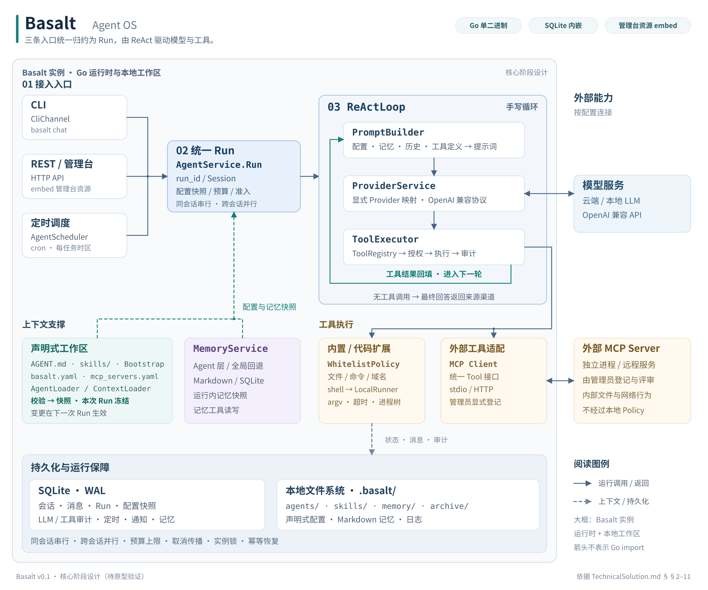

# Basalt 技术方案

> 本文档是 Basalt 四份权威文档中的**技术方案篇（How）**，也是四份中**最权威**的一份：需求口径冲突以本文为准，实现细节冲突以本文为准。配套文档：[行业调研](IndustryResearch.md)（Why）、[需求文档](DemandAnalysis.md)（What）、[AI 编程指南](AiProgrammingGuide.md)（How 落地）。
>
> **配套工件（开工前补的三件套）**：[Compatibility.md](Compatibility.md)（与 NivroOS 的逐项三态对照）、[contracts/](contracts/)（运行时契约四件：Run 与错误 / AGENT.md 与工具 / 完整 DDL / 静态 OpenAPI）、[Operations.md](Operations.md)（部署、备份、升级与凭证）。三件套与本文冲突时**一律以本文为准**。
>
> **文档结构（三部分）**：第一部分"底座"（§1~§10）描述运行时内核的完整设计；第二部分"定义一个 Agent"（§11）是目录协议与渐进披露的单一事实源；第三部分"整合与验证"（§12~§15）给三个端到端 Demo、实施节奏、性能与总结。
>
> **血缘一句话**：设计与能力口径自 NivroOS 第一阶段交付蒸馏而来——`AGENT.md` 协议、工具契约与安全语义**逐字对齐**（同一份 `AGENT.md` 两个底座都能加载）；数据模型与工程形态按 Go 侧重做。**逐项对照、有意改变清单与共享验收样例一律以 [Compatibility.md](Compatibility.md) 为准**，本文不复述。工程形态：单 module + `internal/` 分包、无 ORM、无框架、`CGO_ENABLED=0` 单二进制。所有版本坐标均于 **2026-10-14 经模块代理实测**（核实记录见 §1.2 脚注）。

---

## 第一部分：底座

## 1. 方案概述

### 1.1 关键决策

| # | 决策 | 内容 | 理由 |
| --- | --- | --- | --- |
| 1 | **自实现 ReAct 循环** | 核心循环手写（约数十行 Go），**不得**引入任何 Agent 框架（eino / langchaingo / adk-go / trpc-agent-go 等）。判别标准 = **是否接管 ReAct 循环或自动执行工具**——协议 SDK 不属此类（如 MCP SDK 只做协议编解码，工具调度仍唯一归 `ToolExecutor`） | 完全可控、可审计、可定制；框架会接管循环并引入版本与行为耦合 |
| 2 | **LLM 客户端只做协议调用** | 用 OpenAI 兼容客户端库做 Chat 调用与工具 schema 序列化；**不得**启用其任何自动工具循环能力 | 工具调度唯一归属 `ToolExecutor`；防止工具被调两次 |
| 3 | **Provider 显式映射** | `provider name → 客户端实例` 的映射表在装配处一次构建；路由只查表 | 多 Provider 并存时类型相同，扫描推断必然歧义 |
| 4 | **一个目录 = 一个 Agent；技能声明式绑定** | `AGENT.md` frontmatter 即运行配置；`skills:` 声明即绑定；渐进披露 L1/L2/L3 | 业务方零代码上线；杜绝平台差异（软连接类绑定机制**不得**引入） |
| 5 | **审计 day-one** | `llm_calls` / `tool_invocations` 两张表从第一天写入 SQLite | 可审计是差异化能力，不是扩展阶段功能 |
| 6 | **授权与执行分离（两接口）** | `Policy.Check(ctx, action) error`（这个动作允许吗）与 `CommandRunner.Run(ctx, cmd) (CommandResult, error)`（在受控环境里执行它）；核心阶段唯一组合 = 白名单 Policy + 本地 Runner | 升级（容器 / microVM）= **两个接口各新增实现 + 装配切换**，调用方零改动；其中 Runner 额外负责 cwd、环境变量、输出上限、取消与进程树清理——**不再宣称"单接口不变"** |
| 7 | **同步执行 + context 只承载取消** | 全程同步阻塞；goroutine-per-request；`context.Context` **只承载取消、截止时间与追踪标识**——Agent 配置快照、Session、工具执行环境一律走显式类型化参数（`RunRequest` / `RunEnv`） | 不引入异步编排；Go 无 ThreadLocal，"显式传递"的载体是**类型化参数**而不是 `context.WithValue` |
| 8 | **单二进制纪律** | `CGO_ENABLED=0`；运行时代码与管理台静态资源随单 Go 二进制交付；核心底座运行期无需外部数据库 / 缓存 / 消息队列（SQLite 内嵌、静态资源 embed；模型服务与显式配置的 MCP Server 属按配置接入的业务能力）；第三方依赖最小化 | 交付形态是本项目的核心卖点；破例即是产品破位 |
| 9 | **不用 ORM，手写 SQL** | schema 幂等脚本 + 显式 SQL + repository 接口（定义在 `core`，实现在 `storage`） | SQLite 迁移能力弱，ORM 自动迁移是坑；显式 SQL 可审计、可优化 |
| 10 | **五大能力优先，范围卡紧** | 企业级治理层（认证 / 多租户 / 审计查询）放扩展阶段 | 核心阶段先交付最小完整内核 |

### 1.2 技术栈（版本均为 2026-10-14 实测）

| 组件 | 选型 | 说明 |
| --- | --- | --- |
| 语言 / 工具链 | **Go 1.27.2** | 2026-10-02 发布；`go.mod` 的 `go` 行写**最低版本要求** `go 1.27`，准确构建版本由 `toolchain` 指令与 CI 工具链配置固定（Go 1.21 起语义） |
| 工程结构 | **单 Go module + `internal/` 分包** | 约束是**依赖方向 + 职责清晰 + 无环**（§10）；包数不冻结 |
| CLI | `github.com/spf13/cobra` **v1.10.2** | 多级子命令原生支持 |
| YAML | `github.com/goccy/go-yaml` **v1.19.2**（已定 U-3） | 活跃维护 + 报错可读（加载期校验依赖）；备选 `go.yaml.in/yaml/v3` **v3.0.5**（官方接管的维护分支——原生态默认 `gopkg.in/yaml.v3` 上游 2025-04 已归档） |
| LLM 客户端 | `github.com/sashabaranov/go-openai` **v1.43.0**（已定 U-4） | 自定义 base URL 成熟；备选官方 `openai/openai-go` |
| HTTP 服务 | **标准库 `net/http` + ServeMux 方法路由**（已定 U-6） | Go 1.22+ 支持 `POST /api/v1/sessions/{id}/messages` 模式；备选 `chi` v5.4.0 |
| SQLite | `modernc.org/sqlite` **v1.60.1** | **纯 Go、无 CGO**——`CGO_ENABLED=0` 单二进制的前提；驱动经 `database/sql` 使用 |
| 调度 | `github.com/robfig/cron/v3` **v3.0.1**（U-7 已定） | 6 段经 `cron.NewParser(cron.Second｜cron.Minute｜cron.Hour｜cron.Dom｜cron.Month｜cron.Dow)`；每任务时区经 `CRON_TZ=<zone>` 前缀（**v3.0.1 没有 `parser.WithLocation`**——2026-10-14 解包实测；`cron.WithLocation` 是调度器级 Option） |
| MCP | `github.com/modelcontextprotocol/go-sdk` **v1.8.0**（已定 U-5） | 官方 SDK，与 Google 协作维护 |
| 文件监听 | `github.com/fsnotify/fsnotify` **v1.10.1** | 工作区热加载（US-11/US-12） |
| 日志 | **标准库 `log/slog`**（JSON handler） | 零依赖；请求级字段经 context 携带 |
| 测试 | 标准库 `testing` + `github.com/stretchr/testify` **v1.12.1** | 断言可读；集成测试用 build tag 隔离 |
| 格式 | `gofmt` + `mvdan.cc/gofumpt` **v0.12.0** | 门禁 `gofmt -l` 零输出 |
| 静态检查 | `go vet` + `honnef.co/go/tools`（staticcheck）**v0.8.2** | 可选汇总入口 `golangci-lint` **v2.14.0** |
| 安全扫描 | `gosec` **v2.29.0** + `govulncheck`（`golang.org/x/vuln` **v1.9.0**） | 静态安全 + 依赖漏洞，双轨。gosec **不得**用 `go install ...@v2.29.0` 装：它自带的 `golang.org/x/tools` **v0.49.0** 读不了 Go 1.27 的导出数据（版本 5 > 最高支持 4），扫描静默降级、类型相关规则整批失效；构建**必须**钉 `golang.org/x/tools` **v0.50.0**——配方与探针读数见[起步手册 §2.5](GettingStarted.md)，CI 同一配方 |
| 构建 | `go build`（`CGO_ENABLED=0`、`-trimpath`、`-ldflags "-s -w -X main.version=..."`） | 交叉编译矩阵见 §10.2 |
| 官网展示主页 | `vitepress` **v1.6.4** + Node（**仅构建期**，不进单二进制） | `website/` 静态站点（US-13）；2026-10-14 经 npm registry 核实 |

> 版本核实方式：Go 工具链取自 `go.dev/VERSION?m=text`；模块版本取自 `goproxy.cn` 的 `@latest`（本机网络下 proxy.golang.org 不可达，等效镜像）。写入 `go.mod` 后由 `go.sum` 锁定。
>
> 工具链版本语义（[官方文档](https://go.dev/doc/toolchain)）：`go` 行是**最低版本要求**（低版本工具链被拒），**不是**准确版本锁定；1.27.2 作为构建版本由 `toolchain go1.27.2` 与 CI 的 `go-version: 1.27.2` 共同固定。

### 1.3 与基线的逐项对照

本文自述 Basalt 口径；与基线（NivroOS，基线 commit 见 [Compatibility.md](Compatibility.md) §1）的逐项对照——工程形态、运行行为、数据模型、有意改变清单——**只在 [Compatibility.md](Compatibility.md) §2 / §3 表达**。本节不另立第二份对照表（两份必漂移）。

---

## 2. 整体架构

### 2.1 三条入口，一条链路

```text
人推（CLI）      basalt chat ─────┐
人推（HTTP）     POST /sessions/{id}/messages ──┤
钟推（定时器）   AgentScheduler ──┘
                                  │
                                  ▼
                     AgentService.Run(ctx, RunRequest) (RunResult, error)
                     ── 统一入口：生成 run_id、取配置快照、加载 Session、写会话历史
                                  │
                                  ▼
                     ReActLoop.Run
                     ── PromptBuilder 组装提示词（四部分）
                     ── ProviderService 调 LLM（写 llm_calls）
                     ── ToolExecutor 执行工具（写 tool_invocations）
                     ── 循环直到最终响应或 max_iterations
                                  │
                                  ▼
                     响应返回来源渠道（CLI 打印 / REST 返回）
```

`ReActLoop` 不感知消息从哪条路来——三条路在 `AgentService` 处即已完成归一。

### 2.2 分层视图

```text
┌─────────────────────────────────────────────────────────────────────┐
│ 接入层  cmd/basalt（CLI）        internal/web（REST + 管理台）        │
├─────────────────────────────────────────────────────────────────────┤
│ 编排层  AgentService（统一入口）                                      │
│         ReActLoop / PromptBuilder / ToolExecutor                     │
├─────────────────────────────────────────────────────────────────────┤
│ 能力层  ProviderService    MemoryService    ToolRegistry + Policy/Runner │
├─────────────────────────────────────────────────────────────────────┤
│ 支撑层  AgentLoader / ContextLoader（agents、skills、bootstrap）      │
│         AgentScheduler   Channel(CLI)   ConfigLoader   Notify        │
├─────────────────────────────────────────────────────────────────────┤
│ 存储层  SQLite（modernc/sqlite）+ 文件系统（.basalt/）                │
└─────────────────────────────────────────────────────────────────────┘
```

依赖方向单向向下：`web` / `channel` / `cli` → `core` ← `provider` / `memory` / `tool` / `storage`。**`core` 不 import 任何其他内部包**（依赖倒置：接口在 `core`，实现在各自包）；装配全部集中在 `internal/app`。

### 2.3 五大能力的关系

```text
        ┌──────────────┐
        │  能力二      │  ReActLoop（发动机）
        │  ReAct 循环   │
        └──────┬───────┘
               │ 每轮消费
   ┌───────────┼───────────────┐
   ▼           ▼               ▼
┌──────┐  ┌──────────┐   ┌──────────┐
│能力一 │  │ 能力三    │   │ 能力四    │
│Provider│ │ Memory   │   │ Tool     │
└──────┘  └──────────┘   └──────────┘
               ▲
        ┌──────┴───────┐
        │  能力五       │  Web Service（对外的门）
        │  REST/CLI    │
        └──────────────┘
```

能力一给循环供"脑"、能力三供"记忆"、能力四供"手脚"、能力五是整体的对外门面；循环是它们交汇的地方。

### 2.4 架构总览图



图示为**核心阶段的运行时关系**：实线表示调用与返回，虚线表示上下文或存储关系。大框表示 Basalt 实例的 Go 运行时与本地工作区；模型服务与 MCP Server 位于进程外。运行时代码与管理台静态资源随单 Go 二进制交付，工作区保存本地配置与持久化数据。图中箭头不表示 Go 包的 `import` 方向，包依赖以 §10.1 为准。

三条入口统一进入 `AgentService.Run`；一次 Run 冻结配置与记忆快照，经 `ReActLoop` 完成多轮模型调用、工具执行和结果回填。内置工具由 `WhitelistPolicy` 授权，`shell` 由 `LocalRunner` 执行；MCP Server 内部的文件与网络行为不经过本地 Policy。会话、消息、Run 与审计落入 SQLite，声明式配置与 Markdown 记忆保存在文件系统。

**复用工件**：[SVG 矢量源图](assets/basalt-architecture.svg) / [PNG 图片](assets/basalt-architecture.png)。SVG 可直接用于官网，PNG 适用于需要位图的展示渠道；两者表达同一份架构。图中的状态标注与当前文档一致，正式冻结后应同步更新。

仓库根目录的 README 可直接引用：

```markdown

```

---

## 3. 能力一：对接 LLM（Provider）

### 3.1 设计

`ProviderService` 是 LLM 调用的唯一出口，职责三件：

1. 持有**显式映射表** `map[string]ProviderClient`（provider name → 客户端实例）
2. 把统一请求（messages + tools + 参数）转为 OpenAI 兼容协议请求并发出
3. 计量与审计：解析 usage（可能为空）、记录耗时、**成败都写** `llm_calls`

```go
// ProviderClient 抽象单个供应商的调用能力。
// ProviderClient abstracts one provider's chat call.
type ProviderClient interface {
    Chat(ctx context.Context, req ChatRequest) (ChatResponse, error)
}

// ProviderService 持有 name → 客户端的显式映射（原则三）。
// ProviderService holds the explicit name→client map (Principle 3).
type ProviderService struct {
    clients map[string]ProviderClient // 装配时一次构建，只读
    models  map[string]string         // provider → 默认模型（可被 Profile 覆盖）
}
```

### 3.2 显式映射（硬约束）

```yaml
# basalt.yaml
http:
  addr: 127.0.0.1:8080      # 远程访问必须显式改（安全默认）
  max_request_bytes: 1048576  # 请求体总上限（缺省 1 MiB，解析前拒绝，见 contracts/openapi.yaml）
budget:
  max_iterations: 10        # ReAct 轮次上限；Profile 可覆盖（settings.max_iterations），不得放大
  max_tool_calls: 50        # 一次 Run 的工具调用次数上限
  max_output_bytes: 262144  # 单工具输出 256 KB（读取中截断）
  context_tokens: 32768     # 上下文 token 硬上限；不可裁剪内容超限 → 拒绝启动该次 Run
providers:
  - name: deepseek
    base_url: https://api.deepseek.com
    api_key: ${DEEPSEEK_API_KEY}
    default_model: deepseek-chat
  - name: qwen
    base_url: https://dashscope.aliyuncs.com/compatible-mode/v1
    api_key: ${DASHSCOPE_API_KEY}
    default_model: qwen-plus
  - name: local
    base_url: http://127.0.0.1:8000/v1
    api_key: ${LOCAL_LLM_KEY}
    default_model: qwen2.5-32b-instruct
```

- 映射表在 `internal/app` 装配处由配置**逐条构造**——**不得**遍历、**不得**推断、**不得**把"唯一的那个"当默认
- `api_key` 只允许 `${ENV_VAR}` 占位；启动时解析，未解析（`${` 残留）或为空 → 拒绝启动并点名配置项
- 新增一家 OpenAI 兼容供应商 = 配置加一段；协议不兼容（如 Anthropic 原生协议）= 新增一个 `ProviderClient` 实现（接口不变）

### 3.3 核心阶段不做

- **不做 fallback 链**（A 失败自动切 B）——模型选择是配置事实，不是运行时猜测；要容灾就在网关层做
- **不做调用重试**——工具调用（如 `http_post` / `notify`）与 LLM 调用失败即失败：运行时**不会自动重试**、崩溃恢复**不会自动重放**（承诺边界逐字见 [contracts/run-and-errors.md](contracts/run-and-errors.md) §3.3）；"超时"指单次等待上限，不是重试；不做流式（扩展阶段）
- 不做 embedding / 图片 / 语音——只做 Chat Completions

---

## 4. 能力二：ReAct 循环

### 4.1 算法（核心循环）

**Run 是一次运行的最小完整单位**：从收到一条消息开始，到产生最终结果（或达到终止条件）为止，包含其中全部 LLM 轮次与工具执行。会话消息、LLM 调用、工具执行、审计记录全部挂在 `run_id` 下——审计的关联单位是 Run 而不是 Session（同一会话有多次运行，必须能区分）。

> **类型字面量的唯一事实源**：`RunRequest` / `RunResult` / `RunEnv` / `ToolEnv` / `Budget` 与全部状态字面量（`completed` / `limit_reached` / …）定义在 [contracts/run-and-errors.md](contracts/run-and-errors.md) §1.1，本节只给循环算法；**不得**在本节另抄一份字段清单（重复定义必漂移）。

```go
// Run 是 AgentService 的唯一入口——三条触发路径都归约到它（签名见 contracts/run-and-errors.md §1.1）。
// ReActLoop 是 Run 内部的循环引擎，不感知触发来源。
func (l *ReActLoop) run(ctx context.Context, env *RunEnv) (RunResult, error) {
    for i := 0; i < env.Budget.MaxIterations; i++ {   // 默认 10，可在 Profile 覆盖
        if ctx.Err() != nil {                         // 每轮开头检查取消
            return env.cancelled(), nil
        }
        prompt := l.builder.Build(env)                // 四段拼接（§4.2），配置取自快照
        resp, err := l.provider.Chat(ctx, env.llmEnv(i, prompt)) // ★ 拼好的 prompt 显式传进 ChatRequest；写 llm_calls（两阶段：调用前先插 pending）
        if err != nil {
            if ctx.Err() != nil {                     // ★ 取消 / 截止时间造成的错误 → cancelled，不是 failed
                return env.cancelled(), nil
            }
            return env.fail(err), nil                 // 其它错误 = 真失败，归入 Status，不双通道
        }
        env.Session.AppendMessage(env.assistantMessage(resp)) // ★ 先落 assistant（含 tool_calls / reasoning_content），再执行工具；最终回答也在这条里
        if len(resp.ToolCalls) == 0 {                 // 无工具调用 → 最终响应
            return env.complete(resp.Content), nil    // ★ complete 只组装 RunResult——历史已在上一行落库，不得重复追加
        }
        for _, call := range resp.ToolCalls {         // 一次响应多个工具调用：顺序执行
            if ctx.Err() != nil {                     // 每次工具执行前检查取消
                env.Session.CompleteToolGroup(resp.ToolCalls, cancelReason(ctx)) // ★ 未完成的调用合成显式结果，组保持完整
                return env.cancelled(), nil
            }
            if env.Budget.toolCallsExhausted() {      // ★ 预算用尽：本轮剩余调用逐个合成「未执行（工具调用次数超限）」
                env.Session.CompleteToolGroup(resp.ToolCalls, overBudgetReason) //    "人人有结果"后才可落 limit_reached
                return env.limitReached(), nil
            }
            result := l.executor.Execute(ctx, env.ToolEnv(), call) // Policy → Runner → 两阶段写 tool_invocations
            env.Session.AppendToolResult(call, result) // 结果（或错误信息）回填对话历史
        }
        if ctx.Err() != nil {                         // ★ 工具组返回后复查取消——取消优先于预算判定
            return env.cancelled(), nil               //    （组已完整；最后一轮最后一个工具执行中被取消，仍以 cancelled 收场）
        }
    }
    return env.limitReached(), nil                    // 达上限 = 预期终止，不是错误
}
```

**留痕顺序（不得颠倒）**：assistant 消息（含 `tool_calls`）**必须**在工具执行**之前**落进会话历史。反过来的写法（先执行、后落 assistant）在崩溃时会留下"有 tool 结果、无对应 tool_calls"的孤儿消息，供应商判 400，且该会话此后无法继续。取消路径同理：退出循环前先补齐全组（合成结果见 §4.6），**不得**把残缺的组留在历史里。

**示例里三处已消除的歧义**（都是"看起来是细节、写错就串状态"的点）：

1. **取消 / 截止时间的错误分类**：模型调用返回错误时**先看 `ctx.Err()`**——非 nil 说明该错误由取消或截止时间造成，按 `cancelled` 收场；`ctx.Err() == nil` 才是真失败（`failed`）。反着写（凡 `err` 皆 `fail`）会把"用户主动取消 / 撞 RunTimeout"审计成"运行失败"，§4.7 的 `RunTimeout → cancelled` 契约当场失效
2. **最终回答只落一次**：assistant 消息（最终回答就在其中）在 `AppendMessage` 那一行落库；`complete` **只组装** `RunResult`（`Status` + 文本），**不得**再追加一条 assistant——重复追加会让历史里出现两条内容相同的最终回答，下一轮当上下文再送一遍
3. **prompt 显式传参**：`Build` 出来的 `prompt` 作为**参数**传给 `Chat`（`env.llmEnv(i, prompt)`），**不得**让它成为环境上的隐式副作用——否则"送进 `ChatRequest` 的到底是哪份内容"在代码里读不出来

**返回语义**（完整表见 [contracts/run-and-errors.md](contracts/run-and-errors.md) §1.2）：

| 情形 | 返回值 | error |
| --- | --- | --- |
| 运行到最终回答 | `Status=completed` + 文本 | `nil` |
| 达 `max_iterations` | `Status=limit_reached` + **部分结果** | `nil`——**预期终止**，不是错误 |
| 被取消 | `Status=cancelled` | `nil` |
| 运行中致命错误 | `Status=failed` + `Reason` | `nil`（错误已入 RunResult，**不**双通道） |
| 调用方用法错误（Agent 不存在、会话忙） | 零值 `RunResult` | 非 nil（映射 404 / 409） |

### 4.2 四个部件

| 部件 | 职责 | 关键约束 |
| --- | --- | --- |
| `ReActLoop` | 循环控制：调 LLM → 有工具则执行并回填 → 再来一轮 | 同步阻塞；工具顺序执行；达 `max_iterations` = `limit_reached` 状态 + 部分结果（**预期终止，不是错误**） |
| `PromptBuilder` | 组装四段提示词（见下） | 每次**运行**组装一次快照、运行内冻结（§11.5）；Skill 只注入 L1 元数据卡片 |
| `ToolExecutor` | 工具解析 → Policy 校验 → Runner 执行 → 审计 → 包装结果 | 失败也落审计（含 `error_kind`）；**不得**吞异常；沙箱拒绝信息原样进结果；`tool_invocations` 两阶段写（§9.4） |
| `AgentService` | 统一入口：生成 `run_id` / 取配置快照 / Session 加载 / 历史追加 / 循环调用 / 历史落库 | **唯一**入口；三条触发路径都走它；准入与并发控制在它这一层（§4.6） |

**提示词四段**：

```text
[1] 系统提示词   AGENT.md 正文 + Bootstrap 文件 + Skill 元数据卡片（L1）
                 + 末尾附当前日期时间
[2] 记忆注入     会话历史（持久化部分）+ 长期记忆（Agent 层或有则注、无则回退全局层）
[3] 对话历史     最近 max_history_turns 轮（默认 20）
[4] 工具列表     本轮工具池（Function Calling 格式；工具池 = AGENT.md 的 tools: 声明）
```

**上下文传递**（Go 形态的核心纪律）：

- 业务状态走**显式类型化参数**——`RunEnv`（运行环境：配置快照 / Session / 预算 / 工具池）与 `ToolEnv`（单次工具调用的执行环境：run_id / Agent 身份 / Agent 目录 / 预算解析值），字段定义见 [contracts/run-and-errors.md](contracts/run-and-errors.md) §1.1，**不得**在本节另抄一份
- `ctx` 的正当用途**只有两个**：取消信号（HTTP 断开 / 管理台停止 / 截止时间到）与追踪标识的跨层携带——取消会原生传播到工具执行与 Runner
- **不得** `context.WithValue` 传业务状态（Profile、Session、工具环境**都是**业务状态）；**不得**用 `sync.Map` 或包级变量模拟 ThreadLocal——那是把已被证伪的隐式耦合换个壳
- **工具拿到的环境必须显式传入**：`Tool.Execute(ctx, env ToolEnv, input)` 的 `env` 是必填参数（§6.1）——全局注册的工具（如 `shell` 解析相对路径、`save_memory` 判定记忆作用域）**不得**从 context、全局变量或进程环境猜测"当前是哪个 Agent"

### 4.3 边界行为

| 场景 | 行为 |
| --- | --- |
| 响应 `content` 为空但有工具调用 | 正常——只处理工具调用 |
| 响应 `content` 与 `usage` 均为空 | 视为空响应：作为最终响应返回空串并记 WARN（不得 panic） |
| 工具执行失败 | 错误信息**回填进对话上下文**（模型看得到失败才能收敛）；`tool_invocations` 记 `status=failed` + `error_kind` |
| 达到 `max_iterations` | `Status=limit_reached` + 部分结果；HTTP **200** + 信封内 `code=LIMIT_REACHED`（**不是 500**——服务没有故障）；CLI 打印醒目提示 + 已获得的部分结果 |
| 上下文超长 | 按**完整工具交互组**从最早整组丢弃（保留系统提示词与工具定义完整）；不做总结压缩（§4.4） |
| 上下文取消（HTTP 断开 / 超时） | `ctx.Err()` 传播，循环立即退出；已发生的调用照常落审计（§4.6） |

**核心阶段不做**：工具并行调用、Agent 间委托、上下文总结压缩、流式响应、准入排队（忙即拒，不排队——§4.6）。

### 4.4 完整消息模型（工具调用轮次的硬约束）

会话历史**不是** `(role, content)` 二元组。工具调用轮次的完整结构必须原样保留并回传，否则供应商侧直接报错：

```go
type Message struct {
    Role             string         `json:"role"`                        // system / user / assistant / tool
    Content          string         `json:"content"`
    ToolCalls        []ToolCall     `json:"tool_calls,omitempty"`        // assistant 发起：每个含 ID / Name / Arguments
    ToolCallID       string         `json:"tool_call_id,omitempty"`      // tool 角色：回填哪次调用
    ReasoningContent string         `json:"reasoning_content,omitempty"` // 供应商扩展：思考过程
    ProviderExtra    map[string]any `json:"provider_extra,omitempty"`    // 供应商扩展字段的透传位
}

type ToolCall struct {
    ID        string `json:"id"`        // 模型生成的调用标识，必须原样回传
    Name      string `json:"name"`
    Arguments string `json:"arguments"` // JSON 字符串（原样保存，不做二次序列化）
}
```

四条硬约束（完整契约见 [contracts/agent-md.md](contracts/agent-md.md) §4）：

1. **`tool_call_id` 原样回传**——一个 assistant 消息可并列多个工具调用，结果必须按对应 ID 回填
2. **`reasoning_content` 必须回传**（DeepSeek 等思考模式模型）——带工具调用的轮次丢掉该字段，供应商返回 **HTTP 400**；且历史被"洗干净"后**整个会话持续 400**，不可恢复
3. **`ProviderExtra` 原样透传**——不认识但供应商发来的字段不能在序列化往返中丢失
4. **组的完整性由写入侧保证**——每次运行结束时（正常完成 / 取消 / 达上限 / 崩溃后恢复），会话历史里**不得**留下"assistant 声明了 tool_call、却没有对应 tool 结果"的**半截组**：取消时同步补齐全组（§4.6）、崩溃后由启动恢复补齐（[contracts/run-and-errors.md](contracts/run-and-errors.md) §4.4）。合成结果**只进会话历史，不进审计**——审计记实际发生的，历史补结构完整的

**历史裁剪的最小单位是"完整工具交互组"**（一个 assistant 消息 + 其全部 tool 结果消息），**不得**只丢一半：只丢 `tool(A)` 而留下 `assistant(tool_calls=[A,B])` 会被供应商判"tool_call 无对应结果"并报 400。

### 4.5 Run 状态机

```text
              ┌──────────┐
              │ running  │   ← 先落库再执行（崩溃时靠它找回来）
              └────┬─────┘
     ┌─────────────┼──────────────┬─────────────┐
     ▼             ▼              ▼             ▼
┌───────────┐ ┌────────────┐ ┌───────────┐ ┌────────┐
│ completed │ │limit_reach │ │ cancelled │ │ failed │
└───────────┘ └────────────┘ └───────────┘ └────────┘
```

状态**只前进一次**（`running` → 任一终态），**不得**从终态回退。完整状态表、各状态的部分结果语义与崩溃恢复标记见 [contracts/run-and-errors.md](contracts/run-and-errors.md) §2 / §4.3。

### 4.6 并发、取消与崩溃恢复

| 场景 | 行为 |
| --- | --- |
| 同一 Session 有 Run 在执行，又来一条 | **拒绝**：HTTP **409** `SESSION_BUSY`（可读文案：等待完成或稍后重试）；锁在**会话**上（`session_id`），不在 Agent 上——同一 Agent 的不同会话可并行 |
| 不同 Session | 并行执行（goroutine-per-request，互不阻塞） |
| 实例级并发超限 | 超过 `server.max_concurrent_runs`（缺省 32）→ **429** `TOO_MANY_RUNS`（给出当前上限） |
| 定时任务到点时上一轮未完成 | **跳过本次触发**记日志——定时器没有交互方，没有"重试"语义，**不产生 409** |
| 取消传播 | `ctx.Done()` → 每轮开头与每次工具执行前检查 → 正在跑的 shell 向进程组发终止信号 → 超时未退则强杀**进程树**；工具组返回后**再复查一次**——取消**优先于**预算判定（最后一轮最后一个工具执行中被取消，仍以 `cancelled` 收场，**不得**先落 `limit_reached`，见 [contracts/run-and-errors.md](contracts/run-and-errors.md) §4.1） |
| 取消时的审计 | 用 `context.WithoutCancel(ctx)` + **独立短超时**（缺省 5 秒）写入——被取消的 Run 正是最需要证据的时刻，审计**不得**随请求一起被掐掉 |
| 崩溃恢复 | **只有持工作区实例锁的启动进程**做恢复——锁是**操作系统级独占文件锁**（`.basalt/basalt.lock`；`instance_id` / `pid` / 心跳**只作诊断**，**不得**据心跳过期抢锁）。写模式命令在锁被活实例持有时**拒绝启动**，只读命令不做恢复（防"读一读就把别人正在跑的 Run 标成失败"）；恢复内容：`runs` 的 `running` → `failed`（原因=进程中断）、`llm_calls` / `tool_invocations` 的 `pending` → **`unknown`**（是否已产生外部副作用**无法确定**，不猜测）、以**消息**为入口扫出未完成的工具交互组并与 Run 状态修复**同事务**补齐（会话可继续）、补组后另扫一次 `runs` 收尾**没有半截组可补**的 `running` 行（等首次 LLM 响应 / 最终回答已落库 / 无状态 invoke）——**组看消息、Run 看表**。完整流程见 [contracts/run-and-errors.md](contracts/run-and-errors.md) §4.3 / §4.4 |
| 客户端重试 | 承诺边界**逐字**见 [contracts/run-and-errors.md](contracts/run-and-errors.md) §3.3：**运行时**不自动重试、**崩溃恢复**不自动重放；但客户端（curl / 调用方程序）超时后重发同一请求，服务端会当成**新的一次 Run** 照常执行（v0.1 不做幂等键）——有外部副作用的调用可能重复发生 |

**不排队**是明确决定：排队会把"这条消息什么时候有结果"变成不可预测的问题，且队列本身需要持久化——拒绝是即时、可解释、可重试的。

锁是**进程内**的（`sync.Mutex` per session_id）；多副本部署的分布式锁属扩展阶段。另有一把**工作区实例锁**（`.basalt/basalt.lock`，**操作系统级独占文件锁**，进程退出即由内核释放；心跳仅诊断，见上表"崩溃恢复"行）——它管的是"哪个进程有权做崩溃恢复、谁算同一个实例"，与上面的会话锁是两件事，**不得**混用。**写模式命令**（`serve` / `gateway` / `chat`，以及 `profile create` / `profile delete` 等会写工作区或数据库的 CLI 子命令）在锁被活实例持有时**拒绝启动**；只读命令不取锁、不做恢复（清单与拒绝文案契约见 [contracts/run-and-errors.md](contracts/run-and-errors.md) §4.3.1）。

### 4.7 执行预算与准入控制

一次 Run 的资源消耗**必须有界**，五项预算缺一不可（完整表见 [contracts/run-and-errors.md](contracts/run-and-errors.md) §6）：

| 预算项 | 缺省值 | 超限行为 |
| --- | --- | --- |
| `MaxIterations` | 10（Profile 可覆盖） | `limit_reached` |
| `RunTimeout` | 60 秒（REST 单次）/ 300 秒（定时任务） | `cancelled`，`Reason=超过运行时限` |
| `ToolTimeout` | 30 秒（Profile 可覆盖） | 该次工具调用失败（`timeout`），**Run 继续**——模型看得到失败并能换个做法 |
| `MaxToolCalls` | 50 | `limit_reached`，`Reason=工具调用次数超限` |
| `MaxOutputBytes` | 单工具输出 256 KB | **读取中**截断（`io.LimitReader`）+ 标记 `truncated: true` 回填模型 |
| `ContextTokens` | 32768（`budget.context_tokens`） | 历史按完整工具交互组从最早丢弃；**不可裁剪内容**（系统提示词 / 核心记忆 / 当前消息）本身超限 → 该次 Run **拒绝启动**（`failed` + 点名配置键，**零 LLM 调用**） |

- **上下文预算**：历史裁剪以实际发送的 token 估算为准（`max_history_turns` 是轮数上限，`budget.context_tokens` 是硬上限，缺省 32768）；不可裁剪内容超限**拒绝启动**该次 Run（见上表）——**不得**静默超发
- **核心记忆写配额**：`save_memory` 写核心区单条 ≤ 4 KB、每 Agent 核心区总量 ≤ 32 KB，超限返回**可读拒绝**（模型可自纠：改写归档区或压缩内容）——"核心区永不截断"的前提是**有界**。手工编辑记忆文件导致的超配额**不**按写拒绝处理：注入时记 WARN 并**完整注入**（不静默截断——静默截断会让排障者误判为模型失忆），若因此超上下文预算，走上面的拒绝启动路径
- **预算由运维定，模型只能缩短、不能加长**：数值预算的配置入口是 `basalt.yaml` 的 `budget:` 段（§3.2）；Profile 只能覆盖 `settings.max_iterations`，**不得**放大运维上限。`shell` 的 `timeout_seconds` 等工具级参数经 `ToolExecutor` 与预算取 **min** 后填入 `ToolEnv.Timeout`（模型传得比上限大 = 按上限执行并在结果里说明），**不得**让模型用参数把自己的预算撑大

---

## 5. 能力三：Memory

### 5.1 统一门面与行为契约

`MemoryService` 是记忆的唯一门面。两类记忆两种路径：

```text
会话记忆     Session.Messages（随会话持久化到 sessions 表）——AgentService 自动读写
长期记忆     LongTermMemoryStore 三方法——只经记忆工具 / 管理读取
```

```go
// LongTermMemoryStore 是所有长期记忆载体（markdown / sqlite / mem0）的统一接口。
// LongTermMemoryStore is the uniform interface over all memory backends.
type LongTermMemoryStore interface {
    // Append 追加一条记忆到指定分区；scope 决定落在哪一层，section 决定落在哪个分区。
    Append(ctx context.Context, scope Scope, section Section, content string) error
    // Load 读取指定层的完整记忆（核心区 + 归档区，核心区永不截断）。
    Load(ctx context.Context, scope Scope) (string, error)
    // RecallByKeyword 在归档区做关键词检索；query 是单个关键词，不分词不扩展。
    RecallByKeyword(ctx context.Context, scope Scope, query string) ([]string, error)
}
```

**行为契约（硬约束；第 1 条为相对基线的有意改变——快照语义，见 §11.5 与 [Compatibility.md](Compatibility.md) §3）**：

1. **不缓存**——每次**运行**开始重建配置与记忆快照，运行内冻结（§11.5）；用户手工编辑 `MEMORY.md` 下一次运行立即生效
2. **核心区不截断但有界**——截断与检索只作用于归档区；核心区**必须**有写配额（单条 ≤ 4 KB、每 Agent 核心区 ≤ 32 KB，超限可读拒绝）——"永不截断"的前提是有界，否则核心区会无限膨胀直到撑爆上下文
3. **写入分区由 Agent 显式指定**——`save_memory` 的入参含分区（参数名 `scope`，取值 `CORE` / `ARCHIVAL`，落 `memory_entries.section` 列；与表里表达**分层**的 `scope` 列不是一回事，映射见 [contracts/agent-md.md](contracts/agent-md.md) §5.4）；底座不猜。**不得**把该参数改名成 `section`——参数名与 NivroOS 基线逐字一致是迁移承诺的一部分
4. **召回是关键词检索**——归档区按整串匹配；实现**不得**引入分词、扩展或向量化（那是扩展阶段的另一档能力）
5. **载体隔离**——`memory/` 目录不在 Agent 文件工具白名单内；记忆只能由记忆工具写
6. **同作用域写入串行化**——同一 Scope 内的写入经进程内 **per-scope 锁**串行，"读-检查-写"全程**不得**交错：sqlite 档的配额检查与追加在同一事务内完成，markdown 档经"临时文件 + `rename`"原子替换。两个并发 Run 的 `save_memory` 不得互相覆盖、也不得绕过配额

### 5.2 作用域：Agent 层 + 全局回退层

```go
// Scope 表达记忆作用域。Go 无 null——全局层是类型的一等值，不是"空串"。
// Scope is a first-class value: the global layer is NOT an empty string sentinel.
type Scope struct {
    Agent string // 非空 = 该 Agent 的层；零值 = 全局层
}

var GlobalScope = Scope{}
```

解析规则（同一份语义覆盖三档载体）：

- **无 Agent 上下文 = 全局层**（`GlobalScope`）——CLI 顶层调用等场景；这是正常取值，**不是异常**
- **Agent 层无内容 → 回退全局层**；**两层不叠加**——Agent 层有内容时不再注入全局层（同一句话不得在提示词里出现两遍）
- 存量全局载体（`.basalt/memory/MEMORY.md`）**不得迁移、不得删除**——它同时就是回退层

### 5.3 三档载体

| 档 | 配置值 | 落点 | 阶段 |
| --- | --- | --- | --- |
| Markdown（默认） | `markdown` | `.basalt/memory/MEMORY.md`（全局）+ `.basalt/memory/agents/<name>/MEMORY.md`（Agent 层） | 核心 |
| SQLite | `sqlite` | `memory_entries` 表（含 scope（分层）/ section（分区）两列） | 核心 |
| mem0 | `mem0` | 外部 mem0 服务（url + api-key） | 扩展（已定 U-8：接口预留；实现与真服务联调放扩展阶段） |

**换后端 = 改一行配置**（`memory.backend`），作用域与分区语义三档完全一致——这是"三档同语义"的可验证口径：同一组 `Append/Load/Recall` 场景测试在每档载体上跑同一套断言。

### 5.4 MEMORY.md 的形态

```markdown
# MEMORY

## 核心记忆
（永不截断：用户身份、长期偏好、硬约束）

## 归档记忆
（可截断、可检索：按时间追加的事件与结论）
```

`USER.md` vs `MEMORY.md`：前者用户手写、底座**只读不写**（初始设定）；后者 Agent 通过 `save_memory` 写入（成长记录）。两者都进系统提示词。

---

## 6. 能力四：Tool 体系

### 6.1 工具接口

```go
// Tool 是所有工具的统一抽象：内置工具、MCP 工具、代码内扩展都实现它。
// Tool is the single abstraction over builtin, MCP and in-code tools.
type Tool interface {
    Name() string
    Description() string
    InputSchema() json.RawMessage // JSON Schema（显式给出，测试钉住）
    // env 是执行环境的显式入口（run_id / Agent 身份 / Agent 目录 / 预算解析值，字段定义见
    // contracts/run-and-errors.md §1.1）——由 ToolExecutor 从 RunEnv 派生后传入。
    // 工具**不得**从 context、全局状态或进程环境里猜"当前是哪个 Agent / 哪次运行"。
    Execute(ctx context.Context, env ToolEnv, input json.RawMessage) (Result, error)
}

type Result struct {
    Content   string // 结果内容（回填给模型）
    Retryable bool   // 失败是否可重试（供模型参考）
}
```

- `error` 非 nil 表示执行失败；`ToolExecutor` 把错误信息写入 `tool_invocations.error_message` 并回填对话
- **`env` 是值传递的必填参数**，不是可选装饰：`shell` 靠它解析工作目录与 `timeout_seconds` 上限、`save_memory` 靠它判定记忆作用域（Agent 层 / 全局层）、`manage_schedule` 靠它确定"自己是谁"。无 Agent 上下文时 `AgentName` / `AgentDir` 是**空串**（不是异常）
- MCP 工具经适配器包装成 `Tool`（`McpToolAdapter`）——ReAct 循环不感知工具来源
- 代码内扩展工具实现同一接口，注册进 `ToolRegistry`

### 6.2 内置十工具

| 组 | 工具 | 关键约束 |
| --- | --- | --- |
| FileTools | `read_file` `/` `write_file` `/` `list_dir` | 路径白名单（真实路径投影）；**写范围收窄为当前 Agent 自己的目录**（§6.5）；技能库与 `AGENT.md` 为只读保护；`memory/` 不在白名单；跨 Agent 读取需显式授权 |
| ShellTools | `shell` | 入参 `executable` + `arguments`（**argv 直执、不经 shell**）；可执行名与白名单**整串逐字**比对；**子进程环境变量白名单**（§6.5）；超时 / 中断**杀进程树**；输出宽容解码 |
| HttpTools | `http_get` `/` `http_post` | 域名白名单（大小写不敏感）+ scheme 必须 http/https（代码固定） |
| MemoryTools | `save_memory` `/` `recall_memory` | 走记忆门面；`recall` 的 query 是单关键词；核心区写配额（§5.1） |
| NotifyTools | `notify` | 渠道注册表解析 → 类型分派适配器；发送前过 HTTP 域名白名单 |
| ManageScheduleTools | `manage_schedule` | 只能改**当前 Agent 自己**的 `schedules:` 段；经与页面编辑器同一道注册写入门 |

`manage_schedule` 是相对 NivroOS 基线的**补齐项**（NivroOS 已有此工具）：若缺它，声明该工具的 `AGENT.md` 在 Basalt 上会因 `tool not registered` **整只不注册**，破坏 `AGENT.md` 可互换承诺。完整参数契约见 [contracts/agent-md.md](contracts/agent-md.md) §5。

**工具执行的工作目录约定**：带 Agent 上下文且该 Agent 目录存在时，子进程工作目录 = 该 Agent 自己的目录（Agent 正文里的相对路径 `scripts/x.py` 因此可移植）；无上下文（CLI 顶层）保持进程默认 CWD。**不得**引入全局 `chdir`。

### 6.3 三档扩展

| 档 | 形态 | 上线方式 |
| --- | --- | --- |
| 零代码（主推） | `AGENT.md` + 现成 MCP server | 配置 `mcp_servers.yaml` + 声明 `mcp_servers:` |
| 轻代码 | 任意语言写 MCP server | 同上 |
| 重代码 | 在 Basalt 代码内实现 `Tool` 接口 | 编译进二进制 |

选择原则：能低就不高。

### 6.4 ToolRegistry

```go
type Registry struct {
    tools map[string]Tool // 装配时注册：内置 + MCP 适配 + 代码内扩展
}
```

- 加载期把 `AGENT.md` 的 `tools:` 名单在注册表中逐个解析；解析不到的**该 Agent 整只不注册**（点名 WARN）
- 运行期工具池 = 该 Agent 声明的子集（**不声明 = 空池**——本轮没有工具可选，模型会把工具调用当文本吐出，这是最容易误判的行为）
- **不得**用反射扫描"所有实现了 Tool 的包"做隐式注册——注册即显式枚举，装配处一处可见

### 6.5 授权与执行：Policy / Runner 两个接口

> **两个接口，不是一个（相对基线的有意改变，见 [Compatibility.md](Compatibility.md) §3）**：**授权**（策略判定："允许吗"）与**执行**（受控动作："怎么做"）职责不同、升级路径也不同。容器化要连**执行方式**一起换，"单接口不变、只新增实现类"在那一档不成立——故本项目**不宣称**单接口不变。

```go
// Policy 回答"这个动作允许吗"；Check 失败返回拒绝错误（模型可见四段式文案）。
// Policy answers "is this action allowed?" — pure authorization, no execution.
type Policy interface {
    Check(ctx context.Context, action Action) error
}

// CommandRunner 回答"怎么受控地执行"；v1 只有本地实现，容器 / microVM 是未来的新增实现。
// CommandRunner executes a command under control: cwd, env, output cap, cancel, process-tree cleanup.
type CommandRunner interface {
    Run(ctx context.Context, cmd Command) (CommandResult, error)
}

// Action 是 Policy 的输入：一个"待判定的动作"——授权只看它（谁、要碰什么），不看"打算怎么做"。
// Action is the input of Policy: who wants to touch what. Execution details carry no authority.
type Action struct {
    Type   ActionType // FILE_READ / FILE_WRITE / SHELL_COMMAND / HTTP_REQUEST
    Target string     // 判据主体：文件路径 / 可执行名 / URL（按 Type 解释）
    Agent  string     // 发起动作的 Agent 名；空 = 无 Agent 上下文（CLI 顶层调用）
}

type ActionType string

const (
    ActionFileRead     ActionType = "FILE_READ"
    ActionFileWrite    ActionType = "FILE_WRITE"
    ActionShellCommand ActionType = "SHELL_COMMAND"
    ActionHTTPRequest  ActionType = "HTTP_REQUEST"
)
```

**v1 唯一实现：`WhitelistPolicy`（授权）+ `LocalRunner`（执行）**，装配处显式选择；升级路径 = 两个接口各新增实现 + 装配切换，调用方（`ToolExecutor`）零改动。

#### 授权矩阵（`WhitelistPolicy`，配置在 `basalt.yaml`）

| 档 | 判据 | 细节 |
| --- | --- | --- |
| 文件读 | 目标投影为真实路径后与根前缀比对（软连接感知） | 可读根 = **当前 Agent 自己的目录** + `.basalt/skills`（技能 L2 必需）；跨 Agent 读取需显式授权（见下）；不可解析（断链 / 成环 / 无权限）→ **失败关闭** |
| 文件写 | 同上 | **写范围收窄为当前 Agent 自己的目录**；`.basalt/skills` 由代码常量拒绝（"技能库不可写入"）；`scripts/` 子目录同样拒写（脚本受控通道的前提是**模型改不动脚本**）；`AGENT.md` 与受保护配置文件拒写（经页面 / 工具的注册写入门另行校验）；**不得**放宽为 `.basalt` 整根；`memory/` 不在白名单 |
| 命令 | `executable` 与 `shell.allowed_commands` **整串逐字**比对 | `"git status"` 这类多词串必拒；**不得**给 `bash` / `sh` 放行；参数一律走 `arguments` 原样传递。**解释器受控通道**（`shell.interpreters`）：解释器只接受 `[脚本路径, 参数…]` 形态——`arguments[0]` 不得以 `-` 开头（`-c` / `-m` / `-e` 内联代码形态一律拒），脚本真实路径必须落在该 Agent 的 `scripts/` 或 `.basalt/skills/` 内；解释器进程拥有**宿主同等权限**，容器化隔离属扩展阶段（[Roadmap.md](Roadmap.md) F 方向） |
| HTTP | 域名通配白名单（大小写不敏感）+ scheme ∈ {http, https}（代码固定，**不可**通过配置放行） | **逐跳校验**：每一跳（含重定向目标）在**发送前**校验 scheme + host + 端口，越界判 `sandbox_denied`（HTTP 客户端**不得**自行跟随）；重定向**跳数上限 5**，超限按越界处理；白名单条目与目标 host **必须是域名**——IP 字面量目标直接拒（白名单按域名匹配，放行 IP 等于绕过它）；**不读环境代理变量**（`HTTP_PROXY` / `HTTPS_PROXY` / `NO_PROXY` 一律不生效，`Transport.Proxy` 恒 `nil`）——出网要么直连，要么由运维网关（透明代理 / NAT）承担，模型可控的出网路径不因运行环境被改而换出口 |

**跨 Agent 读取需要显式授权**：文件读默认**只读得到自己**——避免一个 Agent 用 `read_file` 窥探另一个 Agent 的提示词与配置。授权键 `sandbox.cross_agent_read`（字符串列表，元素 = 允许读取的 Agent 名；缺省空 = 一个都不许）。基线差异登记见 [Compatibility.md](Compatibility.md) §3。

**子进程环境变量白名单**：`shell` 起的子进程**不得**继承调用进程完整环境（那会把 `BASALT_*` / 云凭证 / 代理设置一并送给任意脚本）。只透传 `shell.env_passthrough` **显式登记**的变量；示例配置 `basalt.yaml.example` 登记 `PATH` / `HOME` / `LANG` / `TZ`。**代码无内置默认白名单**——省略该键或配置为空列表时，**不透传**父进程环境变量；工具显式声明的变量仍按规则传入。其余一律清空。

#### 执行控制（`LocalRunner`）

- cwd：有 Agent 上下文且目录存在 → 该 Agent 自己的目录；无上下文 → 进程默认 CWD（**不得**全局 `chdir`）
- 超时 / 取消：向进程组发终止信号 → 超时未退**强杀进程树**
- 输出：合并 stdout/stderr，超过 `MaxOutputBytes`（缺省 256 KB）截断 + `truncated: true` 标记
- argv 直执、**不经任何 shell 解释**（契约与 NivroOS 逐字一致）

#### MCP 的行为边界（写在明面上）

**MCP server 是独立进程，其文件读写与网络访问不经过 Basalt 的 `Policy` 判定**——白名单管的是 Basalt 自己的工具，管不了 MCP server 内部做什么。这是**有意接受**的边界，不是遗漏：

- MCP server 的信任边界 = 管理员在 `mcp_servers.yaml` 里显式登记的那一行（其 `command` 来自配置，非模型可控）
- v1 定位：**经管理员评审**的脚本与 MCP server；对不可信 MCP server 的隔离（容器化）属扩展阶段
- 登记时 `mcp_servers.yaml` 需写明该 server 会碰什么（运维评审的依据）

**拒绝信息是模型可见契约**（四段式，逐字保真）：

```text
<规则>：<越界值>。这是安全策略，请勿反复重试；<放行指引：配置键 + 需重启>
```

拒绝抛 `SandboxViolationError`（专用错误类型）→ 走 `ToolExecutor` 既有失败审计路径（`failed` + `error_kind=sandbox_denied`）。

**升级路径**：本地 Runner → 容器 → microVM；`Policy` 与 `CommandRunner` 各新增实现 + 装配切换，另可叠加容器级 `Policy`（双档授权）——不再有"接口不变"的承诺。

### 6.6 通知渠道（NotifyTools）

- 渠道注册表存 SQLite `notify_channels` 表（`name / type / url / description / created_at`）
- **`url` 列存 `${ENV_VAR}` 引用，发送时解析**（有意改变，见 [Compatibility.md](Compatibility.md) §3）——"零明文落盘"字面成立；解析失败给点名环境变量的可读错误（模型可见），**不得**把引用串当 URL 发出去
- **类型 → 适配器是装配层显式映射**（`map[type]Adapter`）——类型支持集只有**一份真值**；认领不到抛专用错误（不得用裸 error 混淆）
- 两个适配器：
  - `webhook`（通用）：`{"content": "…"}`——承接企微 / 钉钉 / 任意 HTTP 端点
  - `feishu`：`{"msg_type":"text","content":{"text":"…"}}`——**只认响应体 `code == 0`**（投递失败也回 HTTP 200）；回执解析不出来同样判失败
- 凭证红线：渠道地址（url 含 token）**不得**出现在响应 / 日志 / 错误文案——对外只回 scheme + host；沙箱越界文案嵌了原始 target，**不得**透传
- 模型侧只读：`notify` 工具不提供渠道 CRUD（写通道由管理台提供，US-12 口径）

---

## 7. 能力五：Web Service

### 7.1 服务器装配

```go
// net/http 服务器：显式超时、优雅关闭、中间件链。
srv := &http.Server{
    Addr:              cfg.HTTPAddr,          // 默认 127.0.0.1:8080（本机回环，安全默认）
    Handler:           mux,                    // ServeMux + 中间件
    ReadHeaderTimeout: 5 * time.Second,        // 慢速攻击防线（必设）
    ReadTimeout:       60 * time.Second,
    WriteTimeout:      90 * time.Second,       // > Agent 调用 60s 超时
    IdleTimeout:       120 * time.Second,
}
```

- **路由**：标准库 ServeMux 方法模式（`mux.HandleFunc("POST /api/v1/sessions/{id}/messages", h)`，路径参数 `r.PathValue("id")`）
- **中间件**（手写、链式）：`recover`（panic → 500 信封 + ERROR 日志）→ 请求日志（slog + trace id）→ CORS
- **优雅关闭**：`signal.NotifyContext` + `srv.Shutdown(ctx)`（等待在途请求，超时强退）
- 并发模型：goroutine-per-request（默认）；共享依赖（Registry / Provider / Store）只读或自带锁
- **监听默认 `127.0.0.1:8080`**（`http.addr`）：核心阶段无认证，默认只对本机开放；**远程访问必须显式改配置**（容器部署改一行 `http.addr: 0.0.0.0:8080`），并自行保证网络层隔离——这是安全默认，不是功能限制

### 7.2 统一信封与错误

```json
{ "code": "OK", "message": "success", "data": { }, "timestamp": "2026-10-14T12:00:00Z" }
```

- 错误码集中定义（枚举常量），异常统一翻译：

| 场景 | HTTP | code |
| --- | --- | --- |
| 参数 / 校验失败、上限冲突（消息超 32KB / 文件预览超 256KB） | 400 | `BAD_REQUEST` / 领域码 |
| 渠道类型未装配 | 400 | `UNSUPPORTED_TYPE` |
| 未找到（会话 / Agent / 资源） | 404 | `NOT_FOUND` |
| 同一会话已有 Run 在执行 | 409 | `SESSION_BUSY`（可读文案：等待完成或稍后重试） |
| 实例级并发超限 | 429 | `TOO_MANY_RUNS`（给出当前上限；是**准入**不是限流） |
| Agent 运行达迭代 / 工具次数上限 | 200 | `LIMIT_REACHED`（**不是错误**——服务没有故障，`data.status = limit_reached`） |
| Agent 调用超时 | 504 | `TIMEOUT`（Run 本身记 `cancelled`） |
| 作者模型未配置（US-12） | 503 | `NOT_CONFIGURED`（点名配置键） |
| 未预期错误 | 500 | `INTERNAL`（响应体只有话术，**不带**异常细节） |

- `recover` 中间件保证任何 panic 都以 500 信封返回且留 ERROR 日志
- 完整错误码表与 message 要求见 [contracts/run-and-errors.md](contracts/run-and-errors.md) §8；错误文案纪律：点名"要改什么"，**不得**回显凭证、绝对路径、堆栈

### 7.3 10 个核心端点

| 方法 | 路径 | 说明 |
| --- | --- | --- |
| `POST` | `/api/v1/sessions` | 创建会话 |
| `POST` | `/api/v1/sessions/{id}/messages` | 发消息（触发 ReAct 循环） |
| `GET` | `/api/v1/sessions/{id}` | 查会话历史（最多最近 100 条） |
| `DELETE` | `/api/v1/sessions/{id}` | 归档会话 |
| `POST` | `/api/v1/agents/{name}/invoke` | 无状态调用 Agent（60s 超时 → 504） |
| `GET` | `/api/v1/profiles` | 列所有 Agent 配置 |
| `GET` | `/api/v1/memory` | 查长期记忆（全局层） |
| `GET` | `/api/v1/tools` | 列可用工具 |
| `GET` | `/api/v1/health` | 健康检查（200 即健康） |
| `GET` | `/api/v1/info` | 运行信息 + Provider 状态（**不含**任何凭证） |

本文冻结的完整静态契约（全部路径、信封、Schema、错误响应）见 [contracts/openapi.yaml](contracts/openapi.yaml)——实现与页面都以它为准。

### 7.4 管理台与追加端点（核心阶段收尾批次）

- 只读观测端点：Skills / MCP / Notify 渠道（**地址只回 host**）/ Sandbox 白名单 / 会话列表 / Agent 记忆（按层）
- 定时任务管理：`GET /schedules`、`GET /schedules/{id}/executions`、`POST /schedules/{id}/run`、`PUT /schedules/{id}`
- Agent 动态管理（US-12）：`POST /agents`（脚手架）、`POST /agents/{name}/generate-files`（一句生成草稿）、`POST /agents/{name}/files`（多文件提交：先验后写 + 快照回滚）、`DELETE /agents/{name}`（归档：注销定时 → 移出注册 → 目录移入 `archive/`；会话 / 记忆 / 审计不动）、`GET /workspace/tree`、`GET /workspace/file`（真实路径投影校验、256KB 上限、只读）
- 通知渠道 CRUD：`GET /notify-channels`、`GET /notify-channels/types`、`POST`、`PUT`、`DELETE`（被 `AGENT.md` 引用时 400 点名，`?force=true` 强删；**url 留空 = 保留原值**）
- **管理台前端复用 NivroOS 的 Vue + Vite 工程**（同一套页面形态与组件习惯）：产物经 `go:embed` 进二进制，运行时仍单二进制、零外部依赖；**Node 仅构建期需要**，最终用户不需要 Node。页面渲染模型产出文本**必须**走安全子集渲染（自研渲染器逐节点构造 DOM / `html/template` 默认转义），**不得**用 `v-html` / `innerHTML` 直插模型文本，**不得**引入 Markdown 渲染库
- 原方案"服务端渲染手写页面"作废——同一窗口的维护成本高于复用既有前端工程（U-9 已按评审翻转）

### 7.5 限制与不做

- **必做限制**：单条消息 ≤ 32KB；会话历史返回最多 100 条；Agent 调用 60 秒超时；**并发准入**——同会话串行（忙即 409）+ 实例级上限（超即 429），**不排队**（§4.6）
- **核心阶段不做**：认证（内网假设）、SSE、WebSocket、RBAC、请求排序参数（见下方 SQL 纪律）
- **429 是准入不是限流**：区别在于目的——准入保护的是"正在跑的 Run 不被拖垮"（并发数上限），限流保护的是"单位时间请求数"（令牌桶 / 滑窗，防滥用）。核心阶段无认证、内网假设下做限流意义不大；**两者机制不同，不得混称**
- **SQL 纪律（安全约束）**：**不得**从请求参数构造 `ORDER BY` / 排序表达式；仓储层只用带固定 SQL 的显式查询，**不得**暴露排序参数

---

## 8. 支撑模块

### 8.1 工作区初始化（`basalt init`）

幂等创建 `.basalt/` 全套骨架（§11.1 目录树）；已存在文件**不覆盖**、不报错。初始化在 `serve` 启动时自动兜底执行一次（缺目录则建）。

### 8.2 AgentLoader：加载与校验

`AgentLoader` 扫描 `.basalt/agents/` 的每个子目录：

```text
读 AGENT.md → 切 frontmatter（--- 围栏）与正文 → YAML 解析 → 派生 Profile
  → 校验（任一不过 → 该 Agent 整只不注册 + 点名 WARN，其余照常）：
      name 与目录名一致 / model 非空白 / provider 已注册 /
      tools 全部可解析 / skills 在公共技能库有实体 / bootstrap 文件存在 / mcp_servers 已配置
```

职责边界：`AGENT.md` **不是 Tool**——正文归 `ContextLoader` 注入系统提示词，**不进** `ToolRegistry`。

### 8.3 ContextLoader：系统提示词

- **快照语义**：每次**运行**（Run）开始重建一次配置与内存快照（`AGENT.md` 正文 + Bootstrap + 技能卡片 + 长期记忆），**运行内冻结**——一次 Run 的每一轮提示词都基于同一份快照，绝不出现"旧 Profile × 新正文"的混搭；手工编辑在**下一次运行**生效（§11.5）
- 技能卡片（L1）每轮注入：`name + description + 技能库真路径`；模型命中后由 `read_file` 读 L2 正文
- 末尾附当前日期时间（模型需要知道"今天"）

### 8.4 Channel 与 CLI 交互

- `Channel` 抽象：入站消息 → `AgentService`；出站响应 → 渠道格式
- 核心阶段唯一实现 `CliChannel`：`basalt chat` 交互循环（读到 EOF / `exit` 退出）
- **编码纪律（平台差异是这里的最大坑）**：
  - 真控制台（Windows ConHost / PowerShell / Windows Terminal / macOS Terminal）：stdin/stdout 经**控制台 API**（Windows 为 `ReadConsoleW` / `WriteConsoleW`；类 Unix 为 UTF-8 直读）——按控制台代码页正确收发，中文不乱码
  - 管道 / 重定向：两侧一律**显式 UTF-8**
  - 判定方式用终端检测（`IsTerminal`），**不得**按终端名或环境变量猜
  - 实现归 `internal/channel`，平台差异用 build tag 分文件；**实现前先按 H3 核实** Windows 控制台 API 的 Go 侧调用姿势（`golang.org/x/sys/windows` 或 `syscall`）

### 8.5 AgentScheduler（第三触发源）

- 定义源：各 `AGENT.md` 的 `schedules` 段；启动时逐个注册（**动态注册**，不用固定表）
- **cron 6 段（秒 分 时 日 月 周）**；5 段在加载期即拒（解析失败 → 该 Agent 整只不注册）
- **zone 缺省 UTC**（`time.Local` 是禁用词）；要北京时间必须显式 `Asia/Shanghai`
- **每任务时区经 `CRON_TZ=` 前缀**：`cron.NewParser(cron.Second|cron.Minute|cron.Hour|cron.Dom|cron.Month|cron.Dow)` 解析后给表达式加 `CRON_TZ=<zone>` 前缀再 `Schedule`——**`robfig/cron` v3.0.1 没有 `parser.WithLocation`**（实测解包核实），`cron.WithLocation` 是**调度器级** Option（全局一个时区，做不到 per-task）；Agent 配置形态与 NivroOS 逐字相同（`zone` 字段），转换发生在装载层
- **与 NivroOS 的"可互换"限于公共子集**：`*` / 数字 / 范围 / 列表 / 步长 / 月周缩写可用；**`7`（Sunday，用 `0`）、`L`、`W`、`#` 不可用**（Spring 支持、robfig 不支持）。承诺可互换前**必须**先做对拍：两个底座对同一表达式各列未来 10 次触发时间、逐条比对（含 DST 边界例）——样例与程序见 [Compatibility.md](Compatibility.md) §5.2
- 任务 `id`：**单项可缺省**（派生 `<agent>-1`）；**两项及以上每项必须显式声明**（否则调整 `schedules:` 顺序即静默换身份——库里的 `enabled` 与执行历史跟错人）；显式 `id` 全局唯一，显式撞车 = 该 Agent 不注册（[contracts/agent-md.md](contracts/agent-md.md) §3）
- 并发控制：每任务一把 `sync.Mutex`（按 id）——拿不到锁 = 上一轮未完成，**跳过不排队**（记日志，**不产生 409**——定时器没有交互方）
- 失败处理：只记 ERROR 日志 + 写 `task_executions`，不崩调度器
- 会话身份：`session_id` 沿用既有公式，channel 与 user 都固定 `scheduler`
- 状态持久化：`scheduled_tasks` + `task_executions` 两表；`TaskStore` 接口在 `core`，SQLite 实现在 `storage`（依赖倒置）
- **下线 = 标记不物理删**：置 `scheduled_tasks.retired_at`（`task_executions` 的外键永不撞，历史执行记录保留）；**重启对账**：`enabled` 以库为准、定义以文件为准（文件改动不回翻停用）；`retired_at` 后同 id 再现 = 清除 `retired_at`、`enabled` 保持库值
- **停机期间错过的触发点不补跑**（记 WARN；补跑走 `POST /schedules/{id}/run`——与"不自动重试、恢复不重放"同一条纪律）；**启动恢复收尾**遗留 `started` 执行行——按 Run 终态映射（`completed` / `limit_reached` → `completed`；`failed` / `cancelled` → `failed`）

### 8.6 三种运行模式

| 模式 | 命令 | 装配内容 |
| --- | --- | --- |
| 交互 | `basalt chat` | 全量装配 + CLI Channel；无 HTTP 监听 |
| 服务 | `basalt serve` | 全量装配 + HTTP + 调度器 + 热加载 watcher |
| 守护 | `basalt gateway` | 全量装配 + 调度器 + Channel 族（核心 = CLI + 定时） |

### 8.7 CLI 命令（12 个，cobra）

```text
basalt init | status | chat | serve | gateway
basalt profile list | create <name> | show <name> | delete <name>
basalt provider list | tool list | session list
（--version 为全局选项）
```

**轻 / 重两条路**：轻命令（`init`、`profile list` / `profile show`）只读文件系统状态，毫秒级返回、无装配；重命令（涉及注册表或数据库）走完整装配，凡答案涉及**容器内注册表或数据库**就必须走重路径。**`profile create` / `profile delete` 属写模式命令**——无装配但**取工作区实例锁**（写工作区即写模式）：锁被活实例持有时拒绝启动，并指引改用 REST / 管理台（保存即生效）。只读命令打开数据库前**必须**校验 `schema_version`（见 [contracts/run-and-errors.md](contracts/run-and-errors.md) §4.3.1）。**不得**为同一语义写两份实现（轻路径不许有写死的假数据）。

### 8.8 ConfigLoader

- 加载 `basalt.yaml`：服务配置 + providers + sandbox 白名单 + memory 后端 + author 模型（US-12）
- **环境变量占位解析**：所有 `${VAR}` 在装配前统一解析；未解析残留 → 点名报错、拒绝启动
- 校验失败即退出（exit code 非零 + 可读信息），**不静默取默认值**

---

## 9. 数据持久化

### 9.1 SQLite 装配

- 驱动 `modernc.org/sqlite`（纯 Go）；`database/sql` **读写连接池分离**：**写池上限 1**（SQLite 单写者）+ 若干读连接（WAL 模式下读写可并行）
- **PRAGMA 必须逐物理连接设置**：`foreign_keys` 与 `busy_timeout` 是**连接级**设置，连接池会开多条连接——经 DSN 参数（modernc：`?_pragma=busy_timeout(5000)&_pragma=foreign_keys(1)`）对每条新连接生效；`journal_mode=WAL` 是**库级持久**属性（写一次进库文件，重启仍是 WAL），启动时执行一次即可。完整纪律见 [contracts/schema.sql](contracts/schema.sql) 头注释
- **schema 幂等脚本**：`schema.sql`（全部 `CREATE TABLE IF NOT EXISTS` / `CREATE INDEX IF NOT EXISTS`）在启动时执行一次；**新旧库判定以 `schema_version` 表是否存在为准**（不存在 = 新库，全量建表；存在 = 旧库，按当前版本逐版前向迁移），库内版本**高于**二进制支持的版本 → **拒绝启动**（**不得**让旧二进制打开新库）
- **迁移纪律**：**不得**依赖任何 ORM 自动 DDL。表结构变更 = 改 `schema.sql` + 手写**受控版本化**增量 SQL + 版本记录（`schema_version` 表）；迁移脚本入库、可重放；**已发布的迁移不得改写**（只许追加新版本）
- **事务不得跨 LLM 调用与工具执行**：一次事务只覆盖单条记录的读写（如"追加消息 + 更新会话计数"）；LLM 调用与工具执行期间**不持有**数据库事务——它们可能耗时数十秒，持锁会阻塞全部写入

### 9.2 表清单

**表 / 列 / 状态字面量的唯一事实源是 [contracts/schema.sql](contracts/schema.sql)**——本表只列表名与用途，**不得**在此另抄一份列清单（抄一份必漂移一处；建表以 DDL 执行结果为准）。库结构相对基线的变化（消息拆表、审计扩列、新增表、迁移机制）登记在 [Compatibility.md](Compatibility.md) §2.5。

| 表 | 用途 |
| --- | --- |
| `sessions` | 会话元数据（消息不在本表——拆到 `messages`，§4.4） |
| `messages` | 会话消息**逐条追加表**；承载完整工具调用结构（§4.4） |
| `runs` | **一次运行**（执行与审计单位） |
| `llm_calls` | 模型调用审计（两阶段写，§9.4） |
| `tool_invocations` | 工具执行审计（两阶段写，§9.4） |
| `config_snapshots` | 配置快照（§11.5 热加载的落点；**内容寻址**——同内容即同版本，见 DDL 的 `hash` 唯一索引） |
| `scheduled_tasks` / `task_executions` | 定时任务状态与执行历史 |
| `notify_channels` | 通知渠道注册表（`url` 存 `${ENV_VAR}` 引用、发送时解析，§6.6） |
| `memory_entries` | SQLite 记忆档载体（表内 `scope` 列 = 记忆**分层**（agent / global），与 `save_memory` 工具的 `scope` 参数（记忆**分区**）不是一回事——映射见 [contracts/agent-md.md](contracts/agent-md.md) §5.4） |
| `schema_version` | 迁移版本记录 |

### 9.3 文件系统数据

见需求文档 §10.2。核心纪律：**记忆载体不在 Agent 文件工具白名单内**；**技能库对 Agent 只读**；`archive/` 只进不出（恢复 = 手工文件操作）。

### 9.4 审计模型：从"有记录"到"能解释失败"

审计不是"写了就行"——目标是在事后回答**"这一次运行为什么那样做"**。完整契约见 [contracts/run-and-errors.md](contracts/run-and-errors.md) §7，要点：

- **三表按 `run_id` 关联**：`runs`（一行 = 一次运行）/ `llm_calls`（+`round` 第几轮）/ `tool_invocations`（+`tool_call_id` 模型给的调用标识）——同一个会话的多次运行必须能区分
- **失败可解释**：每次失败带 `error_kind` 类别（`sandbox_denied` / `timeout` / `not_found` / `invalid_input` / `external_error` / `runtime_error` / `unknown`），没有类别的审计只回答"失败了"、回答不了"为什么"
- **审计失败策略：fail-closed**——`tool_invocations` 与 `llm_calls` **都是两阶段写**：调用**前**先插 `pending` 行，**插入失败即拒绝发出该次调用**（审计不可用比调用不可用更严重）；调用返回后更新为终态。终态更新失败记 ERROR、该行留 `pending`，由下次启动的恢复流程标 `unknown`。三个已知残余窗口（工具已执行但终态写失败 / Run 终态持久化失败 / 调用完成与审计更新之间崩溃）及其处置**逐条写明**在 [contracts/run-and-errors.md](contracts/run-and-errors.md) §7.2——**不得**只写一句"fail-closed"了事
- **崩溃恢复的诚实语义**：只有**持工作区实例锁**（操作系统级独占文件锁，见 §4.6）的启动进程做恢复（防"读一读就把别人正在跑的 Run 标成失败"）；`running` 的 Run → `failed`（进程中断）、`pending` 的审计行 → **`unknown`**（是否已产生外部副作用无法确定，**不猜测**）、未完成的工具交互组以**消息**为入口扫出并与 Run 状态修复**同一个短事务**补齐（会话可继续，§4.4）——**组看消息**；补组之后、开放服务之前再扫一次 `runs`，把**没有半截组可补**的 `running` 行（等首次 LLM 响应 / 最终回答已落库而终态未写 / 无状态 invoke）一并收尾为 `failed`——**Run 看表**；恢复全程幂等，中途再崩一次，下次启动仍能收口
- **存什么、不存什么**（登记为契约、不是承诺）：存完整入参 / 结果（超 256 KB 截断标记）/ 失败原文（截断 4 KB）/ 耗时 / 轮次 / token / 配置快照版本；**不存**通知渠道地址原文（凭证形态入库）、模型 `reasoning_content`（体积大且含模型内部过程——它只在会话消息里按供应商要求回传）。**Agent 通过工具读到的内容会进审计**——运维需知晓这一点
- **脱敏不是承诺**：凭证的防线在别处——渠道地址只以 `${ENV_VAR}` 引用入库（§6.6）、`api_key` 只从环境变量读（§8.8）

---

## 10. 工程结构

### 10.1 包结构（依赖方向约束）

> **包结构约束（相对基线的有意改变，见 [Compatibility.md](Compatibility.md) §3）**：Go 单二进制下包是编译单元、不是交付单元——**"固定包数、不拆不并"没有对应的工程意义**，且会阻碍第三方实现（cron / MCP / storage）的落位。本项目的约束是**依赖方向 + 职责清晰 + 无环**（下面三条纪律）；现有 10 个包是**起点**，不是冻结清单。

```text
basalt/
├── go.mod / go.sum
├── cmd/
│   └── basalt/
│       └── main.go           # 唯一 main：调 internal/app.Run
├── internal/
│   ├── app/                  # 装配层：读配置 → 构造依赖 → 启动顺序 → 优雅关闭
│   ├── core/                 # 核心抽象与引擎：Tool/Session/Profile/ReActLoop/
│   │                         #   PromptBuilder/ToolExecutor/AgentService/Scheduler/
│   │                         #   仓储接口（TaskStore 等）/Errors/MetricsRegistry
│   ├── provider/             # 能力一：ProviderService + OpenAI 兼容客户端 + 显式映射
│   ├── memory/               # 能力三：MemoryService + 三档载体 + MemoryTools
│   ├── tool/                 # 能力四：内置工具 + MCP Client + Registry + Policy/Runner
│   ├── channel/              # Channel 抽象 + CLI 实现（含平台编码分流）
│   ├── web/                  # 能力五：HTTP Server + 10 端点 + 管理台端点 + embed 静态资源
│   ├── storage/              # SQLite：schema.sql、迁移、各 Repository 实现
│   ├── cli/                  # cobra 命令定义 + ConfigLoader
│   └── workspace/            # 工作区：init / AgentLoader / ContextLoader / 技能库 /
│                             #   热加载 watcher / Agent 生命周期（创建·归档·工作区浏览）
├── assets/                   # go:embed：管理台静态资源、工作区模板文件
├── examples/                 # 演示素材：三个每日 Demo + 自研最小 MCP server
└── docs/                     # 四份权威文档
```

**三条包纪律**（替代"包数固定"）：

1. **依赖方向**：`channel` / `web` / `cli` → `core` ← `provider` / `memory` / `tool` / `storage` / `workspace`；`app` 是唯一允许"什么都知道"的装配层；`core` 只依赖标准库
2. **接口定义在消费方**：`core` 声明它需要的接口（如 `TaskStore` / `MemoryStore` / `Policy`），实现放各自的包——Go 的隐式接口让这成为自然写法（依赖倒置）
3. **第三方实现放消费方包内或 `internal/adapters/`**：**cron 调度封装在 `internal/adapters/cron`**（`core` 只依赖标准库，不 import 第三方调度库）、MCP SDK 封装在 `tool`、SQLite 驱动封装在 `storage`——**新增一个第三方实现不得迫使其他包跟着改**；确实容纳不下时允许按需新增包（前提是三条纪律仍然成立）

**无环**由 CI 用 `go list` 复核（见 §10.2）：

```text
channel / web / cli ──→ core ←── provider / memory / tool / storage / workspace
app ──→ 全部（唯一允许"什么都知道"的包）
core ──→ 仅标准库（不得 import 其他 internal 包）
```

> 与基线（NivroOS）九模块的导航对照表见 [Compatibility.md](Compatibility.md) §2.8。

### 10.2 构建与发布

```bash
# 本机构建（静态单二进制）
CGO_ENABLED=0 go build -trimpath -ldflags "-s -w -X main.version=$(git describe --tags --always)" -o bin/basalt ./cmd/basalt

# 交叉编译矩阵
GOOS=linux   GOARCH=amd64 CGO_ENABLED=0 go build -o dist/basalt-linux-amd64   ./cmd/basalt
GOOS=linux   GOARCH=arm64 CGO_ENABLED=0 go build -o dist/basalt-linux-arm64   ./cmd/basalt
GOOS=windows GOARCH=amd64 CGO_ENABLED=0 go build -o dist/basalt-windows-amd64.exe ./cmd/basalt
GOOS=darwin  GOARCH=arm64 CGO_ENABLED=0 go build -o dist/basalt-darwin-arm64  ./cmd/basalt
```

- 版本号经 `-X main.version=` 注入；`basalt --version` 输出
- 发布产物 = 四个平台二进制 + 校验和文件；**无**安装器、**无**运行时依赖声明（不存在的东西不需要声明）
- 本机开发注意：`GOPROXY=https://goproxy.cn`（proxy.golang.org 在本机网络不可达；已实测）

---

## 第二部分：定义一个 Agent

## 11. 目录协议与渐进披露（单一事实源）

### 11.1 一个目录 = 一个 Agent

```text
.basalt/
├── agents/
│   └── ops-agent/                 # 一个目录 = 一个 Agent
│       ├── AGENT.md               # frontmatter（运行配置）+ 正文（任务指令）
│       ├── REFERENCE.md           # 可选：领域参考（模型按需读取）
│       └── scripts/               # 可选：附属脚本（相对路径按本目录解析）
│           └── check.py
├── skills/
│   └── digest-format/             # 公共技能库（每个子目录一个 SKILL.md）
│       ├── SKILL.md               # frontmatter：name + description；正文：技能说明
│       └── REFERENCE.md           # 可选：附属资源（L3）
└── memory/
    ├── MEMORY.md                  # 全局层（回退层）
    └── agents/ops-agent/MEMORY.md # Agent 层（save_memory 时落盘）
```

### 11.2 AGENT.md 完整样例

```markdown
---
name: ops-agent                # 必须等于目录名（名字即身份）
description: 运维助手
identity:
  agent_name: 运维小欧
  prompt: 你是一个专业的运维助手……
provider:
  name: deepseek               # 必须是已注册 provider
  model: deepseek-chat         # 不得空白（未定填占位符「请在此填写模型名」）
  temperature: 0.7
tools:                         # 本轮工具池的唯一来源；不声明 = 空池
  - read_file
  - shell
  - http_get
  - save_memory
  - recall_memory
skills:                        # 声明即绑定（元素 = 技能库目录名）
  - digest-format
mcp_servers:
  - github-mcp
channels:
  - name: cli
    config: {}
bootstrap:
  - AGENTS.md
  - SOUL.md
  - USER.md
settings:
  max_iterations: 10
  max_history_turns: 20
schedules:
  - id: daily-weather          # 可选（仅当本 Agent 恰有一个任务）；缺省派生 <agent>-1；两项及以上每项必须显式
    cron: "0 0 8 * * *"        # 必须 6 段：秒 分 时 日 月 周
    zone: Asia/Shanghai        # 可选；缺省 UTC
    message: "查一下今天的天气"
---

你是一个专业的运维助手。被触发时……（正文：注入系统提示词的任务指令）
```

### 11.3 渐进披露（Skill 的三层，形态对齐 agentskills 开放标准）

```text
L1  每轮注入（系统提示词）   name + description + 技能库真路径（小卡片）
L2  模型命中后自主 read_file  SKILL.md 正文（不预载、无 use_skill 工具）
L3  按需再取                 REFERENCE.md / scripts/ 等附属资源
```

- 卡片里的路径是**技能库真路径**（`.basalt/skills/<name>/SKILL.md`）——白名单读放行是 L2 可用的前提
- 技能在库里没有实体 → 加载期 `skill not found`，该 Agent 整只不注册
- 遗留形态（Agent 本地 `skills/` 目录 / 软连接）从第一天起就**不被识别**——绑定只有 `skills:` 声明一条路

### 11.4 核心文件系统 vs 扩展 API

- **核心阶段事实源 = 文件系统**：`agents/`、`skills/`、`memory/` 是唯一真值；页面与命令都作用于文件
- 变更入口两条 + 一条后台：
  1. 手工编辑文件（watcher 感知 → 重载注册；无效则保留旧注册 + WARN）
  2. 管理台 / API 写通道（`reconcile` 闸门：先验后写、失败回滚、经**同一段**解析与注册代码）
  3. 定时任务管理端点（只动 `schedules` 状态）
- **多文件提交 = staging 构建 + 目录交换**：写入先在 `.staging` 构建完整副本（原目录不动），校验通过后经**两次 rename** 完成交换（原目录 → `.backup`，staging → 正式目录，删 `.backup`）——崩溃窗口有界，启动恢复按残留判定回滚 / 前滚（见 [contracts/run-and-errors.md](contracts/run-and-errors.md) §4.3.2）
- **归档删除的顺序**：注销定时 → 移出注册索引 → **取消该 Agent 在跑的 Run 并等待退出**（有界等待；超时报错并恢复注册，不留半残态）→ 目录移入 `archive/`
- **不得**存在绕过闸门的第二条写入路径（页面编辑器、Agent 创建、文件提交、归档删除共用它）

### 11.5 热加载：不可变配置快照

**语义**：配置变更不是"改一个正在被读的变量"，而是**校验通过 → 生成新快照 → 原子发布**：

- 加载校验全过 → 生成**不可变配置快照**（`ConfigSnapshot`：**冻结清单 manifest**（AGENT.md + bootstrap 文件 + 绑定技能的 SKILL.md，逐文件 `{path, sha256}`）+ 解析后的 Profile + 正文 + 技能卡片）→ **原子替换**注册表指针（`sync.RWMutex` / `atomic.Pointer`）；**校验失败保持旧快照** + WARN 点名（失败不破坏正在服务的那份）。**"读即所记"**：注入内容与清单哈希出自**同一次读取**，两者必然对应；清单任一文件读取失败 → 该次运行**拒绝启动**（失败关闭）
- **单次运行内冻结**：一次 Run 在开始时取一份快照，整个运行（含每一轮）都基于它——**不得**运行中途换配置（消解"旧 Profile 配新正文"的混搭）；变更在**下一次运行**生效
- **单一变更入口**：页面编辑器 / Agent 创建 / 多文件提交 / `manage_schedule` 共用同一道注册写入门（§11.4），不另立解析路径
- 快照的 `hash`（= manifest **规整序列化**的 sha256，内容寻址）写进 `runs.config_hash` 与 `llm_calls.config_hash`——审计能回答"这次运行用的是哪版配置"。**L2/L3 技能正文与 `scripts/` 脚本不在运行冻结范围**：按需读取、读时为准（读取行为进审计）

**`fsnotify` 非递归**（这是要主动处理的坑，不是默认行为）：

| 情况 | 处理 |
| --- | --- |
| 子目录 | `fsnotify` **只监听被添加的目录本身**，**不**递归——逐目录 `Watch`（`agents/*` 与 `skills/*` 及其子目录），**新建目录时补 watch** |
| 编辑器原子替换 | 多数编辑器保存 = 写临时文件 + `rename` 覆盖——收到的是 `RENAME`/`CREATE` 事件而非 `WRITE`；监听**目录**而非单个文件才能稳定收到 |
| 漏事件兜底 | 防抖窗口结束时做一次全量 `rescan` 校验（watch 失效、事件丢失都能被兜住）——正确性不依赖"事件一条不丢" |

其余口径不变：

- 防抖（~300ms 合并连续事件）后再重跑校验
- 新增占位符模型名的 Agent（`请在此填写模型名`）**能过加载期**——"没配完"在文件里一眼可见，运行时报错在调用模型时
- `mcp_servers.yaml` 变更**不热加载**（连接生命周期复杂）：页面文案明确"改完需重启"；域名 / 沙箱白名单同样**需重启**
- **归档删除 = 先取消该 Agent 正在跑的 Run 并等待退出**（有界等待：注销定时 → 移出注册索引 → 取消并等待 → 目录移入 `archive/`；等待超时报错并恢复注册，不留"注册没了、目录还在"的半残态）——不得把还在执行、且运行中还要读配置目录的 Run 留在后台

---

## 第三部分：整合与验证

## 12. 三个每日端到端 Demo

三个 Demo 是**真实可跑的 Agent 目录**（入 `examples/` 素材库，测试钉住），横向串起全部能力：

| Demo | Agent 形态 | 覆盖点 |
| --- | --- | --- |
| **每日天气** | 光杆目录（只有 `AGENT.md`） | Provider + ReAct + HTTP 工具 + 通知渠道 + 定时（`0 0 8 * * *` Asia/Shanghai） |
| **每日科技日报** | 目录 + `skills:` 声明 | 技能渐进披露 L1/L2/L3 全链路 |
| **每日 GitHub 日报** | 目录 + `scripts/github_trending.py` | 脚本执行：argv 直执、相对路径按 Agent 目录解析、输出回填 |

素材纪律（测试钉住）：每份 `AGENT.md` 可被加载器读回、cron 合法（6 段）、声明的工具名在注册池内、技能与脚本文件存在、脚本只用标准库；演示数据源用免 key 公开 API（域名进白名单）；通知渠道在演示环境按注册表登记（地址不入文档、不入仓库）。

## 13. 实施节奏

14 个 US 递进式排入 5 周（可调）：US-1~US-4 立内核主干，US-5~US-8 为只依赖 US-4 的四条独立枝（可并行 / 调序），US-9~US-12 收口系统面，US-13 立对外门面（官网展示主页 + README），US-14 收尾。精确硬依赖见 [AI 编程指南](AiProgrammingGuide.md) §1.3。

| 周次 | US | 任务 | 可演示成果 | 涉及包 |
| --- | --- | --- | --- | --- |
| 第一周 | US-1 | 工程地基：骨架 / 门禁 / 配置 / 日志 / 工作区 / 持久化 | `make check` 全绿；`basalt init` 出工作区；核心八张 + 支撑三张表就位 | app / storage / workspace / cli |
| 第一周 | US-2 | Provider 显式映射 + 审计落库 | 一次真实 LLM 调用 + `llm_calls` 记录 | core / provider / storage / app / cli |
| 第二周 | US-3 | Agent 目录加载与 Profile（frontmatter 校验 + system prompt 第一段） | `profile` 子命令可用；技能卡片 L1 注入 | workspace / core / cli |
| 第二周 | US-4 | ReAct 循环 + 首闭环（Registry + 白名单沙箱 + FileTools + CliChannel + 会话落库） | `basalt chat` 多轮对话、会话跨重启恢复 | core / tool / channel / cli / storage |
| 第三周 | US-5 | Shell 与 HTTP 工具 | Demo 一：问天气给穿衣建议 | tool / cli |
| 第三周 | US-6 | Memory（两层作用域 + 三档载体 + 两工具） | Demo 二：跨对话记偏好 | memory / storage / core / workspace |
| 第三周 | US-7 | MCP 集成（stdio client + 工具适配 + 失败跳过） | Demo 三：零代码 PR digest | tool / app / workspace |
| 第四周 | US-8 | 通知渠道（注册表 + webhook / 飞书适配器） | 真 webhook 推送一次 | tool / storage |
| 第四周 | US-9 | REST 10 端点 + `serve` / `gateway` + 统一信封 | Demo 四 / 五：curl 全链路 | web / cli |
| 第四周 | US-10 | 定时任务（6 段 cron + 动态注册 + 两表 + 四管理端点 + `manage_schedule` 工具） | 到点触发真跑一次（含手动补跑）；Agent 用 `manage_schedule` 改自己的任务 | core / storage / web / tool / workspace |
| 第五周 | US-11 | 观测端点 + 热加载 + 管理台 | 浏览器看清一个 Agent 全貌；改配置即生效 | web / workspace |
| 第五周 | US-12 | Agent 动态管理 + 通知渠道 CRUD | 页面三分钟上新 Agent；删除被引用渠道被拒 | web / workspace / storage |
| 第五周 | US-13 | 官网展示主页 + README 快速开始 | 站点（首页 / 架构 / 快速开始）可访问；新克隆按 README 起服务 | website / 根 |
| 第五周 | US-14 | 三个每日 Demo + 发布收尾 | 三个 Demo 自动跑；`v0.1.0` 锚点 | examples / 根 |

每个 US 结束：`make check` 全绿 + 可演示成果 + 一致性检查 + 一个 commit。

## 14. 性能目标

| 指标 | 目标 | 说明 |
| --- | --- | --- |
| 二进制体积 | < 40 MB | 含 embed 静态资源；`-s -w` 后 |
| 冷启动（`serve` 到可服务） | < 1 秒 | 单二进制卖点；首次压测后回填实测值 |
| 常驻内存（空载） | < 50 MB | 目标值；首次压测后回填实测值 |
| REST 简单端点 P95 | < 50 ms（本地） | 不含 LLM 时延 |
| 并发 | 10 并发多轮对话无阻塞 | goroutine-per-request；SQLite 单写者由短事务保证 |

> 以上为目标值而非承诺值——首次端到端压测后按实测回填，偏差如实记录，不掩饰。

## 15. 总结

Basalt 的技术方案用一句话概括：**用 Go 的标准库与世界级最小依赖，重造一个已被完整验证过的企业 Agent 底座，并把交付形态升级为单一静态二进制。**

十条关键决策是整个方案的地基：自实现循环（不受框架摆布）、显式映射（不猜）、目录即 Agent（业务零代码）、审计与沙箱 day-one（可信是产品）、同步 + context（简单可推）、单二进制（交付即卖点）、手写 SQL（显式可审计）、范围卡紧（先内核后治理）。

`AGENT.md` 协议、工具参数与安全语义与 NivroOS **逐字对齐**（同一份目录两个底座都能跑，互为验证）；数据模型与工程形态按 Go 侧独立设计——逐项对照与有意改变见 [Compatibility.md](Compatibility.md)。无容器、无 ORM、无框架的工程形态，让每一行依赖都经得起审查。

**先定契约，再写代码**：一次运行的完整契约（`Run` 入口、完整消息模型、配置快照、`Policy` / `Runner` 边界）已写在 [contracts/](contracts/)——按各文件头部自己的状态标注，它们目前是**待验证设计草案**（冻结条件见各文件头部：五链路原型验证通过 + 真实模型调用往返 / 双底座样例加载实测）。开工后的第一件事就是原型验证这五条链路——多轮工具调用、同会话并发、执行取消、运行中热加载、崩溃后恢复。这五条链路的结果比二进制体积和空载启动速度更早决定底座是否可靠。
